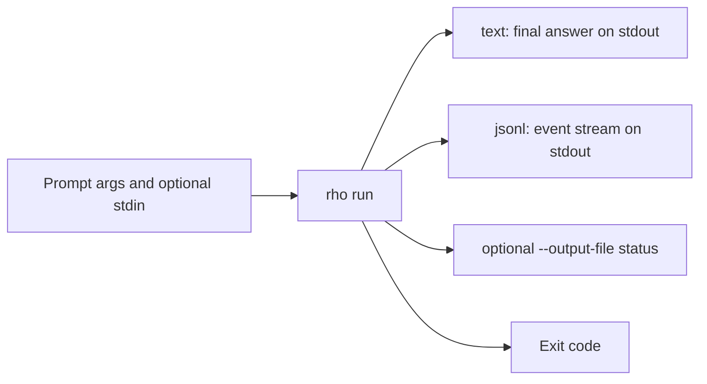
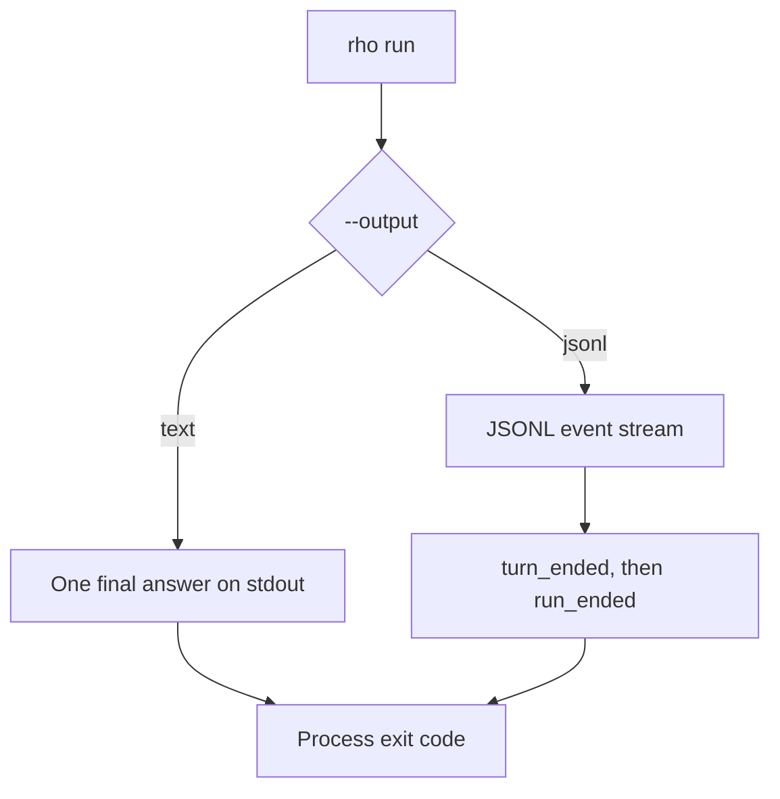

# Automation and CLI

Use `rho run` for non-interactive automation. It sends one prompt and exits. By default, it prints the final answer to stdout. Add `--output jsonl` for a versioned event stream.

```bash
rho run "summarize this repository"
printf 'summarize this repository' | rho run --stdin
rho run "review this diff" --stdin < diff.txt
```

Use the [interactive TUI](/interactive-tui) when you want an ongoing session. Pass `--prompt` to open that TUI with the first prompt already started. Use `rho run` when you want a single answer for a script, hook, alias, pipeline, or CI job. Use [`rho acp`](/integrations/acp) when an editor host speaks Agent Client Protocol. That command does not change `rho run --output jsonl`.



`rho run` accepts prompt text as arguments and can append stdin with `--stdin`:

```text
Usage: rho run [OPTIONS] [PROMPT]...

Arguments:
  [PROMPT]...  Prompt text to send to the agent

Options:
      --stdin               Read additional prompt text from stdin. Required when
                            stdin is a pipe or redirected file; without it, those
                            redirects are rejected so prompt text is not dropped.
      --output-file <PATH>  Write a structured status/result file (JSON). With
                            text output, stream progress and assistant text to
                            stdout and end with a completion marker; the result
                            file is the durable final answer. With JSONL output,
                            stdout stays the event stream.
      --output <OUTPUT>     Select plain final-answer output or a JSON Lines event stream [default: text] [possible values: text, jsonl]
      --max-steps <N>       Override the model-step budget for this run
      --timeout <DURATION>  Cancel the run after this wall-clock duration
      --no-save             Do not save the run's session or its Rho and Claude
                            subagents' sessions, so none is left to export or
                            resume
      --detach              Start the run in the rho daemon, starting one if none
                            runs, and exit once its prompt is saved, printing the
                            session's id
      --worktree            Run in a new git worktree of the current directory's
                            repository, on a new branch from its HEAD
      --no-subagents        Do not expose the delegated-agent tools (agent/agents) to the model
      --agent <ID>          Select the agent definition used for this session or automation run
  -h, --help                Print help (see more with '--help')
```

Prompt text can come from arguments, `--stdin`, or both. A redirected pipe or
file on stdin without `--stdin` is an error (`rho run "review" < diff.txt` needs
`--stdin`). A terminal or null stdin does not require the flag.
`rho run` uses the same [tools and workspace](/tools-workspace) behavior as the TUI when tools are enabled. That includes [advisor mode](/configuration/advisor-mode): when `advisor_mode` is on and an advisor model is set, the run gets the `advisor` tool. It starts in the current working directory. Relative file paths resolve from that directory, but they can use parent components such as `../`; absolute paths can also read or modify files outside it when the model chooses those tools.

Use `rho --no-tools run "..."` to remove tool access. That flag does not suppress Rho's system prompt; add `--no-system-prompt` as well when you want only the raw prompt and model response (`rho --no-tools --no-system-prompt run "..."`). `rho run --no-tools` fails because `--no-tools` is not a `run` flag.

### Sessions, commands, and questions

Each `rho run` saves its session. Session lists, `/resume`, `/sessions`, `-c`,
ACP session lists, and `sessions` tool searches skip runs, so they don't crowd
your own sessions. The JSONL `run_started` line gives the run's session id. Use
it to open the run:

```bash
rho sessions export <ID>           # write its transcript
rho --resume <ID>                  # continue it in the TUI
rho sessions rename <ID> <TITLE>   # runs get no automatic title
```

[Detached runs](#running-in-the-daemon) are listed and titled like your own
sessions.

`rho run --no-save` leaves nothing to export or resume. Its Rho and
`claude-cli` subagents don't save either, but `cursor` and `antigravity`
subagents and workflow nodes still do. This is not a privacy mode. Providers
still receive requests, and usage records, logs, and hooks may keep their own
data.

Slash commands work as in an ACP session, including `/prompt:<name>`, MCP
prompts, `/init`, `/agent:<name>`, and `$skill` mentions. `/compact`,
`/workflow:<name>`, and TUI-only commands fail with exit code `2`.

Nobody answers questions during a run. The model gets no questionnaire tool,
and Rho declines other questions, such as an MCP server's elicitation. The run
continues.

### Automation output

Choose text when a script only needs the final answer. Choose JSONL when it needs progress or terminal state.



The default `--output text` contract has not changed: `rho run` writes one final
assistant answer and a trailing newline to stdout. Reasoning, provider activity,
tool lifecycle events, diagnostics, and errors stay off stdout. Actionable errors
go to stderr and keep their detail (for example a spanned TOML parse error).
Authentication failures stay generic so credentials never appear on stderr or in
JSONL. This keeps command substitution, pipes, and redirected output stable.
Use `--output jsonl` when a script needs the session's events or terminal state:

```bash
rho run --output jsonl --max-steps 12 --timeout 20m \
  "implement the issue"

# Read the authoritative final answer.
rho run --output jsonl "summarize this repository" \
  | jq -r 'select(.event.type == "turn_ended") | .event.outcome.text // empty'
```

JSONL mode writes one JSON object per line and flushes each one. Every object
has `schema_version` (currently `2`), a `seq` counting up from 1, and a `type`:

| `type` | What it holds |
| --- | --- |
| `run_started` | `session` (the session id) and `workspace`. |
| `event` | `event`: one session event, in the [daemon protocol's format](/protocol#following-a-session). |
| `run_ended` | Always last: `reason`, `exit_code` (the [exit status](#exit-status)), and a `message` unless the run completed. If writing to stdout fails, the stream stops and the run exits 1. |

The session's last event is `turn_ended`. Its `outcome` says how the prompt
ended ([outcomes](/protocol#how-a-turn-ends)):

- `answered` carries the whole answer as `text`. Use it rather than joining
  `agent_message_chunk` text, because a provider retry restarts the reply.
- A timeout or a signal gives `cancelled`, and `run_ended` names the cause.

A run that fails before its session opens, such as on invalid configuration,
writes only `run_ended`.

Rho 2 wrote schema version `1`, with events such as `run.completed`. Scripts
that read those events need updating. Read the final answer from `turn_ended`,
as the `jq` example above does.

Tool calls include their input and output. Authentication errors name only the
provider, the auth, and how to log in, and provider diagnostics go to stderr.
Assistant text and tool output can contain workspace data, so don't send the
stream anywhere that shouldn't see it.

`--output-file` has a separate contract. It updates the existing mutable status
artifact used for delegated runs, while `--output jsonl` writes an immutable
event stream to stdout. You can use both at once.

With the default `--output text`, `--output-file` streams progress and assistant
text to stdout and ends with a completion marker such as
`[subagent run complete]`. That stdout mix is for live watching; scripts that
need only the final answer should omit `--output-file`, use `--output jsonl`, or
read the result file. With `--output jsonl`, stdout remains the JSONL event
stream and the result file is still updated.
A broken stdout pipe cancels the run and starts normal tool, subagent, and
managed-process cleanup. A timeout starts after CLI and configuration validation.
Cleanup can finish shortly after the deadline.

### Exit status

Exit codes are part of the automation contract:

| Code | Meaning |
| ---: | --- |
| `0` | Normal model completion |
| `1` | Authentication, provider, tool-host, output, or another run failure |
| `2` | Invalid invocation or configuration |
| `124` | Timeout or model-step limit reached (default budget or `--max-steps`) |
| `130` | SIGINT, after cleanup |
| `143` | SIGTERM, after cleanup |

The JSONL `run_ended` gives a more exact `reason`, such as `completed`,
`max_steps`, `timeout`, `interrupted`, `authentication`, `provider_error`,
`tool_host_error`, `configuration_error`, `output_error`, or `other_error`.
[`rho attach`](#attaching-to-a-daemon-session) adds `cancelled` and
`detached`.
A failed tool call can still lead to a successful run if the model recovers.

For CI, save the stream as an artifact and use the process status for the main
result:

```yaml
- name: Run Rho
  shell: bash
  run: |
    set -o pipefail
    rho run --output jsonl --timeout 20m "review this change" \
      | tee rho-events.jsonl
- name: Upload Rho events
  if: always()
  uses: actions/upload-artifact@v4
  with:
    name: rho-events
    path: rho-events.jsonl
```

### Running in the daemon

`rho run --detach` starts the run in the [daemon](/daemon), prints the session
id, and exits. It starts the daemon if none is running. The turn keeps going
without a terminal. Use `rho attach` to follow it and answer its questions:

```bash
SESSION=$(rho run --detach --timeout 30m "migrate the config loader")
# Later, from any terminal:
rho attach "$SESSION"
```

A detached run differs from a foreground run:

- It uses the workspace's config. Flags that change config, such as `--model`,
  `--provider`, `--permission-mode`, `--config`, and `--save`, fail with exit
  code `2`. Set them in [config](/configuration) instead.
- `--output`, `--output-file`, `--max-steps`, and `--no-save` also fail.
- `--agent`, `--add-dir`, `--no-tools`, `--no-system-prompt`, and
  `--no-subagents` work, and the session keeps them when you reopen it.
- `/compact` and `/workflow:<name>` work.
- The session shows up in session lists and gets an automatic title.
- When `--timeout` runs out, the daemon cancels the turn, and `rho attach`
  exits with `124`.

### Running in a worktree

`rho run --worktree` gives the run its own git worktree on a new branch from
`origin`'s default branch, fetched first, or from `HEAD` when
[`git.worktree_from_remote`](/configuration#git) is off or the fetch fails, so
runs in the same repository don't overwrite each other's edits. It
works with or without `--detach`. The worktree lives under `~/.rho/worktrees/`,
and Rho prints its path and branch on stderr, and without `--detach` what the
branch started from. Outside a git repository, or in one with no commits
and no `origin` to start from, `--worktree` fails with exit code `2`.

#### Cleaning up worktrees

The daemon removes a session's worktree, and keeps its branch, when all of
these are true:

- The session isn't open or running, and nobody has used it for a day.
- The worktree has no uncommitted or untracked changes.
- The current `HEAD` of the checkout you started from, or `origin`'s default
  branch as last fetched, has the branch's changes. Regular, squash, and
  rebase merges all count.

Rho checks only local git and fetches nothing for cleanup. The next worktree
that starts from the remote fetches its default branch, and so does a `git
fetch` of your own. Detecting a squash merge needs git 2.38 or later. Files git ignores,
such as `.env` or `node_modules`, go with the worktree. If you reopen the
session later, the daemon restores its worktree on the branch.

Other worktrees stay. After 14 days unused, `rho daemon status` and
[`/jobs`](/interactive-tui) mark them as stale. Merge what you want, then
remove the worktree yourself:

```bash
git worktree remove ~/.rho/worktrees/api-3fa2c1d0   # add --force to drop uncommitted edits
git branch -D rho/api-3fa2c1d0
```

A `rho run --worktree` without `--detach` doesn't use the daemon, so you always
remove its worktree yourself.

To clean up now instead of waiting a day:

```bash
rho worktrees prune             # remove clean, merged worktrees and say why the rest stay
rho worktrees prune --dry-run   # only list what it would do, with the daemon running
```

### Attaching to a daemon session

`rho attach <ID>` follows a daemon session until its turn ends. It then exits
with the [exit status](#exit-status) `rho run` would have. `ID` is a session id
or a job id, from any workspace. If no turn is running, it reports how the last
one ended.

```bash
rho attach "$SESSION"
rho attach "$SESSION" --output jsonl   # the same stream as rho run --output jsonl
```

In text mode, the conversation goes to stdout, and notices and questions go to
stderr. You answer them at the terminal, as
[Answering and steering](#answering-and-steering) describes. Ctrl+C detaches
and leaves the turn running.

| What happened | `run_ended` reason | Exit code |
| --- | --- | ---: |
| You pressed Ctrl+C, or sent SIGTERM | `detached` | `130`, or `143` for SIGTERM |
| A client cancelled the turn | `cancelled` | `1` |
| The daemon stopped before the turn ended | `interrupted` | `1` |
| A detached run hit its `--timeout` | `timeout` | `124` |

Pass a subagent's job id to watch its run. Watching is read-only, because the
run's questions go to the session that started it. Rho can't follow Claude,
Cursor, or Antigravity subagents, and the error names the session to attach to
instead.

`rho attach` fails with exit code `1` when no daemon is running, because it
never starts one. It also fails when another process, such as a foreground
`rho run` or Rho 2.x, has the session open.

#### Answering and steering

When the turn waits for input, `rho attach` shows the oldest open request. Type
your answer on the next line:

```text
rho: the turn waits for an approval to write /repo/note.txt
  1 allow once · 2 allow for session · 3 deny
```

- An approval takes `1`, `2`, or `3`. A plan approval takes the number of a
  permission mode, or the number for `keep planning`.
- For a question, type a choice's number, several numbers like `1,3` where
  allowed, or your own text. Enter takes the suggestion or skips an optional
  question. `/decline` closes the questions unanswered.
- If a request will [time out](/configuration#questionnaire-timeout),
  `rho attach` says when. Type `/hold` to make it wait for you.
- If another client answers first, `rho attach` says so and moves on.

When nothing is waiting, a typed line steers the turn. Rho adds it to the
turn's next model request. `/cancel` cancels the turn.

`rho attach` reads answers only when stdin is a terminal and it runs in the
foreground. Otherwise it prints the requests, and you answer them from another
Rho frontend. A script can pass `--input stdin` to write answers, but it must
wait for each request on stderr first. Rho drops a line written too early, or
uses it to steer the turn.

## `rho login`

Log in to a provider from the command line. Rho always prints the authorize URL, and opens a browser when one can appear. Headless or remote sessions skip the browser and use device-code when the provider has one. `--device-auth` forces device-code on a graphical session:

```bash
rho login openai-codex
rho login openai-codex --device-auth
rho login xai-oauth
```

API-key providers are usually easier to configure interactively with `/login` in the TUI or with their documented environment-variable override. See [authentication and models](/authentication-and-models) for provider-specific details.

## `rho update`

`rho update` checks the latest GitHub release and dispatches to the detected installation method:

- Cargo installs run `cargo install rho-coding-agent --locked`, adding `--root <cargo-root>` when the current executable is from a non-default Cargo install root.
- mise installs run `mise upgrade --global <tool>` for the tool that installed the current executable, such as `github:matthewyjiang/rho`, found with `mise ls --installed --json`. mise keeps that tool's configured version request, so a pinned version stays pinned, and `--global` (mise 2026.10.7 or newer) ignores a project's own request for the same tool.
- pacman installs run `sudo pacman -Sy mjiang-extras/rho-coding-agent` so pacman can refresh package databases and sync only `rho-coding-agent` from `mjiang-extras`, without performing a full system upgrade. Pacman may prompt for your password.
- Scoop installs show `scoop update; scoop update rho`, or `scoop update; scoop update -g rho` for global installs, so Scoop refreshes buckets before updating the package.
- install-script installs download the official install script to a temporary file and run it with `RHO_INSTALL_DIR` set to the current executable directory.

On Windows, `rho update` prints the detected update command instead of running it automatically.

A running [daemon](/daemon) moves to the new version without interrupting work. After a Cargo, pacman, or install-script update, the daemon restarts itself once nothing would be cut short. `rho update` reports the restart, or says what a busy daemon is waiting for. After a mise update, or on Windows, `rho update` stops an idle daemon, so the next `rho` command starts the new one. For a busy daemon, it tells you what to run. See [The daemon and services](/installation#the-daemon-and-services).

Set `RHO_INSTALL_METHOD` to `cargo`, `pacman`, `scoop`, `scoop-global`, or `script` to override detection.

## `rho uninstall`

```sh
rho uninstall                  # preserve local configuration and sessions
rho uninstall --purge          # also delete ~/.rho and its contents
rho uninstall --purge --dry-run # preview without prompting, stopping, or deleting
```

Rho lists the exact paths it will remove and asks for confirmation with `[y/N]`.
Enter, `n`, `no`, or end-of-input cancels. Only `y` or `yes` proceeds, ignoring
case. Unrecognized answers ask again. Ctrl+C at the prompt exits without deleting.
There is no confirmation-bypass flag.
Cancellation through the prompt exits successfully without changes; removal or
safety-check failures exit with an error.

Automatic executable removal is limited to the default Unix script-install
location, `~/.local/bin/rho`. Package-managed installations print manual uninstall
instructions instead. Custom installation paths and Windows executable removal
are also manual; Rho does not launch a background shell to delete itself.
`RHO_INSTALL_METHOD=script` does not authorize deletion of an arbitrary executable.
Package ownership takes precedence over install-method hints. Unconfirmed Cargo
metadata also prevents automatic executable removal.

`--purge` permanently removes `~/.rho`, including configuration, sessions,
installed user plugins, and file-backed credentials stored there. It can clean
that directory even when the executable requires manual removal. Linked cleanup
roots are refused, and links inside the data directory are removed without
following them into other directories. Uninstall runs before configuration
loading, so a broken config does not block cleanup.
The preview lists removals in execution order: data first, then the executable.
All targets are revalidated after confirmation and before any deletion. If the
data purge fails, the executable remains available to retry.

Uninstall also stops this Rho home's running [daemon](/daemon), which
interrupts any turns in progress. It also stops and disables the service for
[`rho mcp serve --http`](/daemon#running-as-a-service), then deletes its file,
`rho-mcp.service` or `dev.rho.mcp.plist`. Both steps run after you confirm and
before anything else is removed, also for package-managed installs. The preview
lists them. If Rho can't reach systemd or launchd, it still deletes the files
and tells you to stop the service yourself.

OS keyring entries, environment credentials, shell/PATH edits, shared `~/.agents`,
project files, and data outside `~/.rho` remain untouched. This includes a custom
`RHO_HOME` or external `--config` file. Log out of providers before uninstalling
or remove Rho's keyring entries with your OS credential manager. Deleting local
credentials does not revoke them remotely. Removal failures are reported, and
completed deletions are not rolled back.

## CLI reference

Rho accepts global options before an optional subcommand. Provider, model, auth, and reasoning selections apply to the current invocation; add `--save` to write them as the saved defaults. Security and session-control switches apply only to the current invocation.

### Global options

| Option | Description |
| --- | --- |
| `--provider <PROVIDER>` | Select the provider for the current session or run. |
| `--model <MODEL>` | Select a model. A provider/model name can be used when switching providers. |
| `--config <CONFIG>` | Read and save configuration at a specific path instead of `~/.rho/config.toml`. The interactive TUI refuses it; set `RHO_HOME` instead. |
| `--auth <AUTH>` | Select an auth profile and its matching provider profile: `api-key`, `codex`, `anthropic-api-key`, `google-api-key`, `github-copilot`, `xai-api-key`, `xai-oauth`, `moonshot-api-key`, `ollama-api-key`, `ollama-cloud-api-key`, `ollama-cloud-device`, `poolside-api-key`, `openrouter-api-key`, `openrouter-oauth`, `kimi-oauth`, `qwen-token-plan-api-key`, `meta-api-key`, `meta-muse`, `minimax-api-key`, `mistral-api-key`, `opencode-go-api-key`, or `opencode-api-key`. |
| `--reasoning <LEVEL>` | Select a reasoning level: `off`, `minimal`, `low`, `medium`, `high`, `xhigh`, or `max`. |
| `--save` | Persist `--provider`/`--model`/`--auth`/`--reasoning` overrides to the config file. |
| `--agent <ID>` | Select the agent definition for this session or automation run. See [subagents](/subagents). |
| `--no-system-prompt` | Do not send Rho's system prompt, including `AGENTS.md` and skill context. Current invocation only. Place before a subcommand. |
| `--no-tools` | Do not expose tools to the model. Current invocation only. Place before a subcommand: `rho --no-tools run "..."`. |
| `--no-subagents` | Do not expose the delegated-agent tools (`agent` / `agents`). Current invocation only. |
| `--add-dir <PATH>` | Add a directory to the workspace scope for this invocation. Repeatable. Relative paths resolve against the current directory and `~` expands to home. See [additional workspace directories](/tools-workspace#additional-workspace-directories). |
| `-R`, `--resume [<ID>]` | Resume a session by UUID or UUID prefix. Without an ID, open a picker. Interactive sessions only. |
| `-c`, `--continue` | Resume the most recent session in the current workspace without a picker. Starts a new session when the workspace has none. Interactive sessions only; cannot be combined with `--resume`. |
| `--no-save` | Keep an interactive conversation in memory without saving its transcript or prompts to shared history. Cannot be combined with `--resume` or `--continue`. Not a privacy mode; see [sessions](/sessions#sessions-without-saving). |
| `--prompt <PROMPT>` | Open the interactive TUI and immediately submit this prompt. Interactive sessions only. |
| `-h`, `--help` | Show help for Rho or a subcommand. |

### Commands

| Command | Description |
| --- | --- |
| `rho` | Start an interactive TUI session in the current working directory. Add `--prompt` to send the first message as the session opens. |
| `rho run [OPTIONS] [PROMPT]...` | Send one prompt, optionally append stdin, print the final answer, and exit. With `--detach`, start it in the daemon and exit at once; see [Running in the daemon](#running-in-the-daemon). |
| `rho attach [OPTIONS] <ID>` | Follow a daemon session's turn until it ends, and exit as it ended. See [Attaching to a daemon session](#attaching-to-a-daemon-session). |
| `rho acp [--t3code]` | Serve Agent Client Protocol over stdio for an editor host, running its sessions in the [daemon](/daemon). `--t3code` runs subagents as T3 Code child threads. See [ACP](/integrations/acp). |
| `rho workflow <COMMAND>` | Use `list`, `validate`, `plan`, `run`, `status`, `cancel`, or `resume <RUN_ID>` for a [durable workflow](/workflows). |
| `rho sessions list [--all-projects] [--search TEXT] [--limit N] [--json]` | List saved sessions for the current workspace, or every workspace with cwd context. |
| `rho sessions export <ID> [--output PATH] [--format html\|markdown\|json] [--force]` | Export a saved session transcript. Default path is under `$RHO_HOME/exports/` when `RHO_HOME` is set, otherwise `~/.rho/exports/`. |
| `rho sessions rename <ID> <TITLE>...` | Rename a session by UUID or prefix. See [sessions](/sessions#listing-renaming-exporting-and-deleting-sessions). |
| `rho sessions rm <ID>...` | Delete sessions by UUID or prefix. Cascades parent-linked subagent runs. See [sessions](/sessions#listing-renaming-exporting-and-deleting-sessions). |
| `rho sessions cleanup [--yes] [--force]` | Delete sessions whose recorded workspace directories no longer exist. Shows a confirmation unless `--yes` is set. |
| `rho login <PROVIDER>` | Authenticate a provider from a browser or device-code flow. Always prints the authorize URL. Headless sessions prefer device-code when available; `--device-auth` forces it. |
| `rho credential-store probe [os|file]` | Test a credential backend with a temporary secret. Defaults to `os`. |
| `rho credential-store set <BACKEND>` | Save `os` or `file` as the credential backend in config (`behavior.credential_store`). |
| `rho credential-store status` | Print the saved credential backend policy: `unset`, `os`, or `file`. |
| `rho plugins list [--json]` | List discovered Agent Plugin packages (no package code execution). |
| `rho plugins inspect <NAME> [--json]` | Show one plugin package, components, and diagnostics. |
| `rho plugins install <SOURCE> [--scope user\|project] [--force]` | Copy a plugin package from a local path, GitHub link, or git URL into a managed root after validation. See [plugins](/integrations/plugins#installing-from-git). |
| `rho plugins link <PATH> [--scope user\|project] [--force]` | Symlink a local plugin package into a managed root after validation. |
| `rho plugins update [NAME]` | Refetch git-installed plugins and replace any whose ref moved. Omit `NAME` to update all of them. |
| `rho plugins enable <NAME>` | Enable a plugin for new sessions. |
| `rho plugins disable <NAME>` | Disable a plugin without deleting package files. |
| `rho plugins remove <NAME> [--yes]` | Remove a package from a managed root; keeps plugin data. |
| `rho daemon [run\|status [--json]\|stop]` | Run the per-user [daemon](/daemon) in the foreground, show its status, or stop it. `status` and `stop` exit with status 1 when no daemon is running. |
| `rho worktrees prune [--dry-run]` | Remove the daemon's session worktrees that are clean and merged, keep their branches, and say why each other one stays. `--dry-run` changes nothing. See [Cleaning up worktrees](#cleaning-up-worktrees). |
| `rho doctor [--json]` | Run the same setup diagnostics as the interactive `/doctor` overlay and print a text report (or one JSON document). Root `--provider`, `--model`, `--auth`, and `--reasoning` apply to this invocation the same way they do for `rho run`. It also checks the [daemon](/daemon#checking-the-daemon) without starting one. Exits with status 1 when any check fails; warnings exit 0. |
| `rho update` | Update Rho using the detected installation method. |
| `rho uninstall [--purge] [--dry-run]` | Preview and confirm uninstall; preserve local data unless `--purge` is given. |
| `rho help [COMMAND]` | Show help for Rho or a subcommand. |

Provider, model, auth, and reasoning options are described further in [authentication and models](/authentication-and-models) and [configuration](/configuration). For provider-specific automation caveats, see the [provider pages](/authentication-and-models#providers). For example, [GitHub Copilot](/providers/github-copilot#automation) needs a prior `/login` or a `GITHUB_COPILOT_TOKEN` override.

`--no-system-prompt`, `--no-tools`, `--no-subagents`, and `--agent` only affect the current invocation and are not written to config. `--no-system-prompt` and `--no-tools` are root options, so they must come before a subcommand (`rho --no-tools run "..."`). `--no-subagents`, `--agent`, and `--add-dir` are global and may appear before or after the subcommand. `--resume` and `--prompt` cannot be combined with a subcommand such as `run` or `update`. Workflow resume is a separate command: `rho workflow resume <RUN_ID>`.

