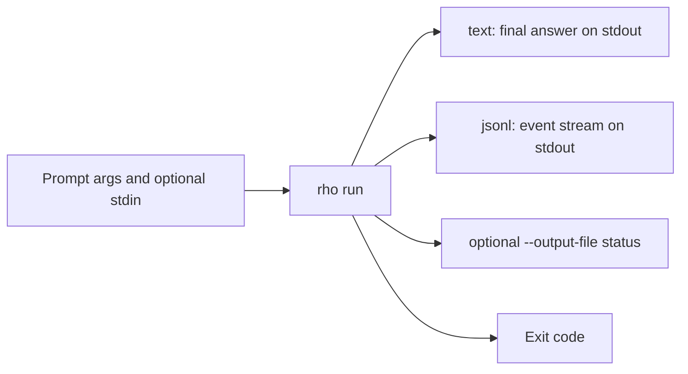
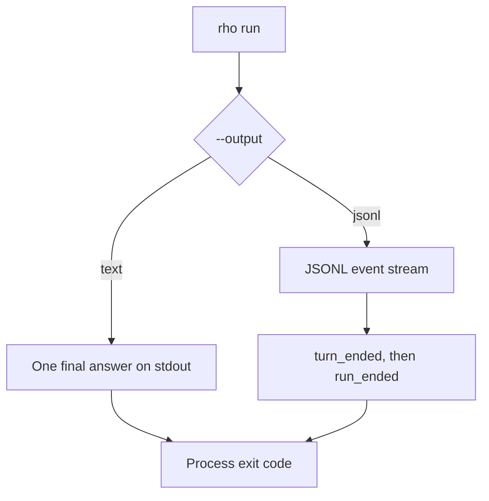

# Automation and CLI

Use `rho run` for non-interactive automation. It sends one prompt and exits. By default, it prints the final answer to stdout. Add `--output jsonl` for a versioned event stream.

```bash
rho run "summarize this repository"
printf 'summarize this repository' | rho run --stdin
rho run "review this diff" --stdin < diff.txt
```

Use the [interactive TUI](/interactive-tui) when you want an ongoing session. Pass `--prompt` to open that TUI with the first prompt already started. Use `rho run` when you want a single answer for a script, hook, alias, pipeline, or CI job. Use [`rho acp`](/integrations/acp) when an editor host speaks Agent Client Protocol. That command does not change `rho run --output jsonl`.



`rho run` accepts prompt text as arguments and can append stdin with `--stdin`:

```text
Usage: rho run [OPTIONS] [PROMPT]...

Arguments:
  [PROMPT]...  Prompt text to send to the agent

Options:
      --stdin               Read additional prompt text from stdin. Required when
                            stdin is a pipe or redirected file; without it, those
                            redirects are rejected so prompt text is not dropped.
      --output-file <PATH>  Write a structured status/result file (JSON). With
                            text output, stream progress and assistant text to
                            stdout and end with a completion marker; the result
                            file is the durable final answer. With JSONL output,
                            stdout stays the event stream.
      --output <OUTPUT>     Select plain final-answer output or a JSON Lines event stream [default: text] [possible values: text, jsonl]
      --max-steps <N>       Override the model-step budget for this run
      --timeout <DURATION>  Cancel the run after this wall-clock duration
      --no-save             Do not save the run's session or its Rho and Claude
                            subagents' sessions, so none is left to export or
                            resume
      --detach              Start the run in the rho daemon, starting one if none
                            runs, and exit once its prompt is saved, printing the
                            session's id
      --no-subagents        Do not expose the delegated-agent tools (agent/agents) to the model
      --agent <ID>          Select the agent definition used for this session or automation run
  -h, --help                Print help (see more with '--help')
```

Prompt text can come from arguments, `--stdin`, or both. A redirected pipe or
file on stdin without `--stdin` is an error (`rho run "review" < diff.txt` needs
`--stdin`). A terminal or null stdin does not require the flag.
`rho run` uses the same [tools and workspace](/tools-workspace) behavior as the TUI when tools are enabled. That includes [advisor mode](/configuration/advisor-mode): when `advisor_mode` is on and an advisor model is set, the run gets the `advisor` tool. It starts in the current working directory. Relative file paths resolve from that directory, but they can use parent components such as `../`; absolute paths can also read or modify files outside it when the model chooses those tools.

Use `rho --no-tools run "..."` to remove tool access. That flag does not suppress Rho's system prompt; add `--no-system-prompt` as well when you want only the raw prompt and model response (`rho --no-tools --no-system-prompt run "..."`). `rho run --no-tools` fails because `--no-tools` is not a `run` flag.

### Sessions, commands, and questions

Each `rho run` saves its session like an interactive one, recorded as a `run`
session. Session lists leave runs out, so a script's runs never crowd the
sessions you had yourself: `rho sessions list`, the `/resume` picker and
`/sessions` manager, `-c`, ACP session lists, and the `sessions` tool's
search scopes skip them. A run opens by its id, which the JSONL stream's
`run_started` reports as `session`: `rho sessions export <ID>` writes its
transcript and `rho --resume <ID>` continues it in the TUI. A run does not ask
a model to title its session; `rho sessions rename` names it. A
[detached run](#running-in-the-daemon) is a daemon session instead: listed,
and titled.

Pass `rho run --no-save` to skip saving. The run's session stays in memory:
no session folder or index row is written, so nothing is left to export or
resume. Its Rho subagents don't save their sessions either, and its
`claude-cli` subagents leave no resumable Claude session. Their run artifacts
go under `~/.rho/subagents/<id>/`, as for any run with no saved session to hold
them. Two kinds of child still save:

- `cursor` and `antigravity` subagents keep the sessions their CLIs save,
  since neither has an unsaved mode.
- Workflow nodes the run starts save their sessions, because a workflow run is
  its own durable record that `rho workflow` resumes from.

Like the interactive `rho --no-save`, this is not a privacy mode: providers
still receive requests, and usage records, logs, and hooks may keep their own
data.

A prompt that starts with a slash command resolves the way it does in an ACP
session: prompt templates (`/prompt:<name>`), MCP prompts, `/init`,
`/agent:<name>`, and `$skill` mentions all work. `rho run` rejects commands it
cannot run, such as `/compact` (a run's session is new, so there is nothing to
compact), `/workflow:<name>` (use `rho workflow run`), and TUI-only commands,
as a configuration error with exit code `2`.

Nobody answers questions during a run, so the run gets no questionnaire tool,
and a question that arrives anyway, such as an MCP server's elicitation, is
declined. The run continues with the refusal instead of failing.

### Automation output

Choose text when a script only needs the final answer. Choose JSONL when it needs progress or terminal state.



The default `--output text` contract has not changed: `rho run` writes one final
assistant answer and a trailing newline to stdout. Reasoning, provider activity,
tool lifecycle events, diagnostics, and errors stay off stdout. Actionable errors
go to stderr and keep their detail (for example a spanned TOML parse error).
Authentication failures stay generic so credentials never appear on stderr or in
JSONL. This keeps command substitution, pipes, and redirected output stable.
Use `--output jsonl` when a script needs the session's events or terminal state:

```bash
rho run --output jsonl --max-steps 12 --timeout 20m \
  "implement the issue"

# Read the authoritative final answer.
rho run --output jsonl "summarize this repository" \
  | jq -r 'select(.event.type == "turn_ended") | .event.outcome.text // empty'
```

JSONL mode writes one JSON object per physical line and flushes each object.
Every object has `schema_version` (currently `2`), a run-local monotonic `seq`
starting at 1, and a `type`:

| `type` | When | Fields |
| --- | --- | --- |
| `run_started` | The run's session opened. | `session`, its id; `workspace`, the working directory. |
| `event` | Each of the session's events. | `event`: a [daemon protocol session event](/protocol#following-a-session) of the conversation, as a client attached to a daemon session receives it. A run has no job, and nobody answers its requests, so the stream holds no `state` or `input_*` events, and `usage` carries no `cost_usd_micros`. |
| `run_ended` | Last, unless writing to stdout failed: then the stream stops, and the run exits 1 with the write error on stderr. | `reason`, `exit_code` (the process's [exit status](#exit-status)), and a `message` unless the run completed. |

Once the session opened, its last event is `turn_ended`, which names the
turn by an id, `turn`, and whose `outcome` says
how the prompt ended ([outcomes](/protocol#how-a-turn-ends)), as a daemon
session's would:

- `answered` carries the model's whole answer as `text`. Use it as the final
  answer rather than the `agent_message_chunk` text: a provider retry restarts
  the reply, and the stream holds a `response_discarded` event saying so.
- A timeout or a signal cancels the turn, so its outcome is `cancelled`, and
  `run_ended` names the cause.
- A slash command `rho run` cannot run fails the prompt before any model call,
  as a `configuration` failure.

A run that fails before its session opens, such as on invalid configuration,
writes only `run_ended`.

Tool calls carry their input and content, as protocol clients see them.
Provider and fatal errors use Rho's existing sanitization: an authentication
failure names only the provider, the auth, and how to log in. Provider
diagnostics go to stderr only. Assistant text and tool content can contain data
from the workspace, so do not send the JSONL stream to a system that should not
receive that data.

`--output-file` has a separate contract. It updates the existing mutable status
artifact used for delegated runs, while `--output jsonl` writes an immutable
event stream to stdout. You can use both at once.

With the default `--output text`, `--output-file` streams progress and assistant
text to stdout and ends with a completion marker such as
`[subagent run complete]`. That stdout mix is for live watching; scripts that
need only the final answer should omit `--output-file`, use `--output jsonl`, or
read the result file. With `--output jsonl`, stdout remains the JSONL event
stream and the result file is still updated.
A broken stdout pipe cancels the run and starts normal tool, subagent, and
managed-process cleanup. A timeout starts after CLI and configuration validation.
Cleanup can finish shortly after the deadline.

### Exit status

Exit codes are part of the automation contract:

| Code | Meaning |
| ---: | --- |
| `0` | Normal model completion |
| `1` | Authentication, provider, tool-host, output, or another run failure |
| `2` | Invalid invocation or configuration |
| `124` | Timeout or model-step limit reached (default budget or `--max-steps`) |
| `130` | SIGINT, after cleanup |
| `143` | SIGTERM, after cleanup |

The JSONL `run_ended` gives a more exact `reason`, such as `completed`,
`max_steps`, `timeout`, `interrupted`, `authentication`, `provider_error`,
`tool_host_error`, `configuration_error`, `output_error`, or `other_error`;
[`rho attach`](#attaching-to-a-daemon-session) adds `cancelled` and
`detached`.
A failed tool call can still lead to a successful run if the model recovers.

For CI, save the stream as an artifact and use the process status for the main
result:

```yaml
- name: Run Rho
  shell: bash
  run: |
    set -o pipefail
    rho run --output jsonl --timeout 20m "review this change" \
      | tee rho-events.jsonl
- name: Upload Rho events
  if: always()
  uses: actions/upload-artifact@v4
  with:
    name: rho-events
    path: rho-events.jsonl
```

### Running in the daemon

`rho run --detach` starts the run in the [daemon](/daemon) instead, starting one
if none runs, and exits as soon as the daemon has saved the prompt. It prints
the session's id on stdout. The turn runs on with no terminal attached, and
`rho attach` follows it and answers its approvals and questions:

```bash
SESSION=$(rho run --detach --timeout 30m "migrate the config loader")
# Later, from any terminal:
rho attach "$SESSION"
```

- `--timeout` is enforced by the daemon: a turn still running then is
  cancelled and ends `timed_out`, which `rho attach` reports with exit 124.
- The daemon opens the session with the workspace's config, as `rho` started
  there would. Flags that change it (`--model`, `--provider`,
  `--permission-mode`, `--save`, and the like) are refused with exit 2 rather
  than dropped; set them in [config](/configuration) instead. `--agent`,
  `--add-dir`, `--no-tools`, `--no-system-prompt`, and `--no-subagents` apply
  to the session as they do to a foreground run, and the session keeps the
  directories and the parts left out when the daemon unloads it and a later
  `rho attach` or prompt reopens it.
- Slash commands resolve as they do in a foreground run, and `/compact` and
  `/workflow:<name>` run too; TUI-only commands fail with exit 2.
- `--output`, `--output-file`, `--max-steps`, and `--no-save` do not apply and
  are refused.
- Unlike a foreground run's, the session is listed like one you had yourself,
  and titled in the background after its first answered turn with one small
  model call, as the TUI titles its sessions.

### Attaching to a daemon session

`rho attach <ID>` follows a session through the [daemon](/daemon) until its
turn ends, then exits as `rho run` would have: with its [exit status](#exit-status)
and, in JSONL, a `run_ended` that says how. `ID` is a session's id, or its
job's as `rho/job/list` reports it. Any saved session works, from any
workspace: the daemon reopens one it has not loaded, such as one an earlier
daemon ran or one the TUI saved.

```bash
# Follow the turn under way, and exit with how it ended.
rho attach "$SESSION"

# The same events a foreground `rho run --output jsonl` writes.
rho attach "$SESSION" --output jsonl | jq -c 'select(.type == "event") | .event.type'
```

- With a turn under way, it replays the session and follows the turn to its
  end. With none, it reports how the session's last turn ended. Before the
  session's first daemon turn, as for one the TUI saved, it waits for that
  turn.
- `--output text` streams the conversation to stdout: the prompt quoted, the
  reply, and a line per tool call. Notices and the input requests the turn
  waits on go to stderr, and lines typed on stdin answer them; see
  [Answering and steering](#answering-and-steering).
- `--output jsonl` writes `run_started`, then every event of the daemon's
  [replay](/protocol#following-a-session) and of the turn, then `run_ended`. A
  daemon session has a job, so unlike a foreground run's the stream holds
  `state` and `input_*` events.
- Ctrl+C detaches: the turn runs on in the daemon, and `rho attach` exits 130
  (143 on SIGTERM) with the reason `detached`.
- A client that cancels the turn ends it with the reason `cancelled`, exit 1;
  a daemon that stops before the turn ends, with `interrupted`, exit 1. A turn
  the daemon cancelled at its `--timeout` ends with `timeout`, exit 124.
- A subagent job's id, or the id of the session its run writes, follows the
  run instead: its events as they come, then exit 0 when the run completed.
  This also holds for the agent nodes of a workflow run. Following a run only
  reads it. The run's questions go to its parent session, so `rho attach`
  takes no answers or steering there. A run that already ended replays the
  session it saved. A subagent on another runtime (Claude, Cursor,
  Antigravity) keeps no Rho session, and a workflow run's own job has no
  events besides its agent nodes'. Both are refused, and the error names the
  session they run in.
- A session another process has open, such as a TUI or a foreground
  `rho run`, is refused until that process closes it; `rho attach` fails with
  exit 1.
- A client that falls too far behind is detached and attaches again. When the
  daemon no longer buffers what it missed, the replay starts over, so the
  conversation is written again.

`rho attach` never starts a daemon; with none running it fails with exit 1.

#### Answering and steering

In text mode, `rho attach` reads the lines typed at the terminal while it
follows the turn. When the turn waits for input, it shows the oldest open
request, and the next line answers it:

```text
rho: the turn waits for an approval to write /repo/note.txt
  1 allow once · 2 allow for session · 3 deny
```

- An approval names what it allows, a command in full, with any line breaks
  shown as `\n`. It takes `1`, `2`, or `3`. A plan approval takes the number of
  the permission mode to carry the plan out in, or of `keep planning`.
- Questions are asked one at a time and sent together. Pick a choice by its
  number, several as `1,3` where a question allows it, or type your own answer
  where it allows that. Enter takes a pre-selected suggestion or skips an
  optional question. `/decline` or `/dismiss` closes the questions unanswered.
- A line that does not answer says why and shows the question again.
- Requests that open while you answer one are told as they open, and asked in
  turn.
- A request the user configured to time out
  ([`[questionnaire] timeout_seconds`](/configuration#questionnaire-timeout))
  says when the daemon answers it. `/hold`, or any line that starts on it
  without answering it, holds it, so it waits for your answer.
- When another client answers the request you are on, or the daemon does at
  its timeout, `rho attach` says so and moves on.
- A line means what was shown when you typed it. One typed before the request
  now shown appeared, or for a request that has since closed, is dropped, and
  `rho attach` says so.

While the turn waits for nothing, a line steers it: the text joins the turn's
next model request. `/cancel` cancels the turn at any point, which ends
`rho attach` with the reason `cancelled`. A slash and one word, such as a
mistyped `/cancle`, is refused rather than sent to the model.

`rho attach` reads stdin only when, as it starts, stdin is the terminal and
`rho attach` runs in its foreground, so a script's stdin is not taken for
answers. Otherwise it only tells the requests, and any frontend can answer them.
It does the same at the end of input; a request it held then no longer times
out. `--input stdin` reads stdin whatever it is, for a script that writes
answers to it. Such a script waits for each request on stderr before it writes
the answer: a line written earlier is dropped, or steers the turn when nothing
was asked. JSONL output reads no input.

## `rho login`

Log in to a provider from the command line. Rho always prints the authorize URL, and opens a browser when one can appear. Headless or remote sessions skip the browser and use device-code when the provider has one. `--device-auth` forces device-code on a graphical session:

```bash
rho login openai-codex
rho login openai-codex --device-auth
rho login xai-oauth
```

API-key providers are usually easier to configure interactively with `/login` in the TUI or with their documented environment-variable override. See [authentication and models](/authentication-and-models) for provider-specific details.

## `rho update`

`rho update` checks the latest GitHub release and dispatches to the detected installation method:

- Cargo installs run `cargo install rho-coding-agent --locked`, adding `--root <cargo-root>` when the current executable is from a non-default Cargo install root.
- mise installs run `mise upgrade --global <tool>` for the tool that installed the current executable, such as `github:matthewyjiang/rho`, found with `mise ls --installed --json`. mise keeps that tool's configured version request, so a pinned version stays pinned, and `--global` (mise 2026.10.7 or newer) ignores a project's own request for the same tool.
- pacman installs run `sudo pacman -Sy mjiang-extras/rho-coding-agent` so pacman can refresh package databases and sync only `rho-coding-agent` from `mjiang-extras`, without performing a full system upgrade. Pacman may prompt for your password.
- Scoop installs show `scoop update; scoop update rho`, or `scoop update; scoop update -g rho` for global installs, so Scoop refreshes buckets before updating the package.
- install-script installs download the official install script to a temporary file and run it with `RHO_INSTALL_DIR` set to the current executable directory.

On Windows, `rho update` prints the detected update command instead of running it automatically.

A running [daemon](/daemon) moves to the updated version without interrupting work. Where the update replaces the executable at its path (install script, Cargo, pacman), the daemon re-executes it once nothing would be cut short; `rho update` waits for an idle daemon to restart and reports it, and for a busy one says what it is waiting for. Where the new version lands at another path (mise) or a running daemon keeps the executable from being replaced (Windows), `rho update` stops an idle daemon so the next `rho` command starts the updated one, and tells you what to run for a busy one. See [The daemon and services](/installation#the-daemon-and-services).

Set `RHO_INSTALL_METHOD` to `cargo`, `pacman`, `scoop`, `scoop-global`, or `script` to override detection.

## `rho uninstall`

```sh
rho uninstall                  # preserve local configuration and sessions
rho uninstall --purge          # also delete ~/.rho and its contents
rho uninstall --purge --dry-run # preview without prompting, stopping, or deleting
```

Rho lists the exact paths it will remove and asks for confirmation with `[y/N]`.
Enter, `n`, `no`, or end-of-input cancels. Only `y` or `yes` proceeds, ignoring
case. Unrecognized answers ask again. Ctrl+C at the prompt exits without deleting.
There is no confirmation-bypass flag.
Cancellation through the prompt exits successfully without changes; removal or
safety-check failures exit with an error.

Automatic executable removal is limited to the default Unix script-install
location, `~/.local/bin/rho`. Package-managed installations print manual uninstall
instructions instead. Custom installation paths and Windows executable removal
are also manual; Rho does not launch a background shell to delete itself.
`RHO_INSTALL_METHOD=script` does not authorize deletion of an arbitrary executable.
Package ownership takes precedence over install-method hints. Unconfirmed Cargo
metadata also prevents automatic executable removal.

`--purge` permanently removes `~/.rho`, including configuration, sessions,
installed user plugins, and file-backed credentials stored there. It can clean
that directory even when the executable requires manual removal. Linked cleanup
roots are refused, and links inside the data directory are removed without
following them into other directories. Uninstall runs before configuration
loading, so a broken config does not block cleanup.
The preview lists removals in execution order: data first, then the executable.
All targets are revalidated after confirmation and before any deletion. If the
data purge fails, the executable remains available to retry.

Uninstall also stops this rho home's running [daemon](/daemon), which interrupts
the turns under way, and removes the service saved for
[`rho mcp serve --http`](/daemon#running-as-a-service): it asks systemd or
launchd to stop the service and no longer start it, then deletes
`rho-mcp.service` with the links that enable it, or `dev.rho.mcp.plist`. Both
happen after confirmation and before anything else is removed, and they happen
for package-managed installations too. The preview names the running daemon and
lists each service file. If the service manager cannot be asked, as in a login
without a user session bus, the files are still deleted and a note says to stop
the service yourself.

OS keyring entries, environment credentials, shell/PATH edits, shared `~/.agents`,
project files, and data outside `~/.rho` remain untouched. This includes a custom
`RHO_HOME` or external `--config` file. Log out of providers before uninstalling
or remove Rho's keyring entries with your OS credential manager. Deleting local
credentials does not revoke them remotely. Removal failures are reported, and
completed deletions are not rolled back.

## CLI reference

Rho accepts global options before an optional subcommand. Provider, model, auth, and reasoning selections apply to the current invocation; add `--save` to write them as the saved defaults. Security and session-control switches apply only to the current invocation.

### Global options

| Option | Description |
| --- | --- |
| `--provider <PROVIDER>` | Select the provider for the current session or run. |
| `--model <MODEL>` | Select a model. A provider/model name can be used when switching providers. |
| `--config <CONFIG>` | Read and save configuration at a specific path instead of `~/.rho/config.toml`. The interactive TUI refuses it; set `RHO_HOME` instead. |
| `--auth <AUTH>` | Select an auth profile and its matching provider profile: `api-key`, `codex`, `anthropic-api-key`, `google-api-key`, `github-copilot`, `xai-api-key`, `xai-oauth`, `moonshot-api-key`, `ollama-api-key`, `ollama-cloud-api-key`, `ollama-cloud-device`, `poolside-api-key`, `openrouter-api-key`, `openrouter-oauth`, `kimi-oauth`, `qwen-token-plan-api-key`, `meta-api-key`, `meta-muse`, `minimax-api-key`, `opencode-go-api-key`, or `opencode-api-key`. |
| `--reasoning <LEVEL>` | Select a reasoning level: `off`, `minimal`, `low`, `medium`, `high`, `xhigh`, or `max`. |
| `--save` | Persist `--provider`/`--model`/`--auth`/`--reasoning` overrides to the config file. |
| `--agent <ID>` | Select the agent definition for this session or automation run. See [subagents](/subagents). |
| `--no-system-prompt` | Do not send Rho's system prompt, including `AGENTS.md` and skill context. Current invocation only. Place before a subcommand. |
| `--no-tools` | Do not expose tools to the model. Current invocation only. Place before a subcommand: `rho --no-tools run "..."`. |
| `--no-subagents` | Do not expose the delegated-agent tools (`agent` / `agents`). Current invocation only. |
| `--add-dir <PATH>` | Add a directory to the workspace scope for this invocation. Repeatable. Relative paths resolve against the current directory and `~` expands to home. See [additional workspace directories](/tools-workspace#additional-workspace-directories). |
| `-R`, `--resume [<ID>]` | Resume a session by UUID or UUID prefix. Without an ID, open a picker. Interactive sessions only. |
| `-c`, `--continue` | Resume the most recent session in the current workspace without a picker. Starts a new session when the workspace has none. Interactive sessions only; cannot be combined with `--resume`. |
| `--no-save` | Keep an interactive conversation in memory without saving its transcript or prompts to shared history. Cannot be combined with `--resume` or `--continue`. Not a privacy mode; see [sessions](/sessions#sessions-without-saving). |
| `--prompt <PROMPT>` | Open the interactive TUI and immediately submit this prompt. Interactive sessions only. |
| `-h`, `--help` | Show help for Rho or a subcommand. |

### Commands

| Command | Description |
| --- | --- |
| `rho` | Start an interactive TUI session in the current working directory. Add `--prompt` to send the first message as the session opens. |
| `rho run [OPTIONS] [PROMPT]...` | Send one prompt, optionally append stdin, print the final answer, and exit. With `--detach`, start it in the daemon and exit at once; see [Running in the daemon](#running-in-the-daemon). |
| `rho attach [OPTIONS] <ID>` | Follow a daemon session's turn until it ends, and exit as it ended. See [Attaching to a daemon session](#attaching-to-a-daemon-session). |
| `rho acp [--t3code]` | Serve Agent Client Protocol over stdio for an editor host, running its sessions in the [daemon](/daemon). `--t3code` runs subagents as T3 Code child threads. See [ACP](/integrations/acp). |
| `rho workflow <COMMAND>` | Use `list`, `validate`, `plan`, `run`, `status`, `cancel`, or `resume <RUN_ID>` for a [durable workflow](/workflows). |
| `rho sessions list [--all-projects] [--search TEXT] [--limit N] [--json]` | List saved sessions for the current workspace, or every workspace with cwd context. |
| `rho sessions export <ID> [--output PATH] [--format html\|markdown\|json] [--force]` | Export a saved session transcript. Default path is under `$RHO_HOME/exports/` when `RHO_HOME` is set, otherwise `~/.rho/exports/`. |
| `rho sessions rename <ID> <TITLE>...` | Rename a session by UUID or prefix. See [sessions](/sessions#listing-renaming-exporting-and-deleting-sessions). |
| `rho sessions rm <ID>...` | Delete sessions by UUID or prefix. Cascades parent-linked subagent runs. See [sessions](/sessions#listing-renaming-exporting-and-deleting-sessions). |
| `rho sessions cleanup [--yes] [--force]` | Delete sessions whose recorded workspace directories no longer exist. Shows a confirmation unless `--yes` is set. |
| `rho login <PROVIDER>` | Authenticate a provider from a browser or device-code flow. Always prints the authorize URL. Headless sessions prefer device-code when available; `--device-auth` forces it. |
| `rho credential-store probe [os|file]` | Test a credential backend with a temporary secret. Defaults to `os`. |
| `rho credential-store set <BACKEND>` | Save `os` or `file` as the credential backend in config (`behavior.credential_store`). |
| `rho credential-store status` | Print the saved credential backend policy: `unset`, `os`, or `file`. |
| `rho plugins list [--json]` | List discovered Agent Plugin packages (no package code execution). |
| `rho plugins inspect <NAME> [--json]` | Show one plugin package, components, and diagnostics. |
| `rho plugins install <SOURCE> [--scope user\|project] [--force]` | Copy a plugin package from a local path, GitHub link, or git URL into a managed root after validation. See [plugins](/integrations/plugins#installing-from-git). |
| `rho plugins link <PATH> [--scope user\|project] [--force]` | Symlink a local plugin package into a managed root after validation. |
| `rho plugins update [NAME]` | Refetch git-installed plugins and replace any whose ref moved. Omit `NAME` to update all of them. |
| `rho plugins enable <NAME>` | Enable a plugin for new sessions. |
| `rho plugins disable <NAME>` | Disable a plugin without deleting package files. |
| `rho plugins remove <NAME> [--yes]` | Remove a package from a managed root; keeps plugin data. |
| `rho daemon [run\|status [--json]\|stop]` | Run the per-user [daemon](/daemon) in the foreground, show its status, or stop it. `status` and `stop` exit with status 1 when no daemon is running. |
| `rho doctor [--json]` | Run the same setup diagnostics as the interactive `/doctor` overlay and print a text report (or one JSON document). Root `--provider`, `--model`, `--auth`, and `--reasoning` apply to this invocation the same way they do for `rho run`. It also checks the [daemon](/daemon#checking-the-daemon), never starting one: whether it runs and matches this `rho`, its socket's permissions, the always-on service, its environment, and the credential store it can reach. Exits with status 1 when any check fails; warnings exit 0. |
| `rho update` | Update Rho using the detected installation method. |
| `rho uninstall [--purge] [--dry-run]` | Preview and confirm uninstall; preserve local data unless `--purge` is given. |
| `rho help [COMMAND]` | Show help for Rho or a subcommand. |

Provider, model, auth, and reasoning options are described further in [authentication and models](/authentication-and-models) and [configuration](/configuration). For provider-specific automation caveats, see the [provider pages](/authentication-and-models#providers). For example, [GitHub Copilot](/providers/github-copilot#automation) needs a prior `/login` or a `GITHUB_COPILOT_TOKEN` override.

`--no-system-prompt`, `--no-tools`, `--no-subagents`, and `--agent` only affect the current invocation and are not written to config. `--no-system-prompt` and `--no-tools` are root options, so they must come before a subcommand (`rho --no-tools run "..."`). `--no-subagents`, `--agent`, and `--add-dir` are global and may appear before or after the subcommand. `--resume` and `--prompt` cannot be combined with a subcommand such as `run` or `update`. Workflow resume is a separate command: `rho workflow resume <RUN_ID>`.

