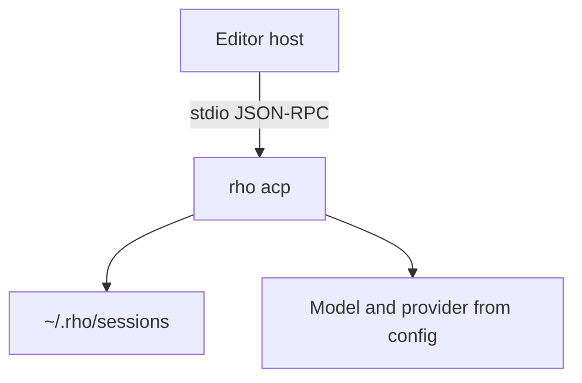

# Agent Client Protocol

Parent: [Integrations](/integrations).

`rho acp` runs Rho inside an editor or desktop app that speaks the [Agent Client Protocol](https://agentclientprotocol.com/) (ACP), such as Zed or T3 Code. The host starts the process, shows the conversation, and asks you for approvals. Rho still runs the model, tools, sessions, and config it uses in the TUI.



This page covers setup and day-to-day use. Host-specific behavior lives on [T3 Code](/integrations/acp/t3-code). Protocol details for people building or debugging a host are in the [ACP host reference](/integrations/acp/reference).

## Set up a host

Every host launches the same command:

```bash
rho acp
```

It uses the model, provider, permission mode, and other flags from the command line and `~/.rho/config.toml`, the same as the TUI. Sign in to your provider before the first session; see [Sign in](#sign-in).

### Zed

Add Rho as a custom agent in Zed's `settings.json` (**Agent Settings → External Agents → Add Agent → Add Custom Agent**):

```json
{
  "agent_servers": {
    "Rho": {
      "type": "custom",
      "command": "rho",
      "args": ["acp"]
    }
  }
}
```

Start a Rho thread from the Agent Panel's new-thread menu. Zed lists saved Rho sessions in its thread history, uses Rho's generated titles as thread names, and shows compaction progress. To see the messages Zed and Rho exchange, run `dev: open acp logs`.

### T3 Code

Add Rho as an ACP agent with the command `rho` and the arguments `acp --t3code`. The `--t3code` flag runs Rho subagents as T3 threads and lets background results wake an idle thread. See [T3 Code](/integrations/acp/t3-code).

### Other hosts

Point the host at `rho acp`. Rho speaks ACP protocol version 1 over stdio. stdout carries only protocol messages and logs go to stderr, so do not wrap the command in anything that prints to stdout.

## Sign in

Hosts offer one sign-in method per Rho provider login, covering API keys and OAuth.

- **OAuth in the host's own sign-in UI.** Hosts that can show a link from the agent, such as Zed, run OAuth logins without a terminal. Rho picks browser or device-code the same way `rho login <provider>` does. You get a browser callback on a desktop. Over SSH or headless you get device code, and the host also shows the code. Open the link, approve, and the host finishes signing in.
- **A terminal everywhere else.** API keys, hosts without that support, and the first sign-in before a credential store is chosen open a terminal that runs `rho login <provider>`, on hosts that have one. API-key input stays hidden.

Either way, credentials go to Rho's own credential store and never travel over ACP.

When credentials are missing, unreadable, or refused by the provider (a revoked key or an expired OAuth session), Rho tells the host that sign-in is needed instead of failing with an internal error. Zed opens its sign-in screen. After you sign in, keep going. You do not need to reconnect.

- Signing in does not change the configured provider or model. Sign in to the provider your config selects. Credentials for other providers show up in the model picker after you reconnect.
- On a host with neither kind of sign-in, run `rho login <provider>` in a terminal as the same user and in the same environment, then connect.
- Ollama Cloud device-key login is not offered in the host. Run `rho login ollama-cloud-device` yourself and reconnect, or use the Ollama Cloud API-key method.
- Logging out from the host signs you out of the provider your config selects, like `/logout <provider>` in the TUI. It deletes those saved credentials, so the terminal and other Rho processes need to sign in again the next time they load them. Open sessions ask you to sign in again on their next message.

## What works in the host

| Feature | In the host |
| --- | --- |
| Sessions | Saved under `~/.rho/sessions`, the same as the TUI. They show up in the host's history, in `rho sessions list`, and in `rho -R`. Loading a session replays its messages and tool cards. See [Sessions](/sessions). |
| Permission modes | `bypass`, `auto`, `allow_edits`, `plan`, and `supervised` appear in the host's mode picker. Tools that need approval ask the host, which offers allow once, allow for the session, and reject. |
| Plan mode | When the plan is ready, the host asks you to approve it into a mode or keep planning. Approving runs the implementation in the same prompt. |
| Model, reasoning, fast mode | Host pickers list your Rho model catalog, favorites first, plus the current model's reasoning levels and fast mode when it has one. |
| Questions | On hosts that support forms, such as Zed and T3 Code, questions from the model or an MCP server appear as a form. |
| Checklist | The model's `todo` list appears as the host's plan. |
| File changes | Edits and writes show up as diffs. |
| Editor buffers | On hosts that serve files, such as Zed, the model reads unsaved edits, and its edits land in the editor's buffers and undo history. |
| Context and cost | The host gets the context fill and the session's cumulative cost, read from the same usage ledger as `/spend`. |
| Workspace roots | Extra roots of a multi-root workspace join the session like `--add-dir`. |
| MCP servers | Servers from your Rho config and servers the host sends both connect. A host server replaces a config server with the same name. |
| Commands and skills | The host's command menu lists the commands below and your skills. |

Changes you make in host pickers apply to that session only. They never rewrite `config.toml`. A change made while a prompt is running takes effect from the next prompt.

Reloading a session restores its conversation, but the mode, model, reasoning, and fast mode go back to the defaults from config and flags. Sessions started with `/agent:` reload as that agent, with its prompt, tools, and model, and those started with a [per-call model](/integrations/acp/reference#per-call-model) keep their saved model.

The host owns approvals. `rho acp` can ask you to approve a tool. Headless `rho run` cannot.

## Commands

The host's command menu lists these. Pick one, or type it at the start of a message:

| Command | Effect |
| --- | --- |
| `/compact [instructions]` | Compacts older context between turns, optionally saying what to keep, and reports the token counts before and after. Cancel stops it before it commits. If the compacted session cannot be saved, later prompts fail until the host loads the session again. |
| `/init` | Surveys the repository and writes `AGENTS.md` through the `rho-init` skill, as in the TUI. Refused in `plan` mode, or when the active agent is missing any of the skill, write, or file-edit tools. |
| `/prompt:<name> [args]` | Runs a [prompt template](/configuration#prompt-templates). |
| `/mcp:<server>:<prompt> [args]` | Runs an MCP server prompt. Arguments follow the TUI rules. |
| `/agent:<name> <task>` | Turns a new, empty session into the [agent](/subagents) `<name>` and runs `<task>`. The session keeps that agent's prompt, tools, and model, including when loaded again. Add `--model <reference> --` before the task to pick the model for this one session. |
| `/workflow:<name> [inputs JSON]` | Starts a workspace [workflow](/workflows#start-a-workflow-by-name) in the background, such as `/workflow:review {"target": "src"}`. Listed only when the active agent has the `workflow` tool; refused in plan mode. |

Other TUI commands, such as `/model`, are rejected with an error that names the command; for `/model`, use the host's model picker. Text that is not a known command, such as `/usr/bin`, goes to the model unchanged. The session saves what you typed, not its expansion. Edge cases are in the [host reference](/integrations/acp/reference#commands).

### Skills

When the active agent has the `skill` tool, the menu also lists one `$<name>` entry per [skill](/skills). Mentioning `$<name>` anywhere in a message loads that skill before the model starts, following the TUI's [mention rule](/skills#load-a-skill-yourself).

## Background work

Background processes, workflows, and subagents report back as they do in the TUI, and each result shows up in the host as a finished tool card.

ACP gives Rho no way to start a turn on its own, so Rho keeps the current prompt open while work it is waiting on is still running, and the model continues once it finishes:

- Subagents hold the prompt open until they finish, whichever prompt started them.
- Workflows and background processes started during the prompt hold it open too. Older processes, such as a dev server, do not; their results arrive with your next message.
- A workflow started with `/workflow:` ends the prompt right away. Its result reaches the model with your next message, and that prompt does not wait for the run to finish.
- Cancelling stops the wait, not the work. Subagents and processes keep running. The next prompt waits for those subagents and delivers their results; processes report in it without holding it open. Stop subagents with the `agents` tool, or by closing or reloading the session.

Under `--t3code`, nothing holds the prompt open: subagents run as T3 threads and background results [wake the thread](/integrations/acp/t3-code#wake-on-background-results).

## Not covered by ACP

- `rho acp` is not an MCP server. See [Model Context Protocol](/integrations/mcp) for using MCP servers in Rho.
- For scripts and CI, use [`rho run`](/automation-cli). `rho acp` does not change `rho run --output jsonl`.
