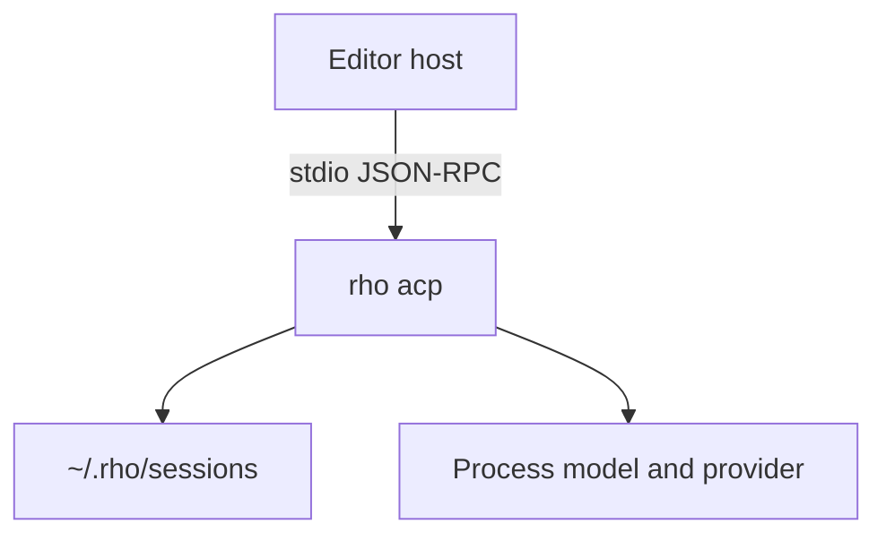

# Agent Client Protocol

Parent: [Integrations](/integrations).

`rho acp` is a stdio JSON-RPC [Agent Client Protocol](https://agentclientprotocol.com/) agent. An editor host such as Zed starts the process and drives sessions over ACP.



## Launch

```bash
rho acp
```

The process uses the model, provider, and other flags from the command line and config. There is no extra host plugin inside Rho.

stdout is protocol only. Logs go to stderr. Do not write other text to stdout, and do not point a logger at stdout while a host is connected.

Rho speaks ACP protocol version 1. The `initialize` response always answers `1`, whatever version the host asked for; a host that cannot speak v1 should disconnect.

## Sessions

ACP sessions persist under `~/.rho/sessions`. They appear in `rho sessions list` and you can resume them with `rho -R`. See [Sessions](/sessions).

`session/load` replays the saved conversation as message chunks marked with `_meta.isReplay: true`. Hosts that keep their own transcript can skip those chunks; hosts that rebuild the transcript from the replay can ignore the marker.

During a session, Rho also sends:

- `usage_update` with the estimated context fill (`used`) and the model's context window (`size`, `0` when unknown). It goes out at each model step and compaction, and when a prompt ends.
- `plan` with the full `todo` checklist whenever it differs from the last one the host received. A checklist restored by `session/load` goes out when the next prompt starts. An empty `entries` list means the checklist was cleared, per ACP v1; T3 Code currently ignores empty plans and keeps showing the last one.

Nothing beyond the replay is sent while `session/load` is in flight, because hosts such as T3 Code discard live updates for a session until its load completes. A model-prompt change notice found at load is sent when the next prompt starts.

## Permissions

New sessions advertise Rho permission modes: `bypass`, `auto`, `allow_edits`, `plan`, and `supervised`. The starting mode comes from config and flags.

Hosts switch modes with `session/set_mode`. The new mode applies to later prompts in that ACP session and keeps the conversation. Write grants carry over the same way they do in the TUI. A switch is rejected while a prompt is in flight. Switching to `auto` fails with invalid params unless a classifier model is configured, the same check headless startup applies. The change does not rewrite `config.toml`, and `session/load` starts from the process default again.

When a tool needs approval, Rho asks the host. The host choices map to allow once, allow for this session, and reject.

`rho acp` can prompt the host for approvals. Headless `rho run` cannot.

## Model

`session/new` and `session/load` advertise a `configOptions` select with id `model` and category `model`. Options are the same catalog list the TUI picker uses: favorites first, value ids `provider/model`.

Hosts switch with `session/set_config_option`. The value id is `provider/model`. A switch is rejected while a prompt is in flight. Re-selecting the current value, including an off-catalog current model, is a no-op success. The swap uses the same conversation-switch path as the TUI: it renegotiates reasoning, rebuilds compaction, updates later delegated agents, and appends the model-switch context line when history is not empty. The new model applies to later prompts in that ACP session. It does not rewrite `config.toml`. `session/load` always resumes on the process default from config and flags, not on a model chosen earlier in that session. History restored on load may still mention a prior switch.

## Reasoning

When the current model exposes configurable reasoning, new and loaded sessions also advertise a `thought_level` select. Hosts that support `session/set_config_option` can change it while the session is idle. Values are Rho reasoning ids: `off`, `minimal`, `low`, `medium`, `high`, `xhigh`, and `max`, filtered to what the current model advertises. Models that do not expose configurable reasoning omit the option so hosts show no control.

The change applies to later turns in that ACP session. It does not rewrite `config.toml`. Launch still honors `--reasoning` and config as the starting value. A prompt already in flight rejects the change as a busy session. After a model switch, the advertised `thought_level` list follows the new model.

## MCP

Rho starts MCP servers from its own config, plus the `mcpServers` the host sends with `session/new` or `session/load`. Host servers belong to that session only. A host server replaces a config server with the same name.

- stdio servers start with the host's command, arguments, and environment.
- HTTP servers connect over Streamable HTTP with the host's headers. The URL must be HTTPS or a loopback address.
- SSE servers are skipped with a warning. `initialize` advertises `mcpCapabilities.http` and not `sse`.
- Host servers cannot request sampling.
- An entry with an invalid name, empty command, repeated environment variable or header, or unsafe URL is reported as an invalid server instead of connected. An invalid host entry still claims its name: a config server with that name stays disconnected for the session rather than connecting with the config's endpoint and credentials.

`rho acp` is not itself an MCP server. See [Model Context Protocol](/integrations/mcp).

## Automation

`rho acp` does not change `rho run --output jsonl`. Use [Automation and CLI](/automation-cli) for one-shot scripts.
