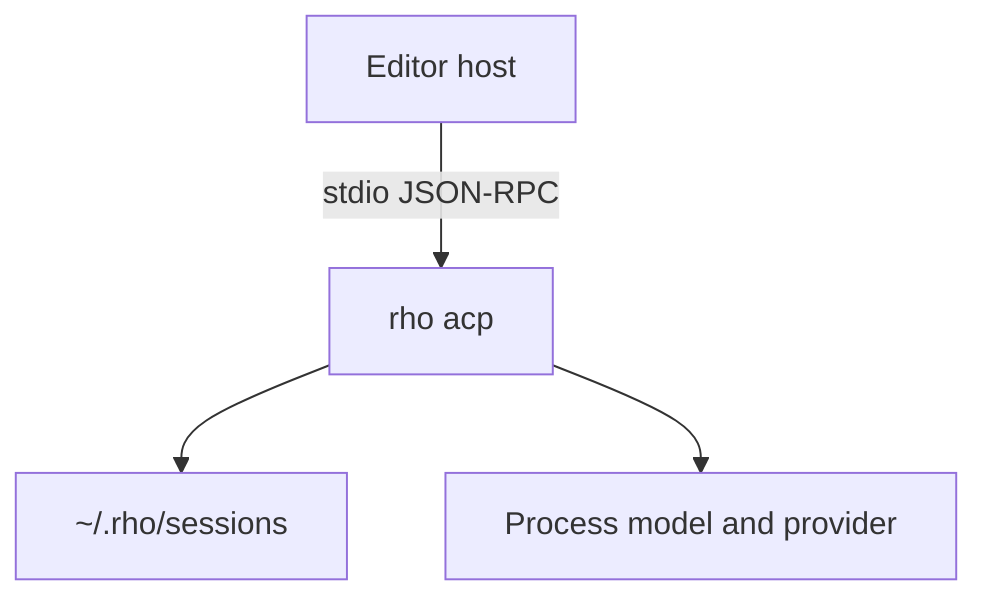

# Agent Client Protocol

Parent: [Integrations](/integrations).

`rho acp` is a stdio JSON-RPC [Agent Client Protocol](https://agentclientprotocol.com/) agent. An editor host such as Zed starts the process and drives sessions over ACP.



## Launch

```bash
rho acp
```

The process uses the model, provider, and other flags from the command line and config. Host-specific integrations are opt-in flags; see [T3 Code](#t3-code).

stdout is protocol only. Logs go to stderr. Do not write other text to stdout, and do not point a logger at stdout while a host is connected.

Rho speaks ACP protocol version 1. The `initialize` response always answers `1`, whatever version the host asked for; a host that cannot speak v1 should disconnect.

## Sessions

ACP sessions persist under `~/.rho/sessions`. They appear in `rho sessions list` and you can resume them with `rho -R`. See [Sessions](/sessions).

`session/load` replays the saved conversation as message chunks marked with `_meta.isReplay: true`. Hosts that keep their own transcript can skip those chunks; hosts that rebuild the transcript from the replay can ignore the marker.

During a session, Rho also sends:

- `usage_update` with the estimated context fill (`used`) and the model's context window (`size`, `0` when unknown). It goes out at each model step and compaction, and when a prompt ends.
- `plan` with the full `todo` checklist whenever it differs from the last one the host received. A checklist restored by `session/load` goes out when the next prompt starts. An empty `entries` list means the checklist was cleared, per ACP v1; T3 Code currently ignores empty plans and keeps showing the last one.

Nothing beyond the replay is sent while `session/load` is in flight, because hosts such as T3 Code discard live updates for a session until its load completes. A model-prompt change notice found at load is sent when the next prompt starts.

## Background work

Background processes, workflows, and delegated agents report back much as they do in the TUI. ACP v1 gives an agent no way to start a turn on its own, so Rho keeps the prompt open instead of waking an idle session:

- A result that arrives while a prompt is running reaches the model at its next step.
- If the model ends its turn while a delegated agent, a workflow, or a background process started during that prompt is still running, the prompt stays open. The model continues in the same prompt once that work finishes. Processes left over from earlier prompts, such as a dev server, do not hold a prompt open; their results arrive at the next prompt.
- Cancelling stops the wait. Background processes keep running and report in the next prompt. A `session/prompt` sent right after `session/cancel` waits for the cancelled prompt to finish instead of failing as busy, so hosts that steer by cancelling and resending, such as T3 Code, can interrupt a waiting prompt.

Each result that reaches the model is also shown to the host as a finished tool call card, the same notification card the TUI shows: a process's outcome, command, run time, and output tail, a delegated agent's result, or a workflow's outcome. A failed process or agent marks its card `failed`. These cards are saved with the session, so `session/load` replays them too. A background process has no live card while it runs; its card appears once its result is delivered.

## Permissions

New sessions advertise Rho permission modes: `bypass`, `auto`, `allow_edits`, `plan`, and `supervised`. The starting mode comes from config and flags. The modes go out twice with the same ids: as the legacy `modes` field, and as the first `configOptions` entry, a select with id `mode` and category `mode`. Per ACP, hosts that support config options ignore `modes` and use the `mode` option; older hosts use `modes`.

Hosts switch modes with `session/set_mode` or `session/set_config_option` on `mode`; both change the same state. The new mode applies to later prompts in that ACP session and keeps the conversation. Write grants carry over the same way they do in the TUI. A switch is rejected while a prompt is in flight. Switching to `auto` fails with invalid params unless a classifier model is configured, the same check headless startup applies. The change does not rewrite `config.toml`, and `session/load` starts from the process default again.

When a tool needs approval, Rho asks the host. The host choices map to allow once, allow for this session, and reject.

`rho acp` can prompt the host for approvals. Headless `rho run` cannot.

## Model

`session/new` and `session/load` advertise a `configOptions` select with id `model` and category `model`. Options are the same catalog list the TUI picker uses: favorites first, value ids `provider/model`. Labels stay short so host pickers do not truncate them: the catalog name when one is known (`GPT-6 Sol`), else the bare model id. When two rows would share a label, each gets its provider appended (`Grok 4.7 (xai)`). When one provider gives several models the same name, those rows show their model ids instead (`gpt-5.6-sol`, `gpt-5.6-sol-pro`). The full `provider/model` id is the option description.

Hosts switch with `session/set_config_option`. The value id is `provider/model`. A switch is rejected while a prompt is in flight. Re-selecting the current value, including an off-catalog current model, is a no-op success. The swap uses the same conversation-switch path as the TUI: it renegotiates reasoning, rebuilds compaction, updates later delegated agents, and appends the model-switch context line when history is not empty. The new model applies to later prompts in that ACP session. It does not rewrite `config.toml`. `session/load` always resumes on the process default from config and flags, not on a model chosen earlier in that session. History restored on load may still mention a prior switch.

## Reasoning

When the current model exposes configurable reasoning, new and loaded sessions also advertise a `thought_level` select. Hosts that support `session/set_config_option` can change it while the session is idle. Value ids are Rho reasoning ids: `off`, `minimal`, `low`, `medium`, `high`, `xhigh`, and `max`, filtered to what the current model advertises. Labels are capitalized for display (`xhigh` shows as `Extra high`). Models that do not expose configurable reasoning omit the option so hosts show no control.

The change applies to later turns in that ACP session. It does not rewrite `config.toml`. Launch still honors `--reasoning` and config as the starting value. A prompt already in flight rejects the change as a busy session. After a model switch, the advertised `thought_level` list follows the new model.

## Fast mode

When the current model supports fast mode, new and loaded sessions also advertise a `fast_mode` select with category `model_config`. It is the ACP counterpart of the TUI's `/fast`: value `on` (named Fast) sends later turns on the priority service tier, and `off` (named Normal) uses the standard tier. Fast mode is a select rather than a boolean option because ACP only allows boolean options for clients that advertise them.

Hosts change it with `session/set_config_option` while the session is idle; a prompt already in flight rejects the change as a busy session. Selecting `on` for a model without fast mode is rejected. The change applies to later turns in that ACP session and does not rewrite `config.toml`. Typed `/fast` is not an ACP command.

A model switch keeps the setting, as in the TUI. Switching to a model without fast mode drops `fast_mode` from the advertised list and the tier has no effect there. Switching back advertises it again with the same value. Like `model`, `session/load` starts from the process default (`fast_mode` in `config.toml`), not a value chosen earlier in that session.

## Commands

Right after each `session/new` and `session/load` response, Rho sends an `available_commands_update`. Hosts show it as their command menu and send a picked command back as `/name args` prompt text:

| Command | Effect |
| --- | --- |
| `/compact [instructions]` | Compacts older context between turns, optionally saying what to keep, and replies with the before and after counts. Cancel stops it before it commits. If the compacted session cannot be saved, later prompts fail until the host loads the session again. |
| `/init` | Surveys the repository and writes `AGENTS.md` through the `rho-init` skill, as in the TUI. Refused in `plan` mode or without the skill, write, and file-edit tools. |
| `/prompt:<name> [args]` | Expands a [prompt template](/configuration#prompt-templates) and runs it as the turn. |
| `/mcp:<server>:<prompt> [args]` | Fetches an MCP server prompt and runs it as the turn. Arguments follow the TUI rules. |
| `/agent:<name> <task>` | Turns a new session into the [agent](/subagents) `<name>` and runs `<task>` as its first prompt. The session takes that agent's prompt, tools, and model, and keeps them when loaded again. Only a session with no conversation yet accepts it; a later one fails with an invalid-params error. Hosts that run subagents themselves, such as [T3 Code](#t3-code), start children this way. |
| `/workflow:<name> [inputs JSON]` | Starts a workspace [workflow](/workflows#start-a-workflow-by-name) in the background and ends the prompt without a model turn. The run id is added to context, so the model can check on it later. Listed only when the active agent has the `workflow` tool; refused in plan mode. Inputs are one JSON object, such as `/workflow:review {"target": "src"}`; omitted inputs use their defaults. ACP has no way for the agent to start a turn, so the result reaches the model at the next prompt. That prompt does not wait for a run that is still going. |

The session saves the command as typed, not its expansion. Other TUI commands, such as `/model`, fail with an invalid-params error that names the command. Text that names no command, such as `/usr/bin` or an unknown template, reaches the model unchanged.

### Skills

When the active agent has the `skill` tool, the update also lists one `$<name>` command per discovered [skill](/skills), using the skill's description. Hosts such as T3 Code list these in their `$` menu. Rho leaves out names a host would read as amounts, such as `$20k`.

A model turn that mentions known skills as whitespace-delimited `$<name>` tokens loads each of them before the first model request, following the same [mention rule](/skills#load-a-skill-yourself) as the TUI. A prompt that starts with `/$<name>`, as a client that prefixes every picked command with `/` sends it, loads that skill first. Any currency symbol works as the sigil. Every mentioned skill loads once, in mention order, as one batch of `skill` tool calls, and the host sees one `tool_call` update per skill.

## T3 Code

Launch Rho in T3 Code with `--t3code`:

```bash
rho acp --t3code
```

Subagents then run as T3 threads, so they appear in T3's subagent panel and keep running after the parent's prompt ends. The `agent` tool starts each child through the `delegate_task` tool of T3's `t3-code` MCP server, with `/agent:<name> <task>` as its first prompt. `agents` maps `status` and `stop` to T3's `task_status` and `task_cancel`. It has no `message` action. T3 delivers a finished child's result to the parent as a new turn, so a waiting child does not hold the parent's prompt open.

Only agents with Rho's own runtime are offered. Agents that run through Claude Code, Cursor, or Antigravity are rejected: T3 runs those providers itself, so the model can start one with T3's `delegate_task` tool directly. Workflows still run inside Rho.

A session fails to start if any of the three T3 tools is missing. Without `--t3code`, Rho never uses T3's task tools for delegation, even when T3's MCP server is attached.

## MCP

Rho starts MCP servers from its own config, plus the `mcpServers` the host sends with `session/new` or `session/load`. Host servers belong to that session only. A host server replaces a config server with the same name.

- stdio servers start with the host's command, arguments, and environment.
- HTTP servers connect over Streamable HTTP with the host's headers. The URL must be HTTPS or a loopback address.
- SSE servers are skipped with a warning. `initialize` advertises `mcpCapabilities.http` and not `sse`.
- Host servers cannot request sampling.
- An entry with an invalid name, empty command, repeated environment variable or header, or unsafe URL is reported as an invalid server instead of connected. An invalid host entry still claims its name: a config server with that name stays disconnected for the session rather than connecting with the config's endpoint and credentials.

`rho acp` is not itself an MCP server. See [Model Context Protocol](/integrations/mcp).

## Automation

`rho acp` does not change `rho run --output jsonl`. Use [Automation and CLI](/automation-cli) for one-shot scripts.
