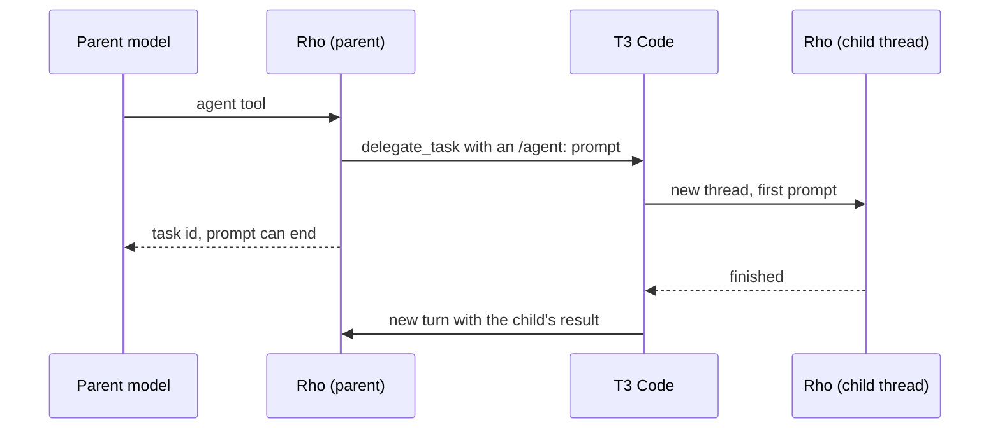

# T3 Code

Parent: [Agent Client Protocol](/integrations/acp).

[T3 Code](https://github.com/pingdotgg/t3code) runs Rho over ACP. Launch it with `--t3code` so Rho subagents run as T3 threads and background results wake an idle thread:

```bash
rho acp --t3code
```

In T3 Code, add Rho as an ACP agent with the command `rho` and the arguments `acp --t3code`. Without the flag, Rho still works in T3 Code as a plain ACP agent, but subagents run inside Rho and background work holds the prompt open, as described in [Background work](/integrations/acp#background-work).

## Sign in

T3 Code's sign-in terminal appends `--login <auth-profile>` to the configured command, for example `rho acp --t3code --login codex`, which runs Rho's login flow instead of the ACP server. Sign-in works even when the configured provider has no credentials yet, and it does not need T3's MCP server. When credentials are missing, unreadable, or refused, at session start or mid-session, T3 Code reports that the agent needs terminal authentication. See [Sign in](/integrations/acp#sign-in).

## Subagents run as T3 threads

Under `--t3code`, each subagent the model starts with the `agent` tool becomes a T3 thread. It shows up in T3's subagent panel and keeps running after the parent's prompt ends. When it finishes, T3 delivers its result to the parent as a new turn, so the parent does not wait with its prompt open.



- Rho calls the `delegate_task` tool of T3's `t3-code` MCP server, with `/agent:<name> <task>` as the child's first prompt. The `agents` tool's `status` and `stop` actions map to T3's `task_status` and `task_cancel`. There is no `message` action.
- T3 derives each child's title from its task. Rho sends the full task and leaves T3's separate title field alone. The local `agents list` label is the task's first nonempty line.
- A per-call `agent.model` travels in that `/agent:` command and is resolved by the child Rho. Rho does not use T3's `target.model`, which is a different model picker. If the model cannot be resolved or signed in, the child task fails. It never reports success on a fallback model.
- Only agents that use Rho's own runtime are offered. Agents that run through Claude Code, Cursor, or Antigravity are rejected, since T3 runs those providers itself. The model can start one with T3's `delegate_task` tool directly.
- Workflows still run inside Rho.

Without `--t3code`, Rho never delegates through T3's task tools, even when T3's MCP server is attached.

### When T3's tools are missing

Rho needs T3's `delegate_task`, `task_status`, and `task_cancel` tools. If any of them is missing, the session still starts, so T3's provider status check passes. The `agent` tool and the `agents` `status` and `stop` actions then fail with an error that names the missing tool. `agents list` still returns the session's local runs. Rho never falls back to in-process subagents under `--t3code`.

## Wake on background results

Under `--t3code`, a prompt that ends while background processes or workflows are still running does not stay open. The thread goes idle, so you can keep talking to it. The first result to finish wakes it with a new turn that delivers the result.

ACP gives an agent no way to start a turn, and T3 refuses a thread's own requests once its turn ends. T3 does wake a parent when a delegated task finishes, so Rho delegates one watcher task:

- The watcher is titled `waiting: <command>` and makes no model call. It runs `/rho-wake <token>`, a command Rho never lists in the menu.
- It waits until the parent signals a finished result, then ends, and T3 wakes the parent. The model gets T3's notice with a note that the watcher holds no result. The results follow it as usual.
- One watcher covers everything still running. Work that finishes during a prompt is delivered in that prompt, so most short commands never start one.
- If the watched work is delivered during a later prompt, Rho cancels the watcher. A watcher also ends when the session that started it closes or its Rho process exits, and it reports that the work did not finish.
- When T3 Code restarts, it tells each thread whose turn it cut short to continue. A watcher treats any such message as a prompt to resume waiting, or to repeat the result T3 missed, never as a model turn. If its parent did not survive the restart, it ends at once and reports that the work did not finish.
- If T3 refuses the watcher, Rho says so in the transcript and the results arrive with your next message.

The same applies to a finished `/workflow:` command: it wakes the thread instead of waiting for your next message.

## How T3 Code shows Rho

T3 Code draws some ACP features differently from other hosts:

| Feature | In T3 Code |
| --- | --- |
| Plan approval | T3's usual approve, approve for session, and decline buttons. They pick `supervised`, `allow_edits`, and keep planning. `bypass` and `auto` cannot be chosen there. A thread in full access approves without showing the plan. A sandboxed thread may reject every time; switch the session's mode by hand. |
| Questions | Every question needs an answer, typed as text. Name a choice by its label or value, and separate several with commas or the separator the form names. Free text on a question that only accepts its listed choices counts as declining. Exact rules: [T3 Code forms](/integrations/acp/reference#t3-code-forms). |
| Checklist | T3 currently ignores an empty checklist and keeps showing the last one, so a cleared `todo` list stays on screen. |
| Interrupting | When you change settings and send a message mid-prompt, the message you send runs with the new settings. |
| Background results | Result cards show the plain output, without markdown fences. |
| Skills | `$<name>` skills appear in T3's `$` menu. |
| Titles | T3 records Rho's generated session title. |

The protocol behind each of these is in the [ACP host reference](/integrations/acp/reference).
