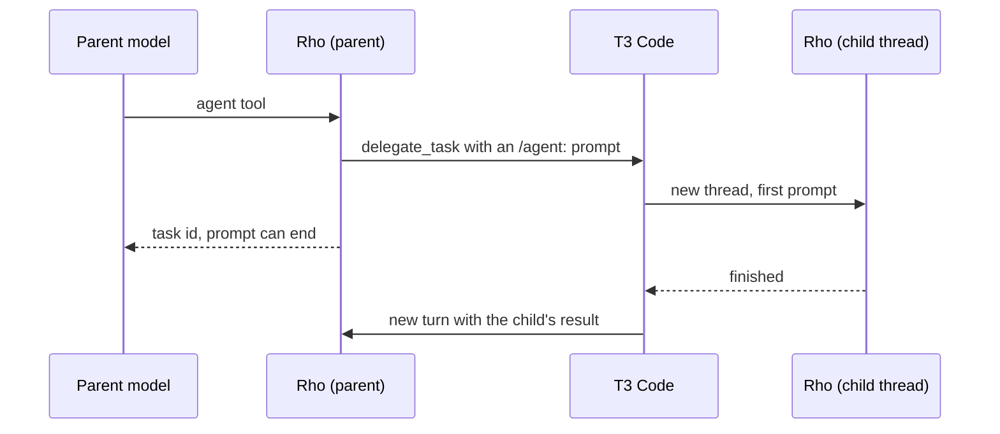

# T3 Code

Parent: [Agent Client Protocol](/integrations/acp).

[T3 Code](https://github.com/pingdotgg/t3code) runs Rho over ACP. In T3 Code, add Rho as an ACP agent with the command `rho` and the arguments `acp --t3code`:

```bash
rho acp --t3code
```

With `--t3code`, Rho subagents run as [T3 threads](#subagents-run-as-t3-threads), background results [wake an idle thread](#wake-on-background-results), and [T3's prompt context](#t3s-prompt-context) stays out of your messages. Without the flag, Rho still works in T3 Code as a plain ACP agent: its subagents run in the daemon, and background work holds the prompt open, as described in [Background work](/integrations/acp#background-work).

Rho negotiates ACP v2 when T3 Code requests it; v1 remains available when a host requests v1. Use an up-to-date T3 Code build: versions predating the October 30, 2026 prompt-echo fix can show the injected `<t3_code_instructions>` as a duplicate user message on v2. Upgrade T3 Code rather than downgrading Rho. Notices use native notice rows instead of assistant reply text.

## Sign in

T3 Code's sign-in terminal appends `--login <auth-profile>` to the configured command, for example `rho acp --t3code --login codex`, which signs in through the daemon instead of serving ACP. Sign-in works even when the configured provider has no credentials yet. When a prompt finds credentials missing, unreadable, or refused, T3 Code reports that the agent needs terminal authentication. See [Sign in](/integrations/acp#sign-in).

## Subagents run as T3 threads

Under `--t3code`, each subagent the model starts with the `agent` tool becomes a T3 thread. It shows up in T3's subagent panel and keeps running after the parent's prompt ends. When it finishes, T3 delivers its result to the parent as a new turn, so the parent does not wait with its prompt open.



- Rho calls the `delegate_task` tool of T3's `t3-code` MCP server, with `/agent:<name> <task>` as the child's first prompt. The `agents` tool's `status` and `stop` actions map to T3's `task_status` and `task_cancel`. There is no `message` action.
- A per-call `agent.model` travels in that `/agent:` command and is resolved by the child Rho. If the model cannot be resolved or signed in, the child task fails.
- So that the child's thread shows the model it runs on, Rho asks T3's `orchestrator_capabilities` tool whether the parent's provider offers that `provider/model` with the parent's options, such as permission mode and thought level. If it does, Rho sets it as the launch `target`. Otherwise the thread keeps the parent's model label, and the child still runs on the requested model.
- Only agents that use Rho's own runtime are offered. Agents that run through Claude Code, Cursor, or Antigravity are rejected; the model can start those with T3's `delegate_task` tool directly.
- Workflows still run in the daemon.
- `rho acp --t3code` asks for T3 threads each time it opens or reloads a session, so they hold across reloads and daemon restarts. The session does not save the choice: a client that reopens it without asking, such as `rho sessions attach`, runs its children in the daemon.

Rho needs T3's `delegate_task`, `task_status`, and `task_cancel` tools. If any of them is missing, the session still starts, but the `agent` tool and the `agents` `status` and `stop` actions fail with an error that names the missing tool. Rho never falls back to running the child in the daemon.

## Wake on background results

Under `--t3code`, a prompt that ends while background processes or workflows are still running does not stay open. The thread goes idle, so you can keep talking to it. The first result to finish wakes it with a new turn that delivers the result.

The daemon never starts a turn by itself, and T3 refuses a thread's own requests once its turn ends. T3 does wake a parent when a delegated task finishes, so Rho delegates one watcher task:

- The watcher is titled `waiting: <command>` and makes no model call. It runs `/rho-wake <token>`, a command Rho never lists in the menu.
- It waits until the parent signals a finished result, then ends, and T3 wakes the parent. The model gets T3's notice with a note that the watcher holds no result. The results follow it as usual.
- One watcher covers everything still running. Work that finishes during a prompt is delivered in that prompt, so most short commands never start one.
- If the watched work is delivered during a later prompt, Rho cancels the watcher. A watcher also ends when its parent session is deleted or unloaded, or the daemon stops, and it reports that the work did not finish. The daemon never unloads a session whose background work still runs.
- When T3 Code restarts, it tells each thread the restart cut off to continue. A watcher that already answered repeats its answer instead of running a model turn. A watcher cut off while it waits resumes the wait, whether T3 quit or crashed.
- If T3 refuses the watcher, Rho says so in the transcript and the results arrive with your next message.
- Watchers keep their files in `~/.rho/t3-wakes`, readable only by you. A watcher that starts cleans up files no watcher can use any more once they are 30 days old.

The same applies to a finished `/workflow:` command: it wakes the thread instead of waiting for your next message.

## T3's prompt context

T3 Code wraps each prompt in its own blocks: `<t3_code_instructions>` before your text, with your text in `<user_request>`, and `<runtime_info>` and `<pull_request_linking>` after it. Under `--t3code`, Rho sends those blocks to the model as context ahead of your message, and saves only what you typed. Session titles, `session/list`, and transcript replay show your words, and slash commands work on a thread's first message.

Only those tags count, and only whole at the start or end of the prompt. A tag in the middle of your text, or one Rho does not know, stays part of your message. Sessions saved before this change keep the blocks in their messages.

## How T3 Code shows Rho

T3 Code draws some ACP features differently from other hosts:

| Feature | In T3 Code |
| --- | --- |
| Plan approval | T3's usual approve, approve for session, and decline buttons. They pick `supervised`, `allow_edits`, and keep planning. `bypass` and `auto` cannot be chosen there. A thread in full access approves without showing the plan. A sandboxed thread may reject every time; switch the session's mode by hand. |
| Questions | Every question needs an answer, typed as text. Name a choice by its label or value, and separate several with commas or the separator the form names. Free text on a question that only accepts its listed choices counts as declining. Exact rules: [T3 Code forms](/integrations/acp/reference#t3-code-forms). |
| Checklist | Current T3 builds replace the checklist when Rho clears its `todo` list. Builds predating the October 30, 2026 empty-plan fix can retain the previous list. |
| Manual compaction | T3 intercepts bare `/compact` and currently rejects it for generic ACP agents before Rho receives it. Rho's automatic compaction is unaffected. |
| Interrupting | When you change settings and send a message mid-prompt, the message you send runs with the new settings. |
| Background results | Result cards show the plain output, without markdown fences. |
| Skills | `$<name>` skills appear in T3's `$` menu. |
| Titles | T3 records Rho's generated session title. |

The protocol behind each of these is in the [ACP host reference](/integrations/acp/reference).
