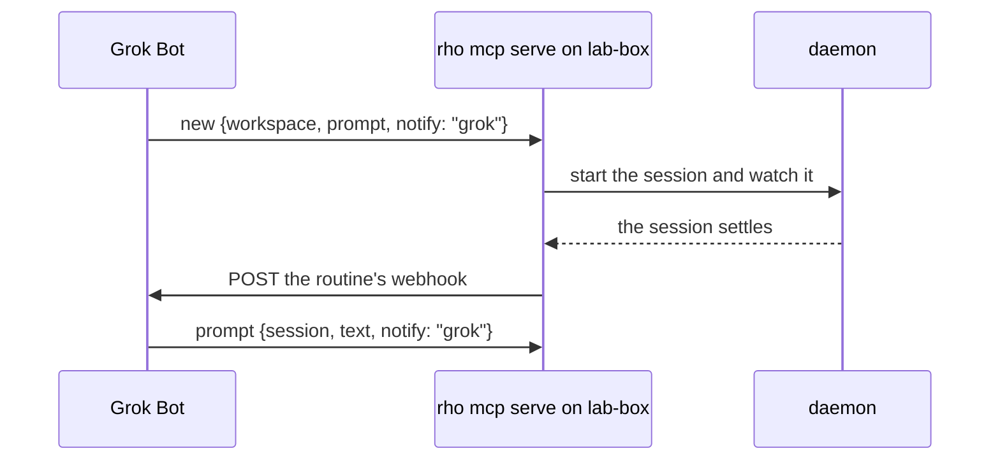

# Grok Bot

Parent: [Integrations](/integrations).

[Grok Bot](https://docs.x.ai/grok-bot/overview) can run Rho coding agents on your machines and hear back when they finish. It starts sessions through each machine's [MCP server](/mcp-server). Each machine sends a [webhook](/mcp-server#webhooks) to one of the Bot's routines when a session the Bot watches settles or needs you. The Bot reads the result, then prompts again or tells you.



Grok Bot runs in the cloud. Every machine needs an HTTPS URL the Bot can reach, and every webhook delivery is a billed routine run.

## On each machine

### 1. Run the MCP server as a service

Use the [systemd unit or launchd agent](/daemon#running-as-a-service), with a machine name and the public hostname of your tunnel:

```bash
rho mcp serve --http 127.0.0.1:8765 --name lab-box --allow-host lab-box.tail1234.ts.net
```

`--name` goes in every webhook body, so the Bot knows which machine to call back. Use a different name on each machine.

### 2. Give it an HTTPS URL

The server listens only on loopback. Put a tunnel in front of it that gives a public HTTPS URL, such as [Tailscale Funnel](https://tailscale.com/kb/1223/funnel):

```bash
tailscale funnel --bg 8765
```

The server's bearer tokens are the only gate. Don't put an OAuth proxy such as Cloudflare Access in front of it. Grok Bot's custom connectors send static headers, and its OAuth flow fails against several proxies.

### 3. Create a token for the Bot

Give it write access to only the workspaces it should work in:

```bash
rho mcp token rotate grok --scope write --workspace ~/src/app
```

Keep the printed secret for step 4.

### 4. Add the machine to Grok Bot

In the Grok Bot desktop app, open **Connect apps**, then **Add a custom connector**:

| Field | Value |
| --- | --- |
| Name | `rho-lab-box`, matching `--name` |
| Type | Remote HTTPS |
| Server URL | `https://lab-box.tail1234.ts.net/mcp` |
| HTTP headers | `Authorization: Bearer <secret from step 3>` |

Type the secret into the form. Don't paste it into a chat, where the Bot would see it.

## Once, in Grok Bot

### 5. Create the routine that hears from Rho

Ask the Bot:

```text
Create a routine called "Rho session updates" with a webhook trigger.
Instruction: follow the Rho orchestration skill on the JSON body.
```

Open the routine on desktop. Its **Webhook** section shows **POST to** and **key**.

### 6. Point each machine at the routine

On every machine, save the routine as a webhook target and bind it to the token from step 3:

```bash
printf %s '<key>' | rho mcp webhook add grok --url '<POST to URL>' --token grok
```

The key is read from stdin and kept in your [credential store](/authentication-and-models#where-credentials-live). `rho mcp webhook list` shows each target's last delivery and any error.

### 7. Teach the Bot the loop

Ask the Bot to save the prompt below as a skill called "Rho orchestration". Replace the machines and workspaces with your own.

````text
You orchestrate Rho coding agents on my machines. Each machine is an MCP
connector named rho-<machine>:
- rho-lab-box: workspaces /home/me/src/app
- rho-laptop: workspaces /Users/me/src/lib

Starting work
- Call `new` on that machine's connector with `workspace` (an absolute path from
  the list above), `prompt`, and `notify: "grok"`. Add `worktree: true` when
  several sessions may work in the same repository.
- Keep a short ledger: machine, session id, goal, status.
- Do not call `wait` in a loop. The routine "Rho session updates" runs when a
  session you started settles or needs me.

When "Rho session updates" runs, the JSON body has `server` (the machine),
`session`, `turn`, `state`, `done`, and `outcome` (with the final answer in
`outcome.text`) or `inputs`.
- Deliveries can repeat. If you already handled this session's `turn` in this
  same `state` with the same `inputs`, stop. A turn that asked me something
  and then finished arrives twice, once per state; handle both.
- `waiting_for_input`: Rho is waiting for me. Tell me the machine, the session,
  and what it asks (`inputs`), and that I can answer with
  `rho attach <session>` on that machine. Never try to answer it yourself.
- `completed`: read `outcome.text`. If the goal needs another step, call
  `prompt` on the same connector with the session, the next instruction, and
  `notify: "grok"`. Otherwise tell me the result in two or three sentences.
- `failed`, `cancelled`, `timed_out`, or `interrupted`: tell me what happened.
  Retry at most once, and only if the cause looks transient.
- Use `read` only when `outcome.text` is not enough to decide.

Boundaries
- Start sessions only in the workspaces listed above.
- Never ask a session to push, merge, deploy, publish, or delete without my OK
  in this chat.
````

## Approvals stay with you

A session that needs an approval or an answer waits. The Bot tells you, and you answer from `rho attach <session>` or the TUI on that machine. To let sessions work without asking, configure a [permission mode](/configuration/permissions) that doesn't ask for those workspaces, as you would for `rho run`.

## Costs and limits

- Each webhook delivery starts one billed routine run. Grok Bot allows 200 runs an hour per routine and 300 across your routines.
- Only sessions the Bot started or prompted with `notify` send webhooks. Turns you start yourself from the TUI do not.
- A session sends one webhook when it settles and one each time it asks for input. It doesn't settle while subagents, workflows, or background [tasks](/tools-workspace/background-processes) it waits on still run, so the Bot hears about the end of the work, not each turn.
- The [MCP server's limits](/mcp-server#limits) on session depth, concurrent sessions, and watches apply to the Bot's token.

## Security

- The MCP server is on the internet behind a bearer token that can start agents in its workspaces. Keep the token's workspaces narrow, and revoke it with `rho mcp token revoke grok` when you stop using the Bot.
- The Bot only names a webhook target. The URL and key come from `rho mcp webhook add` on the machine, so a token holder cannot make it post anywhere else.
- Webhook bodies carry final answers and approval summaries, including paths and commands, to Grok Bot.
