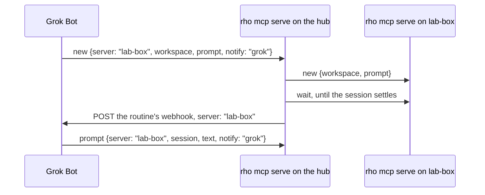

# Grok Bot

Parent: [Integrations](/integrations).

[Grok Bot](https://docs.x.ai/grok-bot/overview) can run Rho coding agents on your machines and hear back when they finish. It connects to one machine's [MCP server](/mcp-server), the hub, which drives the sessions of your other machines too ([Several machines](/mcp-server#several-machines)). The hub sends a [webhook](/mcp-server#webhooks) to one of the Bot's routines when a session the Bot watches settles or needs you, on any machine. The Bot reads the result, then prompts again or tells you.



Grok Bot runs in the cloud, so the hub needs an HTTPS URL the Bot can reach. The other machines only need to be reachable from the hub, for example over a private network such as NetBird or Tailscale. Every webhook delivery is a billed routine run.

## On the hub

Pick the machine the Bot connects to. It can run sessions of its own too.

### 1. Run the MCP server as a service

Use the [systemd unit or launchd agent](/daemon#running-as-a-service), with a name for the hub and the public hostname of your tunnel:

```bash
rho mcp serve --http 127.0.0.1:8765 --name hub --allow-host hub.tail1234.ts.net
```

### 2. Give it an HTTPS URL

The server listens only on loopback. Put a tunnel in front of it that gives a public HTTPS URL, such as a [Cloudflare Tunnel](https://developers.cloudflare.com/cloudflare-one/connections/connect-networks/) or [Tailscale Funnel](https://tailscale.com/kb/1223/funnel). Only the hub needs one. With Funnel:

```bash
tailscale funnel --bg 8765
```

The server's bearer tokens are the only gate. Don't put an OAuth proxy such as Cloudflare Access in front of it. Grok Bot's custom connectors send static headers, and its OAuth flow fails against several proxies.

### 3. Create a token for the Bot

```bash
rho mcp token rotate grok --scope write --workspace ~/src/app
```

`--workspace` limits the Bot on the hub. On the other machines, the token each one issues the hub limits it (step 4). Keep the printed secret for step 5.

## On each other machine

### 4. Serve it to the hub

Run the MCP server as a [service](/daemon#running-as-a-service) on the machine's private network address, the one the hub reaches it at, such as its NetBird address:

```bash
rho mcp serve --http 100.92.10.4:8765 --name lab-box
```

Then, from the hub, give the hub a token for that machine's workspaces and add the machine as a remote, in one line:

```bash
ssh lab-box 'rho mcp token rotate hub --scope write --workspace ~/src' \
  | rho mcp remote add lab-box --url http://100.92.10.4:8765/mcp
```

The token's secret goes from one machine to the other without reaching your terminal. `rho mcp remote add` checks the machine answers before it saves it. These steps need no interaction, so an agent with SSH access to your machines can run them. Plain `http` is allowed only to a private network address: the network keeps the traffic private. Over the internet, use `https`.

## Once, in Grok Bot

### 5. Add the hub to Grok Bot

In the Grok Bot desktop app, open **Connect apps**, then **Add a custom connector**:

| Field | Value |
| --- | --- |
| Name | `rho` |
| Type | Remote HTTPS |
| Server URL | `https://hub.tail1234.ts.net/mcp` |
| HTTP headers | `Authorization: Bearer <secret from step 3>` |

Type the secret into the form. Don't paste it into a chat, where the Bot would see it.

### 6. Create the routine that hears from Rho

Ask the Bot:

```text
Create a routine called "Rho session updates" with a webhook trigger.
Instruction: follow the Rho orchestration skill on the JSON body.
```

Open the routine on desktop. Its **Webhook** section shows **POST to** and **key**.

### 7. Point the hub at the routine

On the hub, save the routine as a webhook target and bind it to the token from step 3:

```bash
read -rs ROUTINE_KEY   # paste the key; it isn't echoed or saved in shell history
printf %s "$ROUTINE_KEY" | rho mcp webhook add grok --url '<POST to URL>' --token grok
unset ROUTINE_KEY
```

The key is read from stdin and kept in your [credential store](/authentication-and-models#where-credentials-live). `rho mcp webhook list` shows the target's last delivery and any error. The other machines need no webhook: the hub watches their sessions and sends their news.

### 8. Teach the Bot the loop

Ask the Bot to save the prompt below as a skill called "Rho orchestration". Replace the machines and workspaces with your own.

````text
You orchestrate Rho coding agents on my machines through the rho connector.
Every tool takes `server`, the machine to act on:
- hub: workspaces /home/me/src/app
- lab-box: workspaces /home/me/src
- laptop: workspaces /Users/me/src/lib

Starting work
- Call `new` with `server`, `workspace` (an absolute path on that machine
  from the list above), `prompt`, and `notify: "grok"`. Add
  `worktree: true` when several sessions may work in the same repository.
- `list` without `server` shows every machine's sessions.
- Keep a short ledger: machine, session id, goal, status.
- If the result has `watch_error`, the session started but its webhook may
  never fire. Tell me, and follow that session with `wait` until it is done.
- Do not call `wait` in a loop. The routine "Rho session updates" runs when a
  session you started settles or needs me.

When "Rho session updates" runs, the JSON body has `server` (the machine),
`session`, `turn`, `state`, `done`, and `outcome` (with the final answer in
`outcome.text`) or `inputs`.
- Deliveries can repeat. If you already handled this session's `turn` in this
  same `state` with the same `inputs`, stop. A turn that asked me something
  and then finished arrives twice, once per state; handle both.
- Check `inputs` first, whatever `state` says. When it is not empty, Rho is
  waiting for me, even with `state: completed` (a delegated agent can ask after
  the turn ended). Tell me the machine, the session, and what it asks, and that
  I can answer with `rho attach <session>` on that machine. Never try to answer
  it yourself, and don't prompt that session until it's answered.
- `completed` with no `inputs`: read `outcome.text`. If the goal needs another
  step, call `prompt` with the body's `server`, the session, the next
  instruction, and `notify: "grok"`. Otherwise tell me the result in two or
  three sentences.
- `failed`, `cancelled`, `timed_out`, or `interrupted`: tell me what happened.
  Retry at most once, and only if the cause looks transient.
- Use `read` only when `outcome.text` is not enough to decide.

Boundaries
- Start sessions only in the workspaces listed above.
- Never ask a session to push, merge, deploy, publish, or delete without my OK
  in this chat.
````

## Approvals stay with you

A session that needs an approval or an answer waits. The Bot tells you, and you answer from `rho attach <session>` or the TUI on that machine. To let sessions work without asking, configure a [permission mode](/configuration/permissions) that doesn't ask for those workspaces, as you would for `rho run`.

## Costs and limits

- Each webhook delivery starts one billed routine run. Grok Bot allows 200 runs an hour per routine and 300 across your routines.
- Only sessions the Bot started or prompted with `notify` send webhooks. Turns you start yourself from the TUI do not.
- A session sends one webhook when it settles and one each time it asks for input. It doesn't settle while subagents, workflows, or background [tasks](/tools-workspace/background-processes) it waits on still run, so the Bot hears about the end of the work, not each turn.
- The [MCP server's limits](/mcp-server#limits) on session depth, concurrent sessions, and watches apply to the Bot's token on the hub, and to the hub's token on each other machine.

## Security

- The hub is on the internet behind a bearer token that can start agents on every machine it reaches. The Bot's token's workspaces limit it on the hub only; on each other machine, the token that machine issued the hub limits it, so keep those narrow too. Revoke the Bot's with `rho mcp token revoke grok` on the hub when you stop using it. `rho mcp token revoke hub` on another machine cuts the hub off from it.
- The other machines speak plain HTTP to the hub on your private network. Anyone who can read that network's traffic can read their requests, tokens included, so use a network that encrypts it, such as NetBird or Tailscale.
- The Bot only names a webhook target. The URL and key come from `rho mcp webhook add` on the hub, so a token holder cannot make it post anywhere else.
- Webhook bodies carry final answers and approval summaries, including paths and commands, to Grok Bot.
