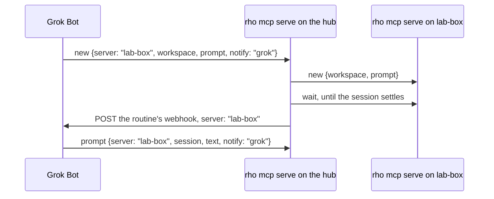

# Grok Bot

Parent: [Integrations](/integrations).

[Grok Bot](https://docs.x.ai/grok-bot/overview) can run Rho coding agents on your machines and hear back when they finish. It connects to one machine's [MCP server](/mcp-server), the hub, which drives the sessions of your other machines too ([Several machines](/mcp-server#several-machines)). The hub sends a [webhook](/mcp-server#webhooks) to one of the Bot's routines when a session the Bot watches settles or needs you, on any machine. The Bot reads the result, then prompts again or tells you.



Grok Bot runs in the cloud, so the hub needs an HTTPS URL the Bot can reach, unless the Bot's computer is on your private network ([A hub that isn't public](#private-hub)). The other machines only need to be reachable from the hub, for example over a private network such as NetBird or Tailscale. Every webhook delivery is a billed routine run.

## On the hub

Pick the machine the Bot connects to. It can run sessions of its own too.

### 1. Run the MCP server as a service {#hub-service}

On Linux, save this user unit as `~/.config/systemd/user/rho-mcp.service`. It names the hub and allows the public hostname of your tunnel. Change `ExecStart` to where `rho` is installed and `PATH` to the directories your sessions' tools live in:

```ini
[Unit]
Description=rho MCP server
After=network.target

[Service]
ExecStart=%h/.local/bin/rho mcp serve --http 127.0.0.1:8765 --name hub --allow-host hub.tail1234.ts.net
# The sessions this server starts look up executables on this PATH,
# including mise's shims and bun's global bin.
Environment=PATH=%h/.local/bin:%h/.local/share/mise/shims:%h/.bun/bin:/usr/local/bin:/usr/bin:/bin
# Stop only the server. The daemon keeps running its turns.
KillMode=process
Restart=always
RestartSec=10

[Install]
WantedBy=default.target
```

Start it, and keep it running while you are logged out, which a machine you reach over SSH needs:

```bash
systemctl --user daemon-reload
systemctl --user enable --now rho-mcp
loginctl enable-linger "$USER"
```

On macOS, use the [launchd agent](/daemon#launchd) with the same arguments.

### 2. Give it an HTTPS URL

The server listens only on loopback. Put a tunnel in front of it that gives a public HTTPS URL, such as a [Cloudflare Tunnel](https://developers.cloudflare.com/cloudflare-one/connections/connect-networks/) or [Tailscale Funnel](https://tailscale.com/kb/1223/funnel). Only the hub needs one. With Funnel:

```bash
tailscale funnel --bg 8765
```

The server's bearer tokens are the only gate. Don't put an OAuth proxy such as Cloudflare Access in front of it. Grok Bot's custom connectors send static headers, and its OAuth flow fails against several proxies.

### 3. Create a token for the Bot

```bash
rho mcp token rotate grok --scope write --workspace ~/src/app
```

`--workspace` limits the Bot on the hub. On the other machines, the token each one issues the hub limits it (step 4). Keep the printed secret for step 5.

The token reaches every session in those workspaces, including the ones you open yourself in the TUI or a web UI, so the Bot can [pick them up](#pick-up-your-sessions). It reaches none outside them. To let the Bot find and drive every session on the hub, grant the whole machine with `--workspace /`; it can then start sessions anywhere too. `rotate` on an existing token issues a new secret, so update the connector (step 5) after you change its workspaces.

A session the Bot starts with `worktree: true` runs in a [worktree](/daemon#sessions-in-worktrees) under `~/.rho/worktrees`, outside the workspace. It still counts as in the workspace it was started in, so the token reaches it with no grant of its own. The same holds on the other machines.

## On each other machine

### 4. Serve it to the hub

Run the MCP server as a service on the machine's private network address, the one the hub reaches it at, such as its NetBird address. The unit is the hub's with another `ExecStart`, saved as `~/.config/systemd/user/rho-mcp.service` on that machine:

```ini
[Unit]
Description=rho MCP server
After=network.target

[Service]
ExecStart=%h/.local/bin/rho mcp serve --http 100.92.10.4:8765 --name lab-box
# The sessions this server starts look up executables on this PATH,
# including mise's shims and bun's global bin.
Environment=PATH=%h/.local/bin:%h/.local/share/mise/shims:%h/.bun/bin:/usr/local/bin:/usr/bin:/bin
# Stop only the server. The daemon keeps running its turns.
KillMode=process
# The private address can come up after network.target, and listening on it
# fails until then. Try again every 10 seconds rather than give up.
Restart=always
RestartSec=10

[Install]
WantedBy=default.target
```

Enable it and the linger as on the hub (step 1). Give it the same `--name` you give the remote below.

#### Let the hub reach it {#let-the-hub-reach-it}

The hub connects to the machine on the MCP port, here TCP 8765. Allow that from the hub:

- In NetBird, an access control policy from the hub's peer or group to this one on TCP 8765. The default policy that allows everything already does.
- In Tailscale, an ACL or grant from the hub to `lab-box:8765`.
- In a host firewall such as `ufw`, the port on the overlay interface, for example `ufw allow in on wt0 to any port 8765 proto tcp` for NetBird.

Check from the hub before you go on:

```bash
curl -sS --noproxy '*' -o /dev/null -w '%{http_code}\n' http://100.92.10.4:8765/mcp
```

`401` means the server is reachable and wants a token. A timeout or `connection refused` means it isn't: see [If `remote add` can't reach it](#remote-unreachable).

If you can't open the port, forward it over SSH instead. Keep `ssh -N -o ExitOnForwardFailure=yes -o ServerAliveInterval=30 -L 18765:100.92.10.4:8765 lab-box` running on the hub, for example in a user unit with `Restart=always`, and use `http://127.0.0.1:18765/mcp` as the URL below. The hub accepts a loopback URL, and the server accepts the forwarded request's loopback `Host`. Give each machine its own local port. Use this only on a hub no one else logs into: while the forward is down, another local user could listen on that port and receive the hub's secret for the remote.

#### Add it as a remote

From the hub, give the hub a token for that machine's workspaces and add the machine as a remote, in one line:

```bash
ssh lab-box '~/.local/bin/rho mcp token rotate hub --scope write --workspace ~/src' \
  | rho mcp remote add lab-box --url http://100.92.10.4:8765/mcp
```

Use the full path of `rho` on that machine: a non-interactive SSH shell often doesn't have `~/.local/bin` or mise's shims on its `PATH`, so a bare `rho` is not found. If the rotate fails, `rho mcp remote add` gets an empty stdin and refuses it, so the line fails.

The token's secret goes from one machine to the other without reaching your terminal. `rho mcp remote add` checks the machine answers before it saves it. These steps need no interaction, so an agent with SSH access to your machines can run them. Plain `http` is allowed only to a private network address: the network keeps the traffic private. Over the internet, use `https`.

#### If `remote add` can't reach it {#remote-unreachable}

`could not reach server "lab-box"` includes the cause, such as `Connection refused` or `Connection timed out`. Usually:

- A firewall or network policy blocks the hub from the port ([Let the hub reach it](#let-the-hub-reach-it)). A timeout often means this.
- The address, port, or path is wrong. The URL ends in `/mcp`.
- The server isn't running on that machine, or listens on another address. `systemctl --user status rho-mcp` and `journalctl --user -u rho-mcp` there say which.

The `curl` above tells you when it's fixed; with the SSH forward, run it against `http://127.0.0.1:18765/mcp` instead. Then run the same line again. That is safe: the secret the failed line rotated was not saved on the hub, and the new rotate replaces it. If the hub already had this remote, it is refused until the line succeeds, since the rotate replaced its secret. A webhook watch of that remote's sessions stops after an hour of refusals; once the line succeeds, look for stopped watches in `rho mcp webhook list` and restart the hub or watch those sessions again.

## Once, in Grok Bot

### 5. Add the hub to Grok Bot

In the Grok Bot desktop app, open **Connect apps**, then **Add a custom connector**:

| Field | Value |
| --- | --- |
| Name | `rho` |
| Type | Remote HTTPS |
| Server URL | `https://hub.tail1234.ts.net/mcp` |
| HTTP headers | `Authorization: Bearer <secret from step 3>` |

Type the secret into the form. Don't paste it into a chat, where the Bot would see it.

When the hub restarts or [updates](/mcp-server#http-updates), the Bot's MCP session ends with it, and a request with the old `Mcp-Session-Id` gets `404 Not Found`. MCP clients answer that by initializing a new session, as the protocol has them do; nothing changes on the hub. If the Bot's calls keep failing after a restart, reconnect the connector.

### 6. Create the routine that hears from Rho

Ask the Bot:

```text
Create a routine called "Rho session updates" with a webhook trigger.
Instruction: follow the Rho orchestration skill on the JSON body.
```

Open the routine on desktop. Its **Webhook** section shows **POST to** and **key**.

### 7. Point the hub at the routine

On the hub, save the routine as a webhook target and bind it to the token from step 3:

```bash
read -rs ROUTINE_KEY   # paste the key; it isn't echoed or saved in shell history
printf %s "$ROUTINE_KEY" | rho mcp webhook add grok --url '<POST to URL>' --token grok
unset ROUTINE_KEY
```

The key is read from stdin and kept in your [credential store](/authentication-and-models#where-credentials-live). `rho mcp webhook list` shows the target's last delivery and any error. The other machines need no webhook: the hub watches their sessions and sends their news.

### 8. Teach the Bot the loop

Ask the Bot to save the prompt below as a skill called "Rho orchestration". Replace the machines and workspaces with your own. [Following a turn](/mcp-server#following-a-turn) describes `inputs` and the rest of the body, and [Webhooks](/mcp-server#webhooks) describes `watch_error`.

````text
You orchestrate Rho coding agents on my machines through the rho connector.
Every tool takes `server`, the machine to act on:
- hub: workspaces /home/me/src/app
- lab-box: workspaces /home/me/src
- laptop: workspaces /Users/me/src/lib

Starting work
- Call `new` with `server`, `workspace` (an absolute path on that machine
  from the list above), `prompt`, and `notify: "grok"`. Add
  `worktree: true` when several sessions may work in the same repository.
- `list` without `server` shows every machine's sessions.
- Keep a short ledger: machine, session id, goal, status.
- If the result has `watch_error`, the session started but its webhook may
  never fire. Tell me, and follow that session with `wait` until it is done.
- Do not call `wait` in a loop. The routine "Rho session updates" runs when a
  session you started settles or needs me.

Picking up a session I started
- When I ask about work I started myself, call `list` with
  `opened_by: "person"`, and `server` when I named the machine. Match what
  I said against `title` and `workspace`; if several fit, ask me which.
- A session can have no `title`. If nothing matches by title, show me the
  candidates by `workspace`, `state`, and session id and ask me which.
- `list` returns 20 sessions unless you ask for more. If the answer says
  `more: true`, call it again with a larger `limit`, up to 1000, before
  you pick one: a better match may be further down. If it still says
  `more: true`, tell me the list was cut off when you show me what you
  found.
- A machine that could not list its sessions has `error` in place of
  `sessions`. Tell me which machines those are and what they said before
  you pick a session: mine may be on one of them.
- Call `read` before you act on it. To follow it, call `watch` with
  `webhook: "grok"`. Add it to the ledger.
- `watch` can answer with the news itself. If it returns `watching: false`,
  the session already settled and no webhook follows: tell me its outcome
  now. If it returns `inputs`, the session is waiting on me and that is not
  sent again: tell me now. If it returns `watch_error`, the watch was not
  saved and the webhook may never fire: tell me, and follow the session
  with `wait` until it is done. Otherwise the webhook brings the news.
- Call `steer`, `prompt`, or `cancel` on it only when I asked for that.

When "Rho session updates" runs, the JSON body has `server` (the machine),
`session`, `turn`, `state`, `done`, and `outcome` (with the final answer in
`outcome.text`) or `inputs` (the approvals or questions it waits on).
- Deliveries can repeat. If you already handled this session's `turn` in this
  same `state` with the same `inputs`, stop. A turn that asked me something
  and then finished arrives twice, once per state; handle both.
- Check `inputs` first, whatever `state` says. When it is not empty, Rho is
  waiting for me, even with `state: completed` (a delegated agent can ask after
  the turn ended). Tell me the machine, the session, and what it asks, and that
  I can answer with `rho attach <session>` on that machine. Never try to answer
  it yourself, and don't prompt that session until it's answered.
- `completed` with no `inputs`: read `outcome.text`. If the goal needs another
  step, call `prompt` with the body's `server`, the session, the next
  instruction, and `notify: "grok"`. Otherwise tell me the result in two or
  three sentences.
- `failed`, `cancelled`, `timed_out`, or `interrupted`: tell me what happened.
  Retry at most once, and only if the cause looks transient.
- Use `read` only when `outcome.text` is not enough to decide.

Boundaries
- Start sessions only in the workspaces listed above.
- Never ask a session to push, merge, deploy, publish, or delete without my OK
  in this chat.
````

## Picking up sessions you started {#pick-up-your-sessions}

The Bot can take over a session you opened yourself, on any machine, as long as the session's workspace is one its token reaches there: the Bot's token on the hub (step 3), the hub's token on each other machine (step 4).

- `list` with `opened_by: "person"` shows your sessions, each with its `workspace`, `state`, and `title`. `hide_idle: true` leaves out the ones in state `idle`, which also hides an older session you reopened and have not prompted since.
- `read` shows what a session did. `watch` with `webhook: "grok"` has the hub tell the routine when it settles or needs you; `wait` follows it without a webhook.
- `steer` adds to its running turn, `cancel` stops it, and `prompt` starts its next turn.

A session you opened and a session the Bot started look the same to these tools. `opened_by` is how the Bot tells them apart. It sorts sessions by how they opened, not by who was at the keyboard: `person` is every session that was not opened through an MCP server or an agent's `sessions` tool, so one that an agent in your own session starts from its shell with `rho run --detach` is listed as `person` too. See [Sessions you opened yourself](/mcp-server#sessions-you-opened-yourself).

## A hub that isn't public {#private-hub}

The public HTTPS URL is for a Bot that reaches the hub from the cloud. If the computer the Bot runs its tools on is on your private network, such as a NetBird peer, it can reach the hub's private address directly, and the hub needs no tunnel:

1. Run the hub as the other machines run (step 4): on its private address, with `--name hub` and no `--allow-host`. Skip step 2.
2. Instead of the remote connector in step 5, ask the Bot to add a custom stdio MCP server that bridges to the hub, with a `Bearer` header from an environment variable:

   ```text
   Add a custom MCP server called rho that runs:
   npx -y mcp-remote http://100.92.10.1:8765/mcp --allow-http --transport http-only --header Authorization:${RHO_AUTH}
   ```

   Give it the environment variable `RHO_AUTH` with the value `Bearer <secret from step 3>`. The Bot keeps it on the server entry. If you give it the value in the chat, the Bot sees the secret, which the remote connector's form avoids, so keep that token's workspaces narrow.

The Bot starts the bridge on its own computer, and the bridge speaks to the hub over the private network. Webhooks still work: the hub posts to the routine's URL from its side, which needs only outbound internet access. The rest of the steps stay the same.

## Approvals stay with you

A session that needs an approval or an answer waits. The Bot tells you, and you answer from `rho attach <session>` or the TUI on that machine. To let sessions work without asking, configure a [permission mode](/configuration/permissions) that doesn't ask for those workspaces, as you would for `rho run`.

## Costs and limits

- Each webhook delivery starts one billed routine run. Grok Bot allows 200 runs an hour per routine and 300 across your routines.
- Only sessions the Bot watches send webhooks: the ones it started or prompted with `notify`, and the ones it called `watch` on, such as [a session you started](#pick-up-your-sessions). Turns you start yourself from the TUI on a session nobody watches do not.
- A session sends one webhook when it settles and one each time it asks for input. It doesn't settle while subagents, workflows, or background [tasks](/tools-workspace/background-processes) it waits on still run, so the Bot hears about the end of the work, not each turn.
- The [MCP server's limits](/mcp-server#limits) on session depth, concurrent sessions, and watches apply to the Bot's token on the hub, and to the hub's token on each other machine.

## Security

- A hub with a public URL is on the internet behind a bearer token that can start agents on every machine it reaches, and read and drive the sessions you opened yourself in the workspaces it reaches. The Bot's token's workspaces limit it on the hub only; on each other machine, the token that machine issued the hub limits it, so keep those narrow too. Revoke the Bot's with `rho mcp token revoke grok` on the hub when you stop using it. `rho mcp token revoke hub` on another machine cuts the hub off from it.
- The other machines speak plain HTTP to the hub on your private network. Anyone who can read that network's traffic can read their requests, tokens included, so use a network that encrypts it, such as NetBird or Tailscale.
- The Bot only names a webhook target. The URL and key come from `rho mcp webhook add` on the hub, so a token holder cannot make it post anywhere else.
- Webhook bodies carry final answers and approval summaries, including paths and commands, to Grok Bot.
