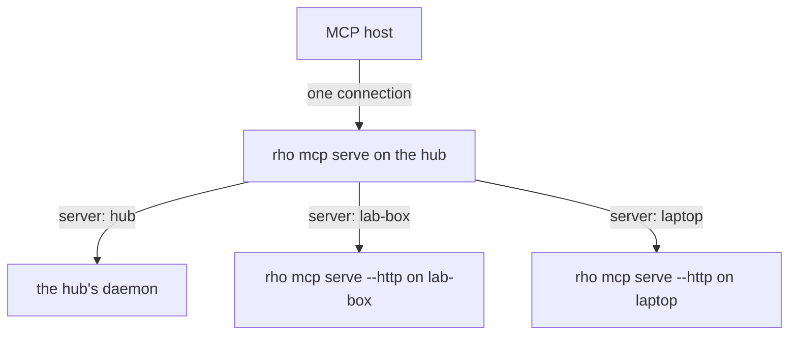

# MCP server

`rho mcp serve` turns Rho into a [Model Context Protocol](https://modelcontextprotocol.io/) server. Another agent, such as Claude Code, Codex, or a Rho session, can then start Rho sessions in any workspace, follow their turns, and read their answers. The sessions run in the [daemon](/daemon), which the server starts if needed.

The server speaks stdio by default. For hosts that connect by URL, use [`--http`](#over-http). A Rho agent gets the same tools through its [`sessions` tool](/sessions#starting-and-driving-other-sessions).

## Tools

| Tool | What it does | Access |
| --- | --- | --- |
| `list` | Lists sessions with their id, workspace, state, who opened them, title, and parent session. Filter by `workspace`, `state`, or `opened_by`; `hide_idle` leaves out sessions in state `idle`. See [Sessions you opened yourself](#sessions-you-opened-yourself). | read |
| `read` | Returns a session's transcript as text, a page at a time. | read |
| `new` | Starts a session in `workspace` (an absolute path) with a first `prompt`. Optional `agent` and `model`. `worktree: true` runs it in a new [git worktree](/daemon#sessions-in-worktrees). | write |
| `prompt` | Starts the session's next turn with `text`. | write |
| `steer` | Sends `text` to the running turn. | write |
| `cancel` | Stops the turn in progress. | write |
| `wait` | Waits for the turn to end or ask for input. See [Following a turn](#following-a-turn). | read |
| `watch` | HTTP only. POSTs the session's news to a [webhook](#webhooks) until it settles. Returns where the session is now, as `wait` does. | read |
| `unwatch` | HTTP only. Stops watching the session. | read |

Over HTTP, `new` and `prompt` also take `notify`, a [webhook](#webhooks) name, to watch the session from that turn on.

A server with [remotes](#several-machines) also takes `server` on every tool: the machine to act on.

Over stdio the host has write access unless you start the server [read-only](#read-only-over-stdio). Over HTTP each [token](#tokens) has read or write access.

## Following a turn

`new` and `prompt` return as soon as the turn starts. `wait` follows the session, and returns when it settles, with no turn running and none rho will start for its background work, when it needs a person, or after `timeout_secs` (30 by default, at most 50). A session the TUI opened ends its turn while a subagent runs and starts a turn of its own to deliver the result; `wait` returns that turn's outcome:

```json
{
  "session": "8c1e…",
  "state": "completed",
  "done": true,
  "outcome": {"type": "answered", "text": "…", "stop": "end_turn"},
  "cursor": "4f0a…:42"
}
```

- If `done` is false, a turn is still running, or the last one ended but background work is still due, such as a subagent or task whose result rho will deliver in a turn of its own. Call `wait` again with the returned `cursor`.
- `outcome` is how the last turn ended, present once it ended even while `done` is false. It is final once `done` is true; until then a later turn, such as the one that delivers a result, may replace it.
- `outcome.text` is the final answer. `read` returns the whole conversation.
- `inputs` lists the approvals or questions the turn waits on. A subagent's question stops `wait` too, even with no turn running.
- `turn` is the turn `state` is of.

## Sessions you opened yourself

The tools reach every session the [daemon](/daemon) knows, not only the ones a caller started through this server. A session you opened in the TUI, a web UI, or with `rho run --detach` can be listed, read, followed, steered, prompted, and cancelled like any other. Over HTTP, a token reaches a session by its workspace, whoever opened it: see [Tokens](#tokens).

Each `list` entry says who opened the session:

```json
{"sessions": [
  {"session": "8c1e…", "workspace": "/home/me/src/app", "state": "running", "opened_by": "person", "title": "Fix the flaky test", "updated_at": 1795516591},
  {"session": "4f0a…", "workspace": "/home/me/src/app", "state": "completed", "opened_by": "agent", "updated_at": 1795510211}
], "more": false}
```

- `opened_by` is `agent` for a session opened through this server or a Rho agent's [`sessions` tool](/sessions#starting-and-driving-other-sessions), and `person` for any other, such as one you opened in the TUI. It does not name the token or the frontend: the daemon does not record them. A session that an agent in one of your own sessions starts from its shell with `rho run --detach` also lists as `person`.
- `title` is the session's title, once it has one. Rho names a session during its first turn, and you can rename it. Once the daemon unloads a session, its title comes from the saved session, so a fork, and a session whose workspace directory is gone, then list without one.
- `opened_by: "person"` as an argument lists only those sessions. `hide_idle: true` leaves out sessions in state `idle`, which the daemon has run no turn on: one opened and not yet prompted, or an older saved session you reopened and have not prompted since.

`list` returns 20 sessions unless `limit` asks for more, so filter rather than page through a busy machine.

A turn the caller prompts on your session runs with the caller's [scope](#scope-follows-the-sessions-a-token-starts). Your next prompt from the TUI runs with your own again. A frontend that follows the session gets the caller's turns as they happen.

- A `steer` joins the turn that is running. On a turn you started, the caller's text is read by an agent that runs with your scope, not the caller's.
- A turn the caller prompts runs its commands with the environment of the `rho mcp serve` process, its `PATH` included, not your shell's.
- If you opened the session with `RHO_TRUST_PROJECT_*` variables the server was started without, or the other way round, `prompt` is refused and the error names the variables.

## Approvals stay with people

No tool here answers a session's approvals or questions. The native `sessions` tool's `answer`, which lets a session answer the questions of a session it started, is not served over MCP ([Sessions](/sessions)). When a turn asks for one, `wait` returns with `done: true`, `state: "waiting_for_input"`, and the request in `inputs`. A person answers it from `rho attach <session>` or the TUI, and the next `wait` follows the turn from there.

To let a session work unattended, give it a [permission mode](/configuration/permissions) that does not ask, as you would for `rho run`.

## Limits

Sessions can start sessions, so the server checks two budgets on every `new` and `prompt`:

- Session depth. A session started by a person or an outside agent is depth 1, a session it starts is depth 2, and so on. `--max-depth` sets the limit, 3 by default.
- Concurrent sessions. Each caller may run `--max-sessions` sessions at once, 10 by default. Each HTTP token is a separate caller. A session counts until its turn ends, including time waiting for a person. A daemon session's own `sessions` tool takes its limit from [`agent_concurrency`](/configuration#behavior) instead, also 10 by default.

Over HTTP, each token may also [watch](#webhooks) `--max-watches` sessions at once: unless set, 5 × `--max-sessions` (50 by default). A watch counts until its news is delivered or it is removed, including while it is stopped on an error. `rho mcp webhook list` shows each token's count against the limit.

A request past a budget is refused with the budget, its limit, and the value asked for:

```text
session depth budget: limit 3, asked 4; a session at depth 3 may not start or prompt another
concurrent sessions budget for token "ci": limit 10, asked 11
session watches budget for token "ci": limit 50, asked 51
```

These limits stop runaway recursion. They are not a sandbox, since a session with a shell can reach the daemon directly.

## Sessions' environment

Sessions get the server's environment, including its `PATH`, as if you started them from the server's shell. Under a service manager that is the service's environment; see [Running as a service](/daemon#running-as-a-service).

## Registering over stdio

The host starts `rho mcp serve` itself. If the host does not inherit your shell's `PATH`, give it the full path to `rho`.

Claude Code:

```bash
claude mcp add --transport stdio rho -- rho mcp serve
```

Codex, in `~/.codex/config.toml`:

```toml
[mcp_servers.rho]
command = "rho"
args = ["mcp", "serve"]
```

Rho, in `~/.rho/config.toml`, so one Rho session can drive others:

```toml
[mcp.servers.rho]
transport = "stdio"
command = "rho"
args = ["mcp", "serve"]
```

A Rho host starts stdio servers with a [sanitized environment](/integrations/mcp#stdio-servers), and the sessions this server starts inherit it. List any variables their tools need in `env_from_env`.

Add `--max-depth` or `--max-sessions` after `serve` to change the [limits](#limits).

### Read-only over stdio

Add `--scope read` for a host that should watch sessions but never start or change one:

```bash
claude mcp add --transport stdio rho-watch -- rho mcp serve --scope read
```

The write tools are refused:

```text
this server's caller has read access; `new` needs write
```

`--scope write` is the default. `--scope` does not work with `--http`, where each [token](#tokens) carries its own scope.

## Over HTTP

```bash
rho mcp serve --http 127.0.0.1:8765
```

The server prints its URL, `http://127.0.0.1:8765/mcp`, on stderr. Port `0` picks a free port.

It binds a loopback address, or this machine's address on a private network: `10.x`, `172.16–31.x`, `192.168.x`, an overlay network peer's `100.64.0.0/10` address such as NetBird's or Tailscale's, or an IPv6 unique local address. It refuses any other address, including `0.0.0.0`.

```bash
rho mcp serve --http 100.75.19.168:8765   # this machine's NetBird address
```

On a private network address the server speaks plain HTTP, and says so on stderr: anyone who can read traffic on that network can read the requests, bearer tokens included. Use it on a network that encrypts its own traffic, such as NetBird or Tailscale, or one you trust. Requests to the address are accepted as their `Host` without `--allow-host`. To reach the server from anywhere else, use a tunnel such as an SSH forward. [Running as a service](/daemon#running-as-a-service) has a systemd unit and a launchd agent that keep it running.

### Updates {#http-updates}

On macOS and Linux, when you update Rho, the HTTP server notices the new executable within a second, as the [daemon](/daemon#upgrading-in-place) does, and switches to it as the same process on the same address. First it stops taking new connections and lets the calls under way finish, waiting at most 90 seconds, then cuts the rest short. A host that connects meanwhile waits until the new version answers. The hosts' MCP sessions end with the switch, so each host starts a new one, as MCP hosts do for a session the server no longer knows. Watches carry over, and news that came during the switch is sent; a webhook POST under way at the moment of the switch may be sent twice, as after a crash. If calls still run after 90 seconds, or the new file is not rho, the server says so on stderr. Rolling back to an older version works the same way, except that the server closes its address while it switches and the older version opens it again, so a host that connects in that moment is refused and calls again. A server started over stdio keeps running its version until its host starts it again. If you install with mise or Homebrew, the new version lands at a different path, and the server can't see it; restart the service.

### Tokens

Every HTTP request needs a bearer token. Create one and name the workspaces it may reach:

```bash
rho mcp token rotate laptop --scope write --workspace ~/src/app --workspace ~/src/lib
```

`rotate` prints the secret once on stdout. Rho keeps only a hash of it, in your [credential store](/authentication-and-models#where-credentials-live). Clients send it as `Authorization: Bearer <secret>`.

- `--scope read`, the default, allows `list`, `read`, and `wait`. `--scope write` also allows `new`, `prompt`, `steer`, and `cancel`.
- `--workspace` grants a directory and everything under it. A new token needs at least one. The token reaches every session there, [whoever opened it](#sessions-you-opened-yourself), and cannot see or touch sessions anywhere else. `--workspace /` reaches every session on the machine: with `--scope read` to watch them all, with `--scope write` to drive them all and start sessions anywhere. A daemon session in a [worktree](/daemon#sessions-in-worktrees), such as one `new` starts with `worktree: true`, counts as in the workspace it was started in, so a token that reaches that workspace reaches the session too, though its worktree is under `~/.rho/worktrees`. A foreground `rho run --worktree` session counts as in its worktree only.
- Running `rotate` on an existing token issues a new secret. It keeps the token's scope and workspaces unless you pass new ones.

```bash
rho mcp token list           # names, scopes, and workspaces; --json for JSON
rho mcp token revoke laptop  # reject further requests with this token
```

Rotations and revokes apply from the next request, without a restart. They do not stop work already in progress. A request with a missing or unknown token gets `401 Unauthorized`.

### Token scope {#scope-follows-the-sessions-a-token-starts}

A turn that a token starts or prompts runs with the token's scope and workspaces. Any `rho mcp serve` the session calls holds it to that scope too. A session the token started keeps that limit for good, so a person who prompts it later does not give it their own access.

Like the [limits](#limits), this is not a sandbox. A write token can also prompt, steer, and cancel a session someone else opened in its workspaces, yours included, and a steer joins a turn that runs with the scope of whoever started it. To keep a caller off your own sessions, give its token workspaces you do not work in yourself.

### Hosts and origins

The server accepts requests whose `Host` is `localhost`, `127.0.0.1`, or `::1`. Behind a tunnel that keeps the public hostname, allow that name:

```bash
rho mcp serve --http 127.0.0.1:8765 --allow-host mcp.example.com
```

Requests with an `Origin` header get `403 Forbidden` unless `--allow-origin` names the origin, so a web page cannot drive the server. Non-browser MCP hosts send no `Origin`. Both flags can be repeated.

### Registering by URL

These examples assume the token's secret is in `RHO_MCP_TOKEN`.

Claude Code:

```bash
claude mcp add --transport http rho https://mcp.example.com/mcp \
  --header "Authorization: Bearer $RHO_MCP_TOKEN"
```

Codex, in `~/.codex/config.toml`:

```toml
[mcp_servers.rho]
url = "https://mcp.example.com/mcp"
bearer_token_env_var = "RHO_MCP_TOKEN"
```

Rho, in `~/.rho/config.toml` (see [Streamable HTTP servers](/integrations/mcp#streamable-http-servers)), with `RHO_MCP_AUTHORIZATION="Bearer <secret>"` in Rho's environment:

```toml
[mcp.servers.rho]
transport = "streamable_http"
url = "https://mcp.example.com/mcp"
headers_from_env = { Authorization = "RHO_MCP_AUTHORIZATION" }
```

### Webhooks

An HTTP server can POST to a webhook when a session has news, so a remote host such as a bot routine does not have to keep calling `wait`. [Grok Bot](/integrations/grok-bot) walks through a full setup. Add a target, bound to the tokens that may use it, with its bearer secret on stdin:

```bash
printf %s "$ROUTINE_KEY" | rho mcp webhook add grok --url https://example.com/hooks/abc --token grok
rho mcp webhook list           # targets, last delivery, stalled watches, each token's watch count; --json for JSON
rho mcp webhook remove grok
```

- `--url` must be `https`, or `http` to a loopback host, with no user name or password in it.
- `--token` can be repeated. A token can use only the targets bound to it. Running `add` again replaces the target.
- The secret is kept in your [credential store](/authentication-and-models#where-credentials-live). No list, tool result, or log shows it.

Then a caller with a token watches a session with `watch`, or with `notify` on the `new` or `prompt` that starts its turn:

```json
{"workspace": "/home/me/src/app", "prompt": "Fix the flaky test", "notify": "grok"}
```

The server POSTs to the target's URL with `Authorization: Bearer <secret>` and `Content-Type: application/json`. The body is what `wait` would return, plus `server`, the server's `--name`, which defaults to the host name:

```json
{"server": "lab-box", "session": "8c1e…", "state": "completed", "done": true, "turn": "…", "outcome": {"type": "answered", "text": "…", "stop": "end_turn"}, "cursor": "4f0a…:42"}
```

What fires:

- Each time the session stops for a person, with `state: "waiting_for_input"` and the requests in `inputs`.
- Once when the session settles, with no turn running and none rho will start for its background work. That ends the watch. To hear about the next turn, pass `notify` to the `prompt` that starts it.
- If the session already settled when you call `watch`, the answer is the news: it returns `watching: false` and nothing is POSTed. If it is waiting for a person, the answer is that news, and it is not POSTed again.

Once `new` or `prompt` with `notify` has started the turn, the call succeeds even if the watch could not be set up, so a retry never starts the turn twice. Such a result has `watch_error` saying what went wrong; `watch` and `unwatch` report a watch they could not save the same way.

Only watched sessions fire. A turn a person starts from the TUI on a session nobody watches, or whose watch already delivered, sends nothing.

Delivery happens at least once, so the same news can arrive twice. To skip a repeat, compare `turn`, `state`, and the ids in `inputs` with news you already handled: the `waiting_for_input` news and the settle of one turn share its `turn`.

A timeout, a network error, `408`, `429`, or a `5xx` is retried, 2 seconds later, then at gaps doubling up to 10 minutes. That is at most 15 attempts for one piece of news: 10 in the first 17 minutes of gaps, then one every 10 minutes (at most 6 an hour), the last after about 67 minutes of gaps. Those times count the gaps alone: each attempt can also take up to 30 seconds before it times out, so a receiver that never answers is given up on about 75 minutes after the first attempt, plus the server's own checks before each attempt. Any other answer, including a redirect, stops the watch at once. Redirects are never followed. `rho mcp webhook list` shows the last delivery of each target and the error of each watch that stopped. Restarting the server, or watching the session again, retries a stopped watch.

Watches survive a server restart, in `mcp-serve/watches.json` in the rho home (`~/.rho` by default). News that came while the server was down is sent when it starts again; the server starts the rho daemon then if it is not running, so a turn a reboot `interrupted` is reported too. After that, a watch never starts the daemon: if you stop it, the watch stops with an error until the server restarts or the session is watched again. One server per rho home keeps the watches; a second one serves the other tools, does not offer `watch`, `unwatch`, or `notify`, and refuses them.

Security:

- A caller names only a target. Its URL and secret come from `rho mcp webhook add`, so a token holder cannot make the server POST anywhere else.
- Before every POST the server checks again that the token exists, the target is still bound to it, and the session is in the token's workspaces. If not, it drops the watch without POSTing.
- The body carries final answers and approval summaries, including paths and commands, to the target.
- If the target is a paid bot routine, each POST is a billed run, including each approval a person has to answer.

## Several machines

One `rho mcp serve` can drive the sessions of several machines: a hub. Add each other machine's [HTTP server](#over-http) as a remote, and every tool takes `server`, the machine to act on. Your MCP host then needs one connection, to the hub.



### Adding a remote

On the remote, run the HTTP server as a [service](/daemon#running-as-a-service) on an address the hub can reach, such as its NetBird address, with `ExecStart=%h/.local/bin/rho mcp serve --http 100.92.10.4:8765 --name lab-box`. Then, from the hub, give the hub a token on the remote and add it, in one line over SSH:

```bash
ssh lab-box '~/.local/bin/rho mcp token rotate hub --scope write --workspace ~/src' \
  | rho mcp remote add lab-box --url http://100.92.10.4:8765/mcp
```

Give the full path of `rho` on the remote: a non-interactive SSH shell often lacks `~/.local/bin` or mise's shims on its `PATH`. If the rotate fails, `add` refuses the empty stdin, so the line fails.

`rho mcp remote add` reads the token's secret on stdin, so it goes from one machine's credential store to the other's without reaching your terminal or shell history. It checks the remote answers with that secret, then saves it in the hub's [credential store](/authentication-and-models#where-credentials-live). If the remote does not answer, nothing is saved, and the error lists the likely causes. Run the line again once it does: the secret the failed line rotated was not saved on the hub, and rotating again replaces it. Until then, a remote already saved under that name is refused, since the rotate replaced its secret. `curl -sS --noproxy '*' -o /dev/null -w '%{http_code}\n' http://100.92.10.4:8765/mcp` from the hub printing `401` shows the remote is reachable. [Grok Bot](/integrations/grok-bot#let-the-hub-reach-it) covers the firewall rule and an SSH-forward fallback. Running `add` again for a name replaces it.

- `--url` must be `https`, or plain `http` to a loopback or private network address, as the remote listens on. A host name for plain `http` must resolve only to private addresses; it is resolved and checked again before every call, and the call connects only to the addresses checked. Plain `http` never goes through a proxy.
- The name is what `server` takes and what [webhook](#webhooks) news calls the machine. Give the remote the same `--name`, so its own logs agree.

```bash
rho mcp remote list           # names and URLs; --json for JSON
rho mcp remote remove lab-box
```

Adding and removing apply from the next call, without a restart. A host sees the new choice of `server` when it next lists the tools.

### Calling a hub

Once the hub has a remote, every tool takes `server`, one of the hub's own name (its `--name`, the host name by default) and its remotes' names. Every tool but `list` and `unwatch` needs it:

```json
{"server": "lab-box", "workspace": "/home/me/src/app", "prompt": "Fix the flaky test"}
```

```text
`new` needs `server`, the machine to act on: one of hub, lab-box, laptop
```

Results name the machine they came from as `server`. `list` without `server` lists every machine at once, each with its sessions or why it could not list them:

```json
{"servers": [
  {"server": "hub", "sessions": [], "more": false},
  {"server": "lab-box", "sessions": [{"session": "8c1e…", "state": "running", "…": "…"}], "more": false},
  {"server": "laptop", "error": "could not reach server \"laptop\": …"}
]}
```

A hub with no remotes offers no `server` and works as before. If the hub cannot read its remotes from the credential store, it serves its own sessions, and a call naming a remote says why it cannot reach it.

A remote can be a hub too, and two hubs can list each other. A call a hub forwards is served on the sessions of the machine it reaches and goes no further.

### Who may do what on a remote

- The hub checks the caller's access, read or write, and sends the call on. The remote's token for the hub holds it to that machine's workspaces and [limits](#limits).
- The remote's token for the hub also decides which of that machine's sessions the hub's callers find: every session in its workspaces, [whoever opened it](#sessions-you-opened-yourself). `list`'s filters are passed on to each remote; a remote running an older Rho refuses a filter it does not know, and `list` reports that as the remote's `error`.
- Every token of the hub reaches every remote. A token's `--workspace` paths are on the hub's machine; on a remote, the remote's token for the hub decides which workspaces the call reaches. So a hub token limited to one workspace still reaches every workspace the remotes' tokens allow, and so do the sessions it starts. Keep the remotes' tokens for the hub narrow.
- Session depth counts across machines: a session one hub session starts on a remote runs one level deeper.

Revoke the remote's token (`rho mcp token revoke hub` on the remote) to cut the hub off.

### Webhooks from a hub

An HTTP hub [watches](#webhooks) remote sessions itself. A `notify` or `watch` with `server` set follows the session through the remote's `wait`, and the hub POSTs its news to its own webhook, naming the remote as `server`. The remotes need no webhook of their own.

Each check reads the remote as the hub has it then, so running `rho mcp remote add` again with a new token or address applies to the watches already running. If a remote stops answering, refuses the hub's secret, or answers with an error that may pass, as with its daemon stopped, the hub tries again at gaps doubling from 2 seconds to a minute, for an hour, so a remote that reboots is followed again once it is back. After that hour the watch stops with an error until the hub restarts or the session is watched again; it still counts toward `--max-watches` until then. A watch's checks never start a remote's daemon: if you stop it, the watch waits for it, as a watch of the hub's own sessions does. A session waiting for a person is checked every 10 seconds until a person answers it. If the remote refuses the session for good, as one it does not know, or is removed from the hub, the watch is dropped.
