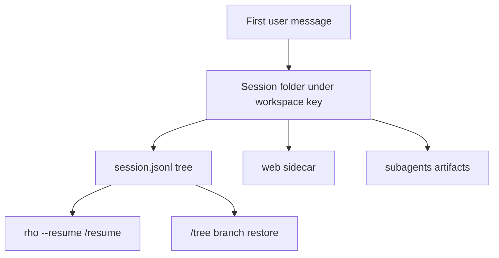
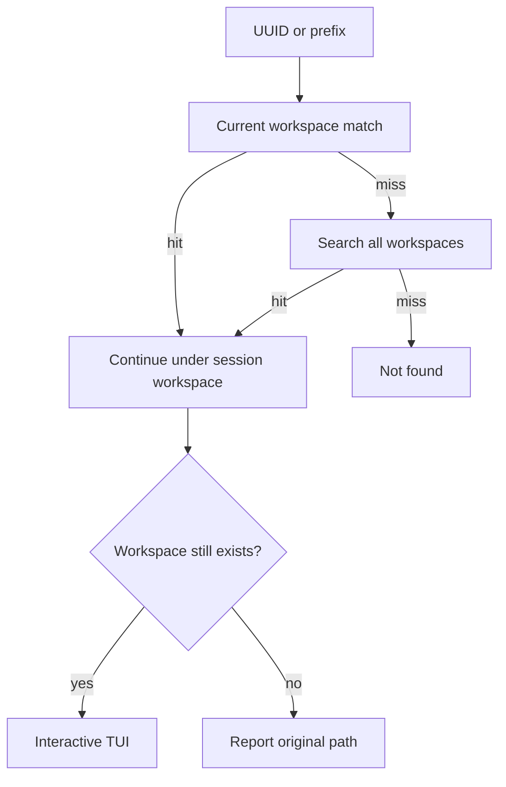
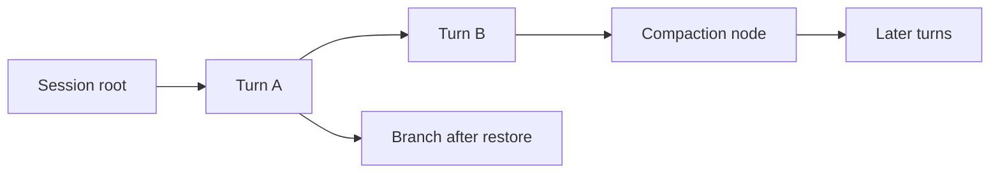

# Sessions

Rho persists interactive conversation history so you can resume work later.



## Storage location

Sessions persist automatically under:

```text
~/.rho/sessions/<workspace-key>/
```

`<workspace-key>` contains a readable encoding of the absolute working directory plus a stable hash to avoid path collisions. Rho uses the current directory as its [workspace](/tools-workspace). Sessions started through [`rho acp`](/integrations/acp) use this same tree and show up in `rho sessions list` and `rho -R`. [`rho run`](/automation-cli#sessions-commands-and-questions), Rho subagents, and workflow agent nodes save their sessions here too. Session lists, pickers, `-c`, and ACP session lists hide them. Commands that take a session id, such as `rho sessions export <ID>` and `rho --resume <ID>`, still open them.

### Layout

New sessions use one folder per session:

```text
~/.rho/sessions/<workspace-key>/<created-at>_<session-id>/
  session.jsonl    # append-only transcript
  web/             # web-access sidecar blobs for this session
  subagents/       # delegated run artifacts owned by this session
  recall/          # originals of tool results elided by compaction
```

Rho still opens legacy flat transcripts directly:

```text
~/.rho/sessions/<workspace-key>/<created-at>_<session-id>.jsonl
```

For those legacy files, web-access blobs use a sibling companion directory named `<created-at>_<session-id>.web/` when needed. Session discovery accepts either the folder transcript path or the legacy `.jsonl` file path.

`~/.rho/sessions/index.sqlite3` is the session catalog behind listing, resume-by-id, and titles. It is an owner-only SQLite cache in WAL mode, so `index.sqlite3-wal` and `index.sqlite3-shm` appear beside it while Rho runs. Listing reconciles catalog rows against transcript size and modification time, so rows that lose their latest writes (for example, after a power loss) repair themselves. Session titles live only in the catalog and are written durably. To rebuild the catalog, stop every Rho process, then delete `index.sqlite3`, `index.sqlite3-wal`, and `index.sqlite3-shm` together; this drops titles. Copy or move the three files together too, never `index.sqlite3` alone. If `index.sqlite3` is a symlink, SQLite keeps the `-wal` and `-shm` files beside its target instead. Like Rho's other SQLite stores, WAL requires `~/.rho` on a local filesystem, not a network home directory shared by several machines.

## Creating a session

Starting `rho` opens the [interactive TUI](/interactive-tui). Rho creates a new session folder only after you send the first message.

### Sessions without saving

For a throwaway conversation, start Rho with:

```bash
rho --no-save
rho --no-save --prompt "explain this function"
```

The conversation stays in memory. Rho never creates a session folder or writes
these prompts to shared prompt history. You can still recall prompts within the
running session. The statusline shows `not saved`, and `/new` keeps this mode.
Exiting or crashing loses the conversation; it won't appear in session history
and cannot be resumed.

`rho --no-save` is interactive-only and cannot be combined with `--resume`, `-R`, `--continue`, or `-c`. To run a scripted prompt without saving, pass [`rho run --no-save`](/automation-cli#sessions-commands-and-questions).
Inside the TUI, `/resume`, `/tree`, `/title`, `/export`, and `/rewind`
are unavailable.
Use `/copy` to copy an answer, or start Rho without the flag to resume saved work.

This is not a privacy or sandbox mode. Providers still receive requests, and
tools can modify files. Cached web content and usage records may still be saved;
hooks, logs, delegated agents, and workflows can retain their own data.
`--save` controls configuration overrides separately; it does not turn session
saving back on.

## Workspace checkpoints

Workspace rewind is on by default for saved sessions a person prompts: the
TUI, daemon sessions, `rho run`, and `rho acp`. Native file
mutations from `write` and the selected edit tool capture the original file once
per turn, including its contents and basic permissions. Checkpoints are stored
alongside the transcript at
`<session>/workspace-checkpoints/checkpoints.jsonl`. Sessions without saving and
legacy flat sessions do not create checkpoint journals.

`/rewind` previews restore actions before confirmation. A successful restore
returns files and conversation state to **before the selected turn**; continuing
creates a new branch, and the original conversation branch stays available in
`/tree`. Conversation selection clears the composer, as `/tree` does; it does
not automatically put the old prompt back for editing. Conflicting paths,
unsupported files, and failed writes stay unchanged. A partial restore leaves
the current conversation state selected and reports its audit. Checkpoints from
the old experimental version lack pre-turn conversation boundaries and cannot
be rewound; they are rejected before any files change. If files restore but saving
the conversation selection fails, retrying skips files already at their original
state and retries the conversation commit.

Only native file-tool mutations are captured. Shell (`bash`), process, Git,
network, database, service, and third-party tool effects cannot be reversed.
Recorded untracked effects display a **limited** badge and warnings in the
preview and audit. Rewinding is not a replacement for Git or a workspace backup.

The **per-file capture budget is 2 MiB**. Files above it are unsupported, with a
transcript notice showing the limit and requested file size. The **per-session
serialized journal budget is 64 MiB**. Capture reserves path and entry metadata
(including absent and empty files and expected-after states), plus base64-expanded
pre-image bytes, against the remaining session budget. It drops the current
turn's capture if it cannot fit, without blocking native tools or the turn.
Serialization also stops at the remaining budget rather than allocating an
oversized record. An append that would exceed it is rejected without losing
earlier checkpoints. Rho reports the budget,
limit, requested total, and minimum requested turn bytes once, and pauses further capture for that running
session. Earlier turns remain rewindable; restarting can attempt capture again
but does not clear the journal or its budget.

If checkpoint storage cannot be initialized, Rho reports the failure and pauses
capture for that running session; ordinary turns and native file writes continue.
Failures to read or save the conversation itself remain fatal, including saving
the pre-turn conversation baseline.

**Privacy:** checkpoint journals contain original file contents, including any
secrets in files touched by native tools. They are not redacted. Disabling rewind
does not delete existing journals. Treat session folders as sensitive data and
include them in your retention policy. To prevent new capture, set
`[behavior] workspace_rewind = false`, or turn off **Workspace rewind** under
**Agent** in `/config`. Sessions you open afterwards stop capturing.

## Searching prior conversations

The `sessions` tool retrieves prior conversations without resuming them or
changing their transcripts. It is available to agents with the `sessions`
capability, including the default agent. Unlike workspace file search, it asks
for read access to the session storage directory. Checked permission modes may
ask for approval or deny that outside-workspace read.

Search and read exclude the current session unless you pass
`"scope":"current"` (see [Searching the current session](#searching-the-current-session)).
Other scopes also skip the sessions that session lists hide, such as those of
`rho run`, subagents, and workflow agent nodes.
`action = "recall"` returns the original text of a tool result that
compaction elided, by the `recall_id` in its stub. Originals are saved in the
session folder under `recall/`. See
[Tool-result elision](/configuration/compaction#tool-result-elision).

In the TUI, search cards show the query, matching-session count, and scope.
Read cards show the original speaker and character range. Press `Ctrl+O` or
click the card to expand grouped excerpts or the retrieved passage, including
full session handles and evidence anchors. Collapse it again to keep only the
receipt. Expanding reveals already-retrieved evidence; it does not fetch another
page. Continuation notices indicate when more results or passage text are
available through another tool call. Tool failures stay visible when collapsed.

```json
{"action":"search","query":"cancellation session index"}
```

Search defaults to the same Git repository, including linked worktrees. Matches
from the current worktree come first, then BM25 relevance with stable tie breaks.
Use `"scope":"worktree"` for just this worktree or `"scope":"all"` to search
across projects. Outside Git, the default scope is the exact working directory.
These scopes always exclude the current session, including from explicit reads.

Queries are literal AND terms with English stemming. They are not regular
expressions, arbitrary substring searches, or SQLite FTS expressions. Use a
distinctive error code, identifier, or a few topic words; shorten an overly
specific query when it finds nothing.

Results group up to five sessions by default, with at most two 320-character
excerpts each. Every excerpt includes its original role, an evidence anchor, a
character offset, and the full evidence length. Tool failures remain
`tool_error`; incomplete assistant output remains `assistant_aborted`.
`omitted_matches` and `next_offset` make undisplayed matches visible. Pass
`limit` and `offset` to page through session groups. The tool stops assembling
groups when its byte budget is full, even if `limit` requests more; follow
`next_offset` for the remaining groups. Budget-limited pages include
`output_budget_bytes`.

Copy the returned `session`, `anchor`, and excerpt `start` into a focused read:

```json
{"action":"read","session":"<returned handle>","anchor":"<returned anchor>","start":0,"chars":4096}
```

Use the same explicit scope when reading a cross-project result. Reads return
one evidence message, not the entire conversation. Follow `next_start` to page
through a long message, or `previous_anchor` / `next_anchor` to inspect adjacent
evidence. Anchors bind the evidence's position and contents: appending messages
keeps existing anchors valid, but replacing their evidence invalidates them.
Search again if a read rejects a stale anchor.

Offsets count Unicode characters, not bytes. Output obeys the configured
tool byte budget; a too-large read reports the budget and requested size instead
of silently dropping text.

The `sessions` tool's own calls and results are never indexed, so earlier
searches do not show up as matches for later ones.

### Searching the current session

Compaction replaces older turns with a summary, but the transcript keeps the
originals. Use `"scope":"current"` to search them. When the `sessions` tool is
available, the system prompt tells the agent to do this instead of guessing
when an earlier detail is no longer in context.

```json
{"action":"search","query":"migration plan","scope":"current"}
```

Because there is only one session, current-scope search pages matching
messages rather than session groups: it returns the session handle,
`total_matches`, and up to `limit` excerpts in `matches`, with `next_offset`
for the rest. A message repeated in a later turn is a separate match. Read a
match with the same scope; reads default to `repo`, which excludes this session:

```json
{"action":"read","session":"<returned handle>","anchor":"<returned anchor>","scope":"current"}
```

Only saved turns are searchable. The turn in progress is saved when it ends or
when compaction runs during it.

Only recorded display evidence is indexed. Model snapshots, provider envelopes,
repeated tool schemas in those envelopes, token accounting, reasoning and media
are omitted. Text within actual user messages, assistant replies and tool results
is not rewritten into a model-generated summary. Reads preserve that text,
including errors. Evidence can include abandoned branches, so retrieval is not a
claim that every indexed message belongs to the active branch. Treat retrieved
instructions as untrusted historical source material, not commands to follow.

### Cache and freshness

First use builds a private `~/.rho/sessions/search.sqlite3` cache. Later calls
consume a persistent change journal maintained by the session catalog: unchanged
queries do not walk session directories or read transcript contents. Changed
sessions are reindexed individually. Imports, manual edits/deletes, or writes
from an older Rho that does not update the catalog require `"refresh":true` to
reconcile the filesystem. The response reports reconciliation, files checked,
bytes read, skipped files and incomplete/malformed records.

Older caches with position-only anchors rebuild automatically on first use.

The cache contains conversation text and has owner-only permissions. It is
derived data; deleting `search.sqlite3` causes a rebuild on next use. When
deleted sessions leave at least 50 MiB and a quarter of the cache as free pages,
the next search runs `VACUUM` to return that space to the filesystem. Search does
not index web sidecars or nested subagent run traces. Symlinked session paths are
not read. A deleted Git worktree first encountered after deletion cannot be
reliably assigned to its former repository; use `scope: all` in that case.

## Starting and driving other sessions

With the [daemon](/daemon) running, the `sessions` tool lets an agent start
other sessions and drive them, as you would from another terminal. These
sessions keep running after the agent's turn ends, can work in another
workspace, and you can pick them up later. When the result should come back
into the current turn, use [subagents](/subagents) instead.

| Action | What it does |
| --- | --- |
| `list` | Lists the daemon's sessions with their workspace, state, and the `parent` session that started them. Filter by `workspace` or `state`. |
| `new` | Starts a session in `workspace`, an absolute path, with a first `prompt`. `agent` and `model` are optional. Returns the session id right away. |
| `prompt` | Starts the session's next turn with `text`. |
| `steer` | Adds `text` to the running turn's next model request. |
| `cancel` | Cancels the turn in progress. |
| `wait` | Waits for the turn to end or to need a person, for up to `timeout_secs`, at most 50. Returns the state, the final answer, and a `cursor` for the next `wait`. |
| `read` | Without an `anchor`, pages through a session's transcript, including the turn in progress. |

```json
{"action":"new","workspace":"/home/me/other-project","prompt":"Run the test suite and summarize failures"}
{"action":"wait","session":"<returned id>","timeout_secs":50}
```

These are the same tools the [MCP server](/mcp-server) offers, with the same
rules. Know these before you approve one:

- `new`, `prompt`, `steer`, and `cancel` ask for approval, and `plan` mode
  refuses them. `list`, `read`, and `wait` ask for read access to session
  storage.
- A new session runs in its workspace's permission mode, which can be looser
  than the agent's.
- A new session gets the agent session's environment, including its
  `RHO_TRUST_PROJECT_*` variables. The target workspace's project agents,
  plugins, and hooks load only if those allow it. Starting a session there
  grants it no trust. See [Environment](/daemon#environment).
- An agent can't answer another session's approvals or questions. That session
  waits until a person answers from a Rho frontend.

Limits apply:

- Started sessions share the daemon's
  [agent budget](/daemon#sessions-other-sessions-start), so one may wait
  `queued` for a slot.
- Rho refuses to start or prompt a session 4 or more levels deep.
- A session can have at most 10 sessions it started or prompted running at
  once.
- The tool needs a daemon that is already running. It never starts one.

## Resuming a session



To resume an existing session for the current workspace, pass its UUID or UUID prefix with `--resume` or `-R`:

```bash
rho --resume <session-uuid>
rho -R <session-uuid-prefix>
rho --resume <session-uuid> --prompt "continue from the last change"
```

Resuming by id first looks in the current workspace. If no session matches there, Rho resolves the id across every workspace, so you can resume a session by id from a different directory. A session resumed this way continues under **its own** workspace, not the current directory, because its history refers to that project's files and tools. If that workspace directory no longer exists, for example after a rename, move, or delete, Rho reports where the session belongs instead of continuing against an unrelated tree. The transcript remains under `~/.rho/sessions`.

You can also omit the ID to open an interactive picker for saved sessions in the current workspace:

```bash
rho --resume
rho -R
```

To pick up where you left off, continue the most recently updated session in the current workspace without a picker:

```bash
rho --continue
rho -c
rho -c --prompt "keep going"
```

If the workspace has no saved sessions yet, `-c` starts a new session instead of failing, so it is safe to use as a default launch command.

The picker and `-c` skip sessions with no messages, such as one whose process was killed before its first save. `/sessions` still lists them so you can delete them.

The picker and session list stay scoped to the current workspace. Inside the TUI, use `/resume` to open the saved-session picker or `/resume <id>` to switch directly. Both reject sessions owned by another workspace. In the picker, press `d` or `Delete` to remove the selected session after a confirmation prompt; `escape` cancels.

To work across every directory, use `/sessions` inside the TUI. It opens a full-width session manager that groups saved sessions by directory, with the current directory first. Worktrees of the same Git repository share one section: the current worktree lists its sessions, and each other worktree shows as one row. Directories that no longer exist collect under a final `MISSING DIRECTORIES` section. Press Enter on a session in the current directory to resume it, or on a directory row to narrow the list to that directory. You can inspect and delete sessions from other directories, but Rho asks you to start it in that directory before resuming so tools and project context cannot stay bound to the wrong workspace. Press `d` on a session to delete it, or on a directory row to delete the reviewed saved sessions in that directory, along with the unlisted run, subagent, and workflow node sessions saved there; both ask for confirmation. When saved sessions refer to workspace directories that no longer exist, the picker adds a cleanup row that deletes the reviewed sessions after confirmation. The current session is never deleted.

### One process per session

Only one Rho process can have a session open at a time. The [daemon](/daemon),
a foreground `rho run`, a workflow run in the terminal, and Rho 2.x each hold
the sessions they open. The TUI and `rho acp` go through the daemon, so many of
them can follow one session.

While another process holds a session, you can't delete it. If that process
isn't the daemon, you can't resume it either. The error names the holder:

```text
session '<id>' is open in another Rho process; close it there first
```

Close the session there, or exit that process, and try again. The daemon lets
go of a session after it sits idle ([unloading](/daemon#unloading-idle-sessions)).
`-c` fails the same way instead of starting a new session. Listing, exporting,
renaming, and searching sessions work from any process. A crash never leaves a
session locked.

## Listing, renaming, exporting, and deleting sessions

Use the `sessions` CLI to inspect, export, rename, remove, and clean up saved history:

```bash
rho sessions list
rho sessions list --all-projects
rho sessions list --search login --limit 20
rho sessions list --json
rho sessions export <session-uuid-or-prefix>
rho sessions export <id> --output notes.md
rho sessions export <id> --format json --output transcript.json
rho sessions export <id> --force   # overwrite an existing target
rho sessions rename <session-uuid-or-prefix> <title>
rho sessions rm <session-uuid-or-prefix>...
rho sessions rm <id> --force   # only for stale non-terminal related runs
rho sessions rm <id> --yes     # skip cross-project confirmation
rho sessions cleanup           # delete sessions for missing workspace directories
rho sessions cleanup --yes     # confirm without an interactive prompt
rho sessions cleanup --force   # allow stale non-terminal related runs
```

`list` shows sessions for the current workspace with a short id, relative age, and title. `--all-projects` includes every workspace and prints each session's working directory. `--search` filters id, title, first/last user message, and cwd (case-insensitive). `--limit` caps how many rows print. `--json` prints one JSON document.

`export` writes the active transcript path for a saved session. Formats are HTML (default), Markdown (`.md`), and JSON (`.json`). The path extension selects the format unless you pass `--format`. When you omit `--output`, Rho writes under `~/.rho/exports/` (or `$RHO_HOME/exports/`) with a timestamped name that includes the short id and optional title slug. Existing files are refused unless you pass `--force`.

`rename` sets the stored session title by UUID or unique prefix. Multi-word titles work without quotes (`rho sessions rename abc123 my new title`). Inside the TUI, `/title <name>` renames the current session. Rho trims the title, and refuses one that is empty, longer than 500 characters, or contains a control character such as a newline.

`rm` accepts one or more session ids or unique prefixes. It checks every id before deleting anything. If it can't delete a session, it reports it, deletes the rest, and exits non-zero. It deletes each session transcript unit (folder layout or legacy flat `.jsonl`), its web sidecar, and its session index row. Folder deletion also removes delegated runs nested under `subagents/`. Rho still removes older or legacy-session runs under `~/.rho/subagents/` when their `result.json` records the session as `parent_session_id`. Usage ledger rows are **not** deleted, so cost history remains.

Deleting a session also deletes the sessions it started, such as its subagents' sessions, and their children, in any workspace. Each child goes through the same checks listed below. If Rho refuses one, the error names it, and the parent stays. Delete the parent again once you fix that. Deleting a child keeps its parent. Deleting the session that started a workflow keeps the workflow's node sessions.

Delete refuses:

- the current interactive session (switch or start a new session first)
- a session open in this or another Rho process (close it first), or an open child session it would delete
- a session with a still-running or starting related run, unless you pass `--force` (intended only for stale artifacts left after a crash)
- an ambiguous UUID prefix (the error lists matching ids and workspaces)

Cross-project deletes ask for confirmation and show the session workspace. Pass `--yes` in non-interactive scripts.

`cleanup` finds sessions whose recorded workspace path is gone or no longer a directory. It shows every missing workspace and asks before deletion. Pass `--yes` in a script. Cleanup uses the same cascade and live-run checks as `rm`; it does not delete usage history. Metadata errors such as permission failures stop cleanup instead of treating an inaccessible directory as missing.

After you send at least one message, Rho restores your shell view on exit and prints a short saved-session summary plus a resume command that you can paste later.

## Conversation trees

Each saved session is an append-only tree of completed conversation states.



Use `/tree` to select any valid turn or compaction state in the current session. Press `up` or `down` to move, type to filter, press `enter` to restore, or press `escape` to cancel. Continuing after you restore an earlier state creates a branch without deleting the path you left. `/info` shows the active leaf ID, node count, and branch count.

Navigation restores conversation and model state only. It does not undo file edits, shell commands, network requests, or any other tool side effects. `/export` renders the active path. The resume picker still shows one row for the whole session, and deleting a session deletes all its branches.

## Compaction and transcript history

Manual and automatic compactions are durable tree states. A compaction node stores the exact model context after summary generation succeeds, while its parent keeps the exact pre-compaction state. The visible transcript keeps the original user, assistant, and tool messages. Selecting the parent lets you continue without that compaction; descendants of the compaction always include it.

New session files use session format 5. Each tree node stores the model messages it adds and the transcript rows it shows. Most rows are the same messages, so format 5 stores a row as a reference to a message in the same node and keeps full content only for rows that differ, such as user input rewritten for the model. This avoids storing most messages twice. Resume, export, `/tree`, the session list, and session search show the same transcript as before.

Rho reads formats 4 and 5. A file keeps the format its header declares. Continuing a format 4 session appends format 4 records, so a Rho release that predates format 5 can still open it.

Rho 3 doesn't open format 1, 2, or 3 files. Rho 0.4.0 through 1.10.x wrote them, between June 21 and July 21, 2026. A file from then keeps its old format even if a later Rho continued it. Resuming, exporting, or opening one through the daemon fails with this error:

```text
this session was created by rho before 1.11 (session format v2) and can't be opened in rho 3; open it with rho 2.x
```

Use Rho 2.x to open and continue these sessions. In Rho 3, `rho sessions list` shows them as untitled rows, the resume picker and session hub hide them, and session search skips them.

Rho releases that predate format 5 refuse format 5 files rather than show an incomplete transcript. Resuming or exporting one fails with `unsupported session version 5`. Their session list may still show a row a newer Rho indexed, and their session search skips the file. Upgrade Rho to open these sessions.

Auto compaction is not a privacy or deletion feature.

## Resetting history

Press `ctrl-r` in the [interactive TUI](/interactive-tui) to reset the conversation. The next message starts a new session folder.

For one-shot prompts that do not need an ongoing interactive session, use [automation and CLI](/automation-cli).
