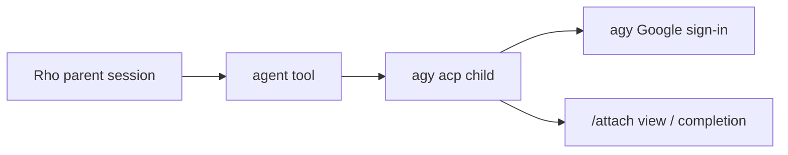
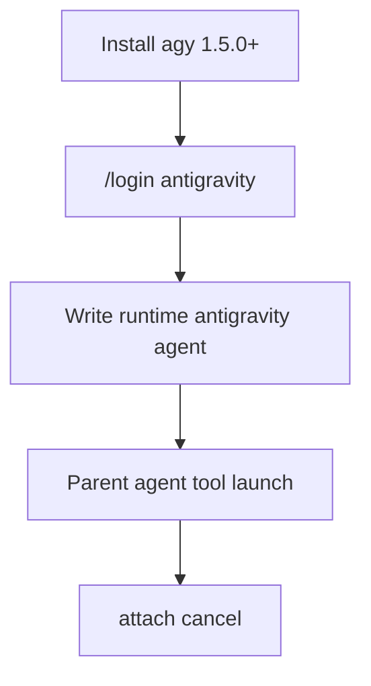

# Google Antigravity as a delegated runtime

Parent: [Agents and delegation](/subagents).

Rho can hand a delegated agent to Google Antigravity's `agy` CLI instead of running Rho's own loop. The parent stays in Rho. The child uses Antigravity's harness, Gemini models, and agy's own Google sign-in. Model choice and runtime choice stay separate: `runtime: antigravity` is not a Rho provider.

Requires agy 1.5.0 or later. Rho speaks the [Agent Client Protocol](https://agentclientprotocol.com) (ACP) to `agy acp` over stdio.



## When this is useful

Use `runtime: antigravity` when you want a Gemini-backed Antigravity child while the main session stays on Rho:

- Keep Rho as the orchestrator (fan-out, attach, cancel, session tree) while Antigravity owns the child loop and sign-in
- Give the child a closed tool allow list that agy itself enforces, and run it as a read-and-plan child (Plan) or a worker (Bypass)
- Steer a running child with follow-up messages, delivered as its next turn

Antigravity agents are **delegated only**. The interactive root and `rho run` root cannot bind `runtime: antigravity`; a Rho parent launches them through the `agent` tool.

## How to use it



1. **Install agy** from [Google's releases](https://github.com/google-antigravity/antigravity-cli/releases) and put it on `PATH`. Update an older copy with `agy update`. Rho does not ship or install it.

2. **Sign in** from the TUI or the shell:

   ```text
   /login antigravity
   ```

   ```bash
   rho login antigravity
   ```

   Both hand the terminal to `agy acp --login`, which prints a Google sign-in link and asks for the code or the address of the page the browser lands on, so it also works over SSH. The sign-in is agy's own and is shared with the agy CLI: if you already use `agy`, you are already signed in. Rho never stores or reads the token. To sign out, use `/logout` in agy.

   Confirm with `/doctor` (or `rho doctor`): the `agy` row under Runtimes shows the version and sign-in state, and warns when agy is older than 1.5.0. `/info` shows the same under External runtimes. Both run `agy --version` and `agy models`.

3. **Write a delegated agent definition**, for example `~/.rho/agents/agy-reviewer.md`:

   ```markdown
   ---
   id: agy-reviewer
   description: Review changes with Antigravity on Gemini
   runtime: antigravity
   model: gemini-3.8-flash
   tools: [read_file, run_command]
   ---
   Review the requested changes. Prefer reading before editing.
   ```

   Notes:

   - `tools:` is required: a nonempty list of `read_file`, `write_file`, `edit_file`, `run_command`, and `search_web` ([vocabulary](/subagents/definition-schema#tool-vocabulary-by-runtime)). agy builds the child with only those built-ins, plus `manage_task` (which agy always adds). Subagent, scheduling, and question built-ins are not available.
   - `model:` is an Antigravity model (for example `gemini-4-argon` or `gemini-3.8-flash`). Rho sets it as the session's `model` option; a value the server does not offer fails the run before the prompt, listing the offered values. Omit it to keep agy's default.
   - There is no `reasoning:` field. Runs use agy's default thinking level.
   - `prompt: replace` is rejected (ACP has no system-prompt override). Use `extend`: the body is prepended to the first prompt.

4. **Delegate from a Rho root session** through the `agent` tool. The call returns a run ID immediately, followed by an automatic completion notification.

5. **Watch and cancel** with `/attach` in the TUI or a click on the run's activity-rail row. `agents` action `message` queues plain text for a running child; Rho sends it as the next `session/prompt` once the current turn ends.

## Permission modes

Each run writes an agy custom agent whose `tools:` is the run's allow list, and starts agy with it. agy enforces the list: a tool outside it does not exist for the model.

| Rho mode | Tools kept | agy session |
| --- | --- | --- |
| Plan | read-only (`read_file`); a list without one is refused | mode `plan`, where the agent reads and writes a plan; Rho rejects every permission request agy sends |
| Bypass | every declared tool | mode `default`; a permission request is approved once when a kept tool covers it (a command needs `run_command`), otherwise rejected |
| Auto, Allow edits, Supervised | - | refused (`antigravity agents run only in Plan or Bypass`): Rho cannot ask a human to approve an Antigravity tool call |

Bypass runs whatever the kept tools allow, inside or outside the workspace, just like a shell tool on any other runtime. In agy 1.5.0, agy asks before every command, while workspace edits and web search run without asking. If agy leaves the mode Rho set, Rho fails the run.

agy falls back to its default agent, with every built-in, when it cannot find the named agent, and says so only in its log. Rho writes the agent before starting agy. In that case the declared list does not stop a workspace edit; a command that asks Rho still needs `run_command` in the list, but one a project permission already allows (below) runs without asking.

agy's `default` mode also honors your agy `toolPermission` setting, which can approve every tool without asking Rho. So Rho runs `agy acp --cli_dir_name rho`, which reads settings from `~/.gemini/antigravity-cli/rho/` instead of your `~/.gemini/antigravity-cli/settings.json`, while keeping your sign-in. Project and shared Antigravity configuration under `~/.gemini/config/` still applies: hooks and MCP servers run, and a command a project permission already allows never reaches Rho as a request, even in Plan.

## Quick checklist

| Step | Command or field |
| --- | --- |
| Install | agy 1.5.0+ on `PATH` (`agy update`) |
| Sign in | `/login antigravity` or `rho login antigravity` |
| Check | `/doctor` or `rho doctor` (`agy` row), `/info` |
| Define | `runtime: antigravity` + `tools:` + optional `model:` |
| Permission mode | Plan or Bypass only |
| Launch | Rho parent `agent` tool, delegated only |
| Messaging | `agents` action `message`; delivered as the next turn |
| Inspect | `/attach` |

## Execution details

Rho runs `agy acp --cli_dir_name rho --add-dir <run>/agy --agent rho-run-<random>` in the workspace. agy 1.5.0 finds custom agents only in `.agents/agents/` under a workspace root, its global config, or a plugin, so each run writes `<run>/agy/.agents/agents/rho-run-<random>.md` under its own run directory and adds that folder to the workspace. Your project and agy configuration are untouched; the child can see the added folder, which holds only that file. The random name keeps a project's own `.agents/agents/` from supplying the agent. Its `initialize` identifies it as `rho` in `clientInfo` and advertises no client filesystem or terminal capabilities. Each ACP setup step (`initialize`, `session/new`, `session/set_mode`, `session/set_config_option`) has a 10 s budget; measured with agy 1.5.0, `initialize` took under 0.1 s and `session/new` about 1.5 s.

Rho never calls ACP `authenticate` during a run. A signed-out agy fails `session/new` with `Authentication required`; run `/login antigravity`.

Cancel sends `session/cancel`. Rho always terminates `agy acp` after the last turn. The ACP session id is recorded but there is no resume command.

Workflow plans freeze the resolved `agy` executable and the kept tools. Plans made for the earlier `agy_acp_server` runtime refuse to resume; plan them again.
