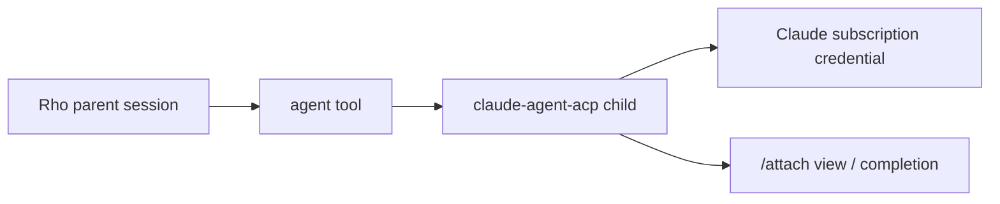
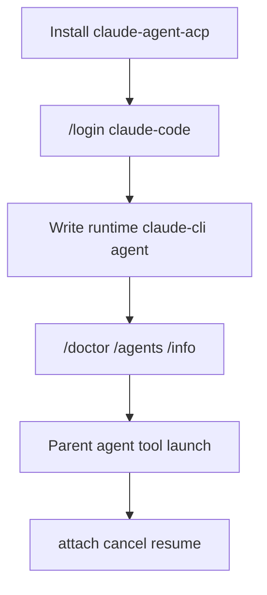

# Claude Code as a delegated runtime

Parent: [Agents and delegation](/subagents).

Rho can hand a delegated agent to Claude Code instead of running Rho's own loop. The parent stays in Rho. The child uses Claude Code's harness and the user's Claude subscription. Model choice and runtime choice stay separate: picking an Anthropic model on the Rho runtime is not the same as `runtime: claude-cli`.

Rho speaks the [Agent Client Protocol](https://agentclientprotocol.com) (ACP) over stdio to [`claude-agent-acp`](https://github.com/agentclientprotocol/claude-agent-acp), the ACP adapter for the Claude Agent SDK. The adapter bundles its own Claude Code CLI, so a separate `claude` install is not needed.



## Subscription workaround

Anthropic does not allow third-party clients to sign in with Claude.ai Free/Pro/Max credentials or to route those plans through their own API stacks. Rho's Anthropic provider path is API-key billing only.

`runtime: claude-cli` is the supported **indirect** way to spend a Claude subscription from a Rho session: Rho stays the parent orchestrator, and Claude Code (through `claude-agent-acp`) owns sign-in, the child loop, and plan usage. Rho never sees or stores the subscription token. This is not a substitute for Anthropic API access inside Rho's own runtime, and it is not a root-session Claude Code mode.

## When this is useful

Use `runtime: claude-cli` when you want that subscription-backed child while the main session stays on Rho:

- Use a Claude Pro/Max plan on planning, review, or research without making Claude Code the root harness
- Keep Rho as the orchestrator (fan-out, attach, cancel, session tree) while Claude owns the child loop and credential
- Reuse Claude Code tool names and permission behaviour for a bounded child task
- Open the full Claude transcript later with `claude-agent-acp --cli --resume <session-id>` after Rho finishes the run

Skip this feature when you only need "a subagent on Opus" through Rho's normal provider path (API key or another provider). Set `model:` / `provider:` on a `runtime: rho` agent instead. You do not need Claude Code for that.

Claude-cli agents are **delegated only**. The interactive root and `rho run` root cannot bind `runtime: claude-cli`. A Rho parent must launch them through the `agent` tool.

## How to use it



1. **Install the adapter** (Rho does not ship it). It needs Node.js or Bun:

   ```bash
   npm install -g @agentclientprotocol/claude-agent-acp
   claude-agent-acp --cli --version
   ```

   `bun add -g @agentclientprotocol/claude-agent-acp` works too. See [Claude Code adapter](/installation#claude-code-binary-optional).

2. **Sign in from Rho** so Claude Code stores the subscription credential:

   ```text
   /login claude-code
   ```

   Or open bare `/login`, pick **Anthropic**, then **Claude Code (delegation only)**. Rho asks you to confirm, then hands the terminal to `claude-agent-acp --cli auth login --claudeai` and never sees or stores the token. Details: [Claude Code runtime sign-in](/authentication-and-models#claude-code-runtime-sign-in).

3. **Write a delegated agent definition** (there is no built-in Claude agent). Run `/agents create` or `/create-agent` for a guided questionnaire, or write a file such as `~/.rho/agents/claude-planner.md`:

   ```markdown
   ---
   id: claude-planner
   description: Use Claude Code to plan with an Anthropic model
   runtime: claude-cli
   model: claude-opus-5
   reasoning: high
   tools: [Read, Glob, Grep]
   inherit_claude_config: false
   ---
   Produce a short plan. Prefer reading before editing.
   ```

   Notes:

   - `tools:` uses Claude Code names (`Read`, `Edit`, `Bash(git *)`), not Rho capabilities
   - Omitting `tools` means no tools. There is no `tools: all`
   - `model:` is a Claude model alias such as `opus`, or a full Claude model name. It is not a Rho `@alias`. In `/agents`, the Model row offers the aliases Rho knows (`fable`, `opus`, `sonnet`, `haiku`) plus a Claude Code default row; a definition that pins a full model name keeps its own row
   - optional `reasoning:` maps to Claude `effort` (`low`/`medium`/`high`/`xhigh`/`max`); omit to inherit Claude's default; `off` and `minimal` are rejected
   - Auto and Allow edits run only when every `tools:` entry is a proven no-prompt Claude built-in for that Rho approval class and `inherit_claude_config` is false. Claude runs read-only tools and `allowedTools` entries without asking, so specifiers such as `Bash(git *)`, write/process tools, unknown Claude/plugin/MCP names, or inherited Claude settings refuse spawn. See [Permission modes](#permission-modes). Supervised always refuses, because Rho cannot ask a human to approve a Claude tool call

4. **Confirm setup** in the TUI:

   ```text
   /doctor
   /agents
   /info
   ```

   `/doctor` checks the adapter and auth health. `/agents` shows runtime and Claude tool lists. `/info` opens an overlay with Claude Code ownership wording when signed in.

5. **Delegate from a Rho root session** (interactive or automation parent on `runtime: rho`):

   Ask the parent to call the `agent` tool with `agent_id: claude-planner` and a clear prompt. The call returns a run ID immediately, followed by an automatic completion notification.

6. **Watch, cancel, and resume**: open the run with `/attach` in the TUI, or click its row in the activity rail.

   Attach paints Claude tools with Rho's generic ACP tool cards: the tool kind and title the adapter reports, plus paths and diffs when it sends them.

   `agents` action `message` steers plain text into the running turn; see [Parent messages](#parent-messages). Cancel through the `agents` tool or parent shutdown. When the run finishes, attach and the completion entry may show `runtime_session_id`. Reopen the Claude-side transcript with:

   ```bash
   claude-agent-acp --cli --resume <session-id>
   ```

   `/limits` probes Claude Code `/usage` through a PTY when you are signed in (Claude still owns the token) and falls back to last-observed windows if that probe fails.

## Quick checklist

| Step | Command or field |
| --- | --- |
| Install | `claude-agent-acp` on `PATH` (`npm install -g @agentclientprotocol/claude-agent-acp`) |
| Sign in | `/login claude-code` |
| Define | `runtime: claude-cli` + Claude `tools:` / `model:` |
| Permission mode | Plan or Bypass. Auto / Allow edits only with proven no-prompt `tools:` for that Rho class and `inherit_claude_config: false`. Unknown names fail closed |
| Launch | Rho parent `agent` tool, delegated only |
| Inspect | `/attach`, `/agents`, `/limits` |
| Messaging | `agents` action `message`; steered into the running turn |
| Full Claude transcript | `claude-agent-acp --cli --resume <session-id>` |

## Permission modes

Every run sets its Claude session mode with ACP `session/set_mode`, because the adapter otherwise starts in your Claude `defaultMode`. If the child leaves that mode, Rho fails the run.

| Rho mode | Claude mode | Claude settings loaded | Rho's answer to a Claude permission request |
| --- | --- | --- | --- |
| Plan | `plan` | project, or user, project, and local with `inherit_claude_config: true` | reject |
| Bypass | `bypassPermissions` | same as Plan | reject |
| Auto, Allow edits | `default` | none | reject |
| Supervised | - | - | refused before spawn |

Auto and Allow edits reproduce Claude's `dontAsk`: read-only tools and `allowedTools` entries run, and anything that would ask is refused. Loading no settings keeps user, project, and local hooks and allow rules from widening the child; org-managed Claude policy still applies. Because Claude runs those tools without asking Rho, these modes also refuse spawn unless every declared tool is a bare built-in proven to stay inside that Rho approval class and `inherit_claude_config` is false. Plan and Bypass keep Claude's own behaviour for those modes (`bypassPermissions` just runs; it is not Claude's classifier `auto`). Under `bypassPermissions`, Claude asks only for its bypass-immune safety checks and explicit `ask` rules, and Rho rejects those, as `claude -p` did.

## Execution details

Rho runs `claude-agent-acp` with no arguments in the project directory. Rho owns the parent tree node; Claude owns the child loop and credential. Each ACP setup step (`initialize`, `session/new`, `session/set_mode`) has a 10 s budget. In a [daemon](/daemon#environment) session, Rho finds `claude-agent-acp` on the `PATH` of the client you prompted from and runs it with that client's whole environment, credentials included.

Everything Claude-specific travels in `session/new` `_meta`:

| Field | Behaviour |
| --- | --- |
| `systemPrompt` | The agent definition body plus the delegated-child communication contract. `prompt: replace` sends a string, which replaces Claude's system prompt; `prompt: extend` sends `{ "append": ... }`. The prompt never appears on argv |
| `claudeCode.options.tools` | Built-in allowlist: the base Claude tool names from `tools:`. A specifier such as `Bash(git *)` still lists `Bash`. An empty list still restricts, so ambient tools are not inherited |
| `claudeCode.options.allowedTools` | Every declared entry from `tools:` (bare names such as `Read` and patterns such as `Bash(git *)`); these run without asking. `Task` and `Agent` are never listed |
| `claudeCode.options.disallowedTools` | `Task` and `Agent`, so Claude nested subagents stay off and fan-out stays under Rho |
| `claudeCode.options.settingSources` | From the [permission mode](#permission-modes) |
| `claudeCode.options.strictMcpConfig` | `true`: MCP servers only from what the session passes |
| `claudeCode.options.maxTurns` | Exact configured step/turn cap from the bound launch data |
| `claudeCode.options.model` | From the agent `model:` field when set, passed through unchanged. Rho also sets `ANTHROPIC_MODEL` to it, because the adapter otherwise takes the session model from your Claude `settings.model`. Omitted when the definition inherits Claude's model. Parent provider/model updates do not overwrite Claude agents |
| `claudeCode.options.effort` | From agent `reasoning:` when set (`low`, `medium`, `high`, `xhigh`, `max`). Omitted when unset so Claude keeps its default |
| `claudeCode.options.promptSuggestions` | `false`: Rho never shows Claude's predicted follow-up prompt |
| `claudeCode.options.persistSession` | Delegated runs leave it unset, so the session can be resumed. Rho's own one-shot calls, such as a Claude Code advisor, set `false` and leave no session behind |

The task is the first `session/prompt`. The adapter's log goes to `log.txt` in the run directory. Cancel sends `session/cancel`, and Rho terminates the adapter after the last turn. Success or failure comes from the prompt's stop reason, not the exit code.

Rho does not check sign-in before a run. A signed-out or expired login fails the run at the prompt with `Authentication required`; run `/login claude-code`.

### Parent messages

Parents can message a running Claude-cli child with the `agents` action `message`. The adapter supports ACP `_session/steering`, so Rho steers each message into the running turn, and attach shows it as steered into the running turn. As when you type into Claude Code mid-turn, a steer interrupts the current response, and a running foreground tool such as Bash moves to the background. When no turn is running or the steer fails, the message is sent as the next turn instead. Claude children do not get `message_parent` or `request_parent_action`.

### Resources

Each delegated run is one adapter process (Node.js or Bun) driving the bundled Claude CLI. Measured right after `session/new`, a run used about 330 MB resident under Bun and 380 MB under Node.js.

## Usage, limits, and resume

Per-run turns and cost (from ACP `usage_update.cost`) are stored on `result.json`, along with `runtime_model`, the concrete model the adapter reported. The adapter does not report token counts, so Claude runs have none.

During a run, Rho records the rate-limit windows the adapter reports into the `/limits` cache. `/limits` also probes the signed-in Claude TUI `/usage` panel (`claude-agent-acp --cli`) over a PTY and shows remaining percentages when the panel includes them. Rho never reads Claude's credential files. If the probe fails, `/limits` keeps last-observed windows from a prior claude-cli run.

The probe forces classic rendering in its child environment so inherited fullscreen preferences or Claude's automatic renderer fallback do not change the panel layout. Your normal Claude renderer settings are unchanged.

Percentages shown while Claude is still refreshing are not treated as live usage. The probe waits for refresh completion and reads the completed panel. A refresh timeout, load error, or last-known/partial-data fallback leaves the previous observations unchanged rather than stamping cached percentages as newly fetched. The probe does not retry a failed refresh automatically.

When a run finishes, `result.json` may include `runtime_session_id`; for `runtime: claude-cli` the ACP session id is the Claude session id. Attach and the parent completion entry show it so you can reopen the full Claude transcript with:

```bash
claude-agent-acp --cli --resume <session-id>
```

Default concurrency is one global pool of 10 delegated runs (`behavior.agent_concurrency` in config). `RHO_AGENT_CONCURRENCY` is no longer read. `/config` → **Agent** → **Concurrent agents** changes the live cap immediately. Claude-cli runs also take a nested Claude permit capped at 2 by default (`RHO_CLAUDE_AGENT_CONCURRENCY` overrides that nested cap). The Claude pool is always `min(total, claude_cap)`, so the nested env cannot open a 2N fan-out window and Claude never exceeds the global total. The named max is 64.

## Auth ownership

| Action | Owner |
| --- | --- |
| Sign in | Claude Code via `/login claude-code` (terminal handoff to `claude-agent-acp --cli auth login --claudeai`) |
| Sign out | Claude Code via `/logout claude-code` or `claude-agent-acp --cli auth logout` (global, not Rho-only) |
| Credential storage | Claude Code only, shared with any other Claude Code install. Rho never sees or stores the token |

## Workflows

Workflow plans freeze the resolved `claude-agent-acp` executable with no arguments. Plans made for the earlier `claude -p` runtime refuse to run; plan them again.

## Protocol facts

Recorded 2026-11-04 against claude-agent-acp 0.100.0 (Agent SDK 0.3.316, bundled Claude Code 2.1.316):

- `_meta.claudeCode.options` reaches the Agent SDK unchanged, and `_meta.systemPrompt` replaces or extends the system prompt.
- The starting mode follows your Claude `defaultMode`. In `default` with no settings loaded, Claude runs read-only tools itself and asks the client for anything else.
- `_session/steering` injects a message into the running turn and declines when no turn is running.
- Rate limits arrive as `usage_update._meta["_claude/rateLimit"]`, and the model as `_meta["_claude/model"]`.
- An expired login still reports an account in `_auth/status_update` and fails only at `session/prompt`; `claude-agent-acp --cli auth status` is the reliable check.
