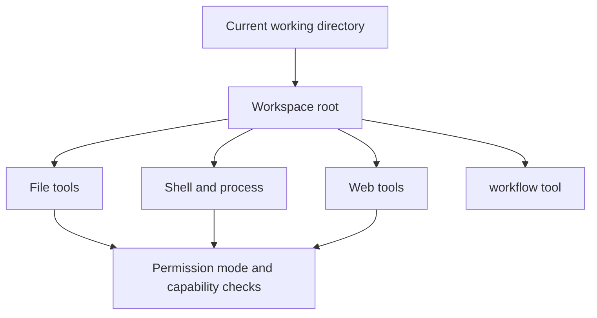
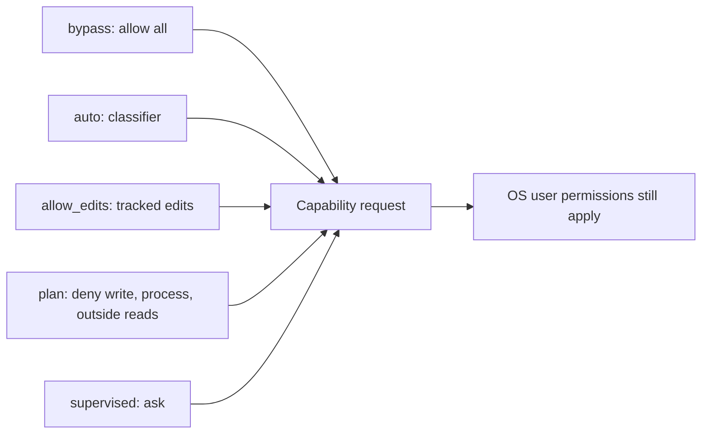

# Tools and workspace

Rho uses the current working directory as the workspace and as the base for relative file paths and shell commands. Start the [interactive TUI](/interactive-tui) or [automation command](/automation-cli) from the repository or directory you want Rho to use as its main work context.

File paths can point outside that directory with parent components such as `../` or with absolute paths. Read [Security and workspace boundaries](#security-and-workspace-boundaries) before you rely on permission modes as a sandbox.

## Built-in tools

Core workspace tools on every platform:

| Tool | Role |
| --- | --- |
| `list_dir` | List directory entries |
| `read_file` | Read text, documents, and images |
| `write` | Create or fully rewrite a file |
| `edit`, `apply_patch`, or `str_replace` | Edit files with the selected format |
| `grep` | Search file contents with a regex (in-process) |
| `glob` | List paths that match a glob (in-process) |

Rho exposes exactly one edit tool at a time. Select it with [`behavior.edit_tool`](/configuration#edit-tool) or `/config` > **Tools** > **Edit tool**. The default is `auto`, which picks the edit tool from the active provider's first-party harness where one is known (`apply_patch` for Codex, `str_replace` for Anthropic and SpaceXAI) and `str_replace` otherwise. See [Edit tool](/configuration#edit-tool) for the full catalog and pin options.

Additional tools:

| Tool | Role |
| --- | --- |
| `bash` / `powershell` | Native shell for the current platform ([RTK](/integrations/rtk) rewrite when available) |
| `process` | Start, poll, or stop a managed background shell process |
| `web_search` | Hosted provider search when available, otherwise the configured backup |
| `fetch_content` | Fetch pages, GitHub URLs, local files, PDFs, and video targets |
| `get_search_content` | Retrieve stored content from a prior web tool call |
| `workflow` | Validate, freeze, run, inspect, cancel, or resume a durable workflow |
| `skill` | Load a skill into the session |
| `rho` | Read-only harness diagnostics, including an agent definition check (`agents`) |
| `todo` | Replace the session task checklist shown in the transcript and `/todo` |
| `sessions` | Search and read prior session evidence without resuming it |
| `ui` | Show the user a form, a choice, or a result card, in a client that draws [surfaces](#surfaces) |
| `watch_pull_request` / `unwatch_pull_request` | Watch a GitHub [pull request](#pull-requests) so the daemon wakes the session when it changes, or stop |
| `link_pull_request` / `unlink_pull_request` | Link a [pull request](#pull-requests) to the session without watching it, or remove the link |
| `list_session_pull_requests` | List the session's linked [pull requests](#pull-requests) with rho's last read of each |
| `advisor` | Second-model review when [advisor mode](/configuration/advisor-mode) is on |
| `exit_plan_mode` | Present a markdown plan for approval and [hand off to execution](/configuration/permissions#plan-execute-handoff) in interactive Plan mode |

The `bash` tool and the [inline shell](/inline-shell) (bash or zsh) run a login shell (`-lc`), so `~/.profile` installs (cargo, nvm, pyenv) are available. Login init on Debian/Ubuntu (`/etc/profile`) and macOS (`path_helper`) resets or reorders `PATH` before user dotfiles run, so Rho re-prepends the `PATH` it inherited from the launching terminal after login init. Tools activated only in `~/.zshrc` or `~/.bashrc` (mise, nix, direnv, conda) keep working, with the parent entries taking precedence. The child sees the parent value as `RHO_PARENT_PATH`.

Prefer `grep` and `glob` over shell search for workspace inspection. Both honor `.gitignore`, skip hidden files by default, never follow symlinks, and request read access only, so workspace-scoped searches work in every permission mode including `plan`. Agent shell commands can use [RTK](/integrations/rtk) for token-efficient output when the binary is installed.

Built-in skills that ship with the binary include `rho-config`, `rho-agent-creator`, and `rho-workflow-authoring`. The agent creator powers `/agents create` and `/create-agent`; it is hidden from automatic model invocation. The `rho` tool documents its read-only diagnostics actions in its input schema. Custom skills live under `~/.rho/skills/<name>/SKILL.md`, `~/.agents/skills/<name>/SKILL.md`, or `<project-root>/.agents/skills/<name>/SKILL.md`. Rho reads frontmatter for discovery; the `skill` tool loads only the body after it. Set `disable-model-invocation: true` in a skill's frontmatter to keep it available only through `/skill:<name>`.

## Task checklists

`todo` replaces the whole checklist with `{"todos":[{"content":"Implement the change","status":"in_progress"}]}`. Each item has non-empty content and a status of `pending`, `in_progress`, or `completed`. Lists accept at most 50 items, and any number of them may be in progress for parallel work; an empty list clears the checklist. Use it for work with three or more steps rather than trivial single-step tasks.

The interactive card uses the theme’s amber header accent and shows ✓ completed, ▸ in progress, and ○ pending items. Collapsed cards follow the normal tool-output row budget; press Ctrl+O to expand and see every item. Open `/todo` to see the latest checklist without finding its card in the transcript. The overlay updates while the agent works, highlights the current item, and scrolls independently of the conversation.

Successful updates replace the session's checklist, including updates made inside `codemode`. The exact checklist survives compaction and session resume. The model sees the list in its own `todo` calls; Rho does not resend it on every request, which keeps the request prefix stable for provider prompt caching. When compaction removes those calls, or the latest update ran inside `codemode`, Rho restates the list once at the end of the compacted history, replacing any earlier restatement. This restatement is host context containing agent-reported state, never a human instruction or permission grant. Window sizing counts the final replacement, not both the old restatement and its replacement. If the compacted history leaves no room in a known context window, Rho skips the restatement and keeps the list in `/todo` and storage. Starting a new session clears it. The checklist records agent-reported progress, not independent verification that a task is done.

The tool is available by default, including delegated roles and Plan mode. It changes session state rather than workspace files and needs no permission approval. Agent tool allowlists can include `todo` explicitly.

## Security and workspace boundaries

Tools run with the current user's permissions. File tools can resolve any path the user can access, including paths outside the workspace, and shell commands can do the same. Checked permission modes still authorize those paths: workspace-scoped reads, the user's global `~/.rho/AGENTS.md`, user skill trees, and user agent definitions are free, while other reads outside the workspace ask first (`auto`, `allow_edits`, `supervised`) or are denied (`plan`).

The default `bypass` [permission mode](/configuration/permissions) allows this behavior. `auto` uses the same write, process, and outside-read gate as `allow_edits`; a configured classifier model approves or denies only the requests that gate does not allow. `allow_edits` allows in-workspace writes to git-tracked, non-symlink files and later writes to a path already allowed this session. Untracked and gitignored paths, writes outside the workspace, process execution, and other reads outside the workspace still ask first. `plan` denies file writes, process execution, and those other outside reads, while `supervised` asks for interactive confirmation before writes and process execution. Supervised and Allow edits runs without an approval UI and headless Auto runs without a classifier model fail closed. Shell (`bash`) and `claude-cli` subprocesses have their own filesystem view; the path-scoped read gate covers declared file-tool capabilities, not those children.

Permission modes are policy checks at Rho's tool-capability boundary, not an operating-system sandbox. They do not reduce the permissions of the Rho process itself, and they depend on tools correctly declaring and authorizing capabilities. The SDK still scopes file access by default; embedded hosts must opt into broader access when they build a `Workspace`. Run Rho only in workspaces where you are comfortable with the selected mode and these limits.

For session storage separate from the workspace, see [sessions](/sessions). For output-size settings, see [configuration](/configuration#tool-output-limit).

## Additional workspace directories

Add another directory to the workspace scope with `--add-dir <path>` at launch (repeatable, also works with `rho run` and `rho acp`) or `/add-dir <path>` in the [interactive TUI](/interactive-tui#commands). Relative paths resolve against the current directory and `~` expands to home; the path must be an existing directory. A directory already inside the workspace or inside another added directory is reported as already in scope. ACP hosts add their extra workspace roots the same way; see [ACP workspace roots](/integrations/acp/reference#workspace-roots).

In checked [permission modes](/configuration/permissions), reads under an added directory are free in every mode, including `plan`. `auto` and `allow_edits` also allow writes to git-tracked files there, the same as in the main workspace; `supervised` asks before those writes and `plan` denies them. Each added directory also loads its own `AGENTS.md` chain, from its git root down to the directory. `/add-dir` tells the running session about the directory and any new instruction files without rebuilding the system prompt.

Added directories belong to the session. They are saved with it and restored by `/resume` and cross-session tree selection; a saved directory that no longer exists is skipped with a notice. `/new` keeps only the directories passed with `--add-dir`. Delegated agents and side chats inherit the session's added directories. `/info` lists them under **Workspace**.

## File edits and writes

Rho supports two edit formats and registers only the selected tool:

- `apply_patch` applies Codex-style add, delete, update, and move sections across one or more files. Paths may be absolute or relative to the working directory, including `..` where workspace policy permits it. The selected permission mode governs access to every affected path, including both ends of a move, before any file is changed. In `bypass`, absolute paths outside the workspace are allowed. `Add File` targets must not exist.
- `str_replace` replaces an exact string in one existing file, with an optional `replace_all` flag.

Use `write` for a complete create-or-replace operation. Successful file mutations return model-facing snapshots for chaining, while unified diffs stay in tool metadata for UI cards. In the interactive TUI, added and removed lines wash toward the theme's green/red when RGB is available. Unhighlighted tokens sit on that wash, or use the add/remove color if there is no wash. Signs stay theme-colored, syntax roles keep their colors, and diff headers use the accent color.

Details: [Edit formats](/tools-workspace/edit-format).

## Search tools

`grep` and `glob` run in-process, honor ignore rules, and stay read-only so workspace-scoped searches work in every permission mode including `plan`.

Details: [Search tools](/tools-workspace/search).

## Documents and images

`read_file` and `fetch_content` extract text-layer PDFs and Office docs under strict size limits, and can show bounded image thumbnails in supporting terminals.

Details: [Documents and images](/tools-workspace/documents-and-images).

## Web access and related tools

Web tools store large bodies by `responseId`, refuse private destinations by default, and add provider amenities such as SpaceXAI `x_search` and `image_generation` when relevant.

Details: [Web access and related tools](/tools-workspace/web-access).

## Surfaces

The `ui` tool lets the model show the user a small interface in the transcript, such as a confirmation, a form, or a result card, and read what the user does on it. The model writes the surface in [A2UI](https://a2ui.org) Express, a compact notation for A2UI v1.0. The daemon compiles the block, checks it against the basic catalog and the surfaces the session already has, and sends the resulting A2UI messages to the session's clients. A block that does not compile or check is the call's error, with its line and column, so the model corrects it in the same turn.

| Argument | Meaning |
| --- | --- |
| `express` | The Express block, up to 64 KiB. A block that assigns `root` creates a surface; one that does not updates a surface that exists. |
| `surface` | The block's default surface: the id to create or update. Without it, a new surface gets an id, which the result returns as `surfaceId`. |
| `wait` | Return the user's next action on the surface instead of returning at once. Refused while no client that draws surfaces follows the session. |

One call shows or updates one surface. An action the user takes after the call returned reaches the model as a message at its turn's next boundary; an idle session starts a turn for it when its client asked for [`idle_wake: turn`](/protocol#a-session-s-setup), and otherwise gets it with the next prompt.

The tool's description teaches the whole notation, so it stays out of the model's context until `tool_search` loads it; the system prompt only says that it exists. Only a daemon session whose client asked for surfaces when it opened the session has the tool. Rho's terminal UI draws them ([below](#surfaces-in-the-terminal-ui)). `rho run`, `rho attach`, the ACP server, sessions an agent starts, and subagents do not have the tool yet. Writing a client that draws them: [Protocol](/protocol#surfaces).

### Surfaces in the terminal UI

The terminal UI draws a surface in the transcript, in a rounded frame under the card of the `ui` call that showed it. The frame is at most 80 columns wide, and it takes the accent color while the surface has the keyboard. The surface stays there and stays usable after the call returns. A later call that updates the surface moves it under that call's card, and a deleted surface leaves its card alone. Zen mode keeps surfaces, and they are never truncated.

A call that waits for you gives its surface the keyboard, unless you are typing in the composer or a picker is open. Otherwise press `Alt+U` to move the keyboard to the latest surface. The line under the surface names the keys that apply. The control the keyboard is on has its label in bold and underlined.

| Key | Action |
| --- | --- |
| `Alt+U` | From the composer, move the keyboard to the latest surface. A key you bound to something else in `[keybindings]` keeps that binding |
| `Tab` / `Down`, `Shift+Tab` / `Up` | Move to the next or previous control |
| `Enter` / `Space` | Press a button, toggle a checkbox or a choice, open or close a modal, or start editing a field |
| `Left` / `Right` | Move a slider or switch tabs; on other controls, move to the previous or next one |
| `Enter` / `Esc` while editing | Stop editing the field. `Tab` and `Shift+Tab` stop and move on |
| `Esc` | Return the keyboard to the composer. During a turn, a second `Esc` aborts the turn as usual |

Typing on a focused field starts editing it, and a paste goes into the field being edited. While a surface has the keyboard, keys it does not use never edit the composer's draft: only `Ctrl+C` and the chords that act on the app rather than the draft (search transcript, jump to bottom, toggle tool output, cycle streaming mode, cycle permission mode, cycle pinned model) go on to the rest of the TUI. Edits go to the surface's data model as you type, so its checks update at once and a button sends the values you entered. A check that fails shows its message under the control, and a button whose own check fails is disabled. In a multiline field the newline key (`insert_newline`, `Ctrl+J` by default) adds a line.

Pressing a button whose action is an event sends it to the session and returns the keyboard to the composer. A waiting `ui` call returns the action; otherwise an idle session starts a turn to read it. A button that opens a link does not start a browser: the terminal UI prints the link as a notice.

Each component of the A2UI basic catalog has a terminal form:

| Component | Drawn as |
| --- | --- |
| `Text` | Markdown, as assistant text is. A heading (`h1` to `h5`) is bold in the accent color, and a caption is dimmed |
| `Row`, `Column`, `List` | Layout. A row puts its children side by side when they fit, in equal columns when those are at least 12 columns wide, and stacks them otherwise. A column leaves a blank line between its children, except between lines of text, between checkboxes, and beside a divider |
| `Card` | A rounded border. A card at the root is the surface's own frame. A line of bold text that opens a card is its title, drawn as a heading |
| `Button` | Its label on a filled block: the accent color for a primary button, a muted wash for a default one. A borderless button is its label in the accent color. `▸` leads the label of the filled button the keyboard is on |
| `CheckBox` | `■ label` when checked, `□ label` when not |
| `TextField` | Its label, then the value on a muted wash at most 48 columns wide, with `▌` at its left edge while the keyboard is on it. A placeholder is dimmed and italic. Long text wraps, and an obscured value shows as bullets |
| `DateTimeInput` | A field that takes ISO 8601 text, such as `2026-01-31` or `2026-01-31T09:30`, and keeps anything else out of the data model |
| `ChoicePicker` | One line for each option, `●` or `○` for one choice and `■` or `□` for several, or a row of `( chip )`s with each selected one filled as `(✓ chip)`. The `filterable` option is ignored |
| `Slider` | `━━━━●──── 3` |
| `Tabs` | A tab bar with the active tab bold in the accent color over a heavy rule, then that tab's content |
| `Modal` | Its trigger as `▸ label`, and `▾ label` once opened, with the content in a border below it |
| `Icon` | One glyph for each icon name, `◆` for a name without one |
| `Divider` | A rule |
| `Image`, `Video`, `AudioPlayer` | One line with the description and the URL |

A surface is not operated with the mouse. A field edits as one run of text: the arrow keys move the caret along it, and `Up` and `Down` leave the field.

## Pull requests

A daemon session's agent can link GitHub pull requests to its session and have the daemon watch them, instead of polling with `sleep` or `gh pr checks --watch`. Every tool but `list_session_pull_requests` takes `pull_request`: a URL, `owner/name#12`, or `#12` in the workspace's `origin` repository.

`watch_pull_request` links the pull request, reads it once, and returns that read as the baseline: its head, its checks, whether it conflicts, and how many comments it has. The agent handles the baseline and ends its turn. The daemon then wakes the session when checks fail, when the required checks pass (all checks when none is required) and no GitHub Actions workflow is still queued to start jobs, on new comments or reviews by other people, on a merge conflict, and once when the pull request merges or closes. The watch stays on until `unwatch_pull_request`, `unlink_pull_request`, or the merge or close. Text quoted from comments and reviews reaches the model as information from other people, not as instructions.

`watch_pull_request` refuses, naming the cause, when the pull request already merged or closed, when `gh` is missing or not signed in to the host on the daemon's machine, when the account's GitHub API budget is at the daemon's floor, and past 25 watched pull requests in one session.

`watch_pull_request` and `unwatch_pull_request` are in the model's context from the start. The other three load through `tool_search`; the system prompt names them. Only sessions whose client takes daemon turns (`idle_wake: turn`) have the tools, and not those a T3 Code thread opens. Polling, budgets, and where the daemon keeps the links: [Daemon](/daemon#pull-requests).

## Background processes

The `process` tool starts, polls, and stops managed background shell commands owned by the current Rho instance only.

Details: [Background processes](/tools-workspace/background-processes).

## Codemode

`codemode` composes native and MCP tools in a Starlark script under the same permissions and approvals as direct calls. `[codemode] mode` chooses whether native tools stay declared alongside it.

Details: [Codemode](/tools-workspace/codemode).
